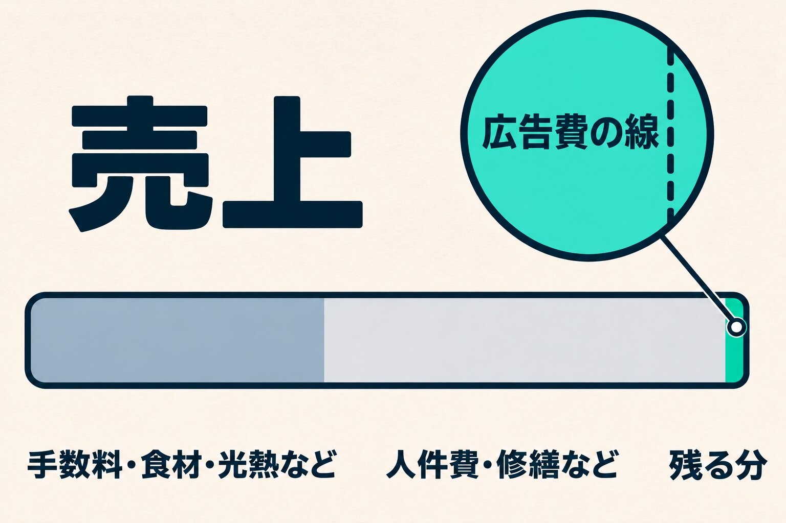

私たちの会社（HAMAYOUリゾート）は、山梨県の西湖でホテル・日帰り温泉・キャンプ場を営んでいます。ホテルには、大学生のゼミやサークルの合宿もよく来ます。ゼミの合宿の申し込みは、ほとんどが大学の中にある宿を紹介する窓口や、旅行会社を通して入ってきます。

11月のある日の夕方、営業の担当から、その窓口に出す広告のことで相談が届きました。この記事では、その相談に、広告費の線を1本決めて返すまでのことを書きます。

## 一番上の枠で出したい、という相談

相談は、窓口が作っているホームページに、合宿の宿として載せてもらう広告のことでした。今年はホームページだけでしたが、来年は紙の冊子も作るそうで、掲載料は今年の2倍近くになります。枠はいくつかあり、担当は営業として一番上の枠で出したい、と書いていました。

そのうえで、売上と利益と広告費の釣り合いはどうか、広告費に使える予算はいくらか、を教えてほしいということでした。

## 掲載料を3つの見方で並べた

まず、この窓口を通した今年度の売上に対して、掲載料がどれくらいかを見ました。売上に対しては約2.4%です。

次に、売上から、窓口に払う手数料・食材・シーツなどのリネン・光熱を引いた残りに対して見ました。この経路では、売上の6割近くが残ります。それに対しては、掲載料は約4%です。

3つ目は、何人泊増えれば取り返せるかです。今年から増える分は、8月から9月にかけて新しく来た団体の、平均の半分ほどの人数で取り返せます。掲載料の全部でも、団体1つ分でした。

ここまでなら、一番上の枠で出しても問題なさそうに見えます。

## 全部載せると、残る分の半分以上を使う

ただ、上の「残り」には、人件費や修繕、消耗品などの現場の経費が入っていません。それまで全部載せると、この経路の合宿で1人1泊に残るのは、売上の4%弱でした。

その全部載せて残る分と比べると、来年の掲載料は6割を超えます。売上で見ると数%の額でも、全部載せたあとに残る分から見ると、その半分以上を広告に使うことになります。

_売上から全部の費用を引くと、残る分は細い帯になります。_

## 線は「全部載せても赤にならない」ところに引いた

そこで、この経路の広告費は、この経路の売上の3%までを線にしました。全部載せて残るのが4%弱なので、3%までなら、広告費を載せても赤にならない計算です。手数料などを引いた残りで見ると、約5%にあたります。

来年の掲載料は、この線の内側に収まります。担当には、私の意見として、一番上の枠で大丈夫だと返しました。

前の記事では、閑散期にホテルを開けるか休むかを、開けて増える費用だけで比べました（[閑散期のノーゲストの日に、小さな団体を何人から受けるか決めた話](/blog/small-groups-on-no-guest-days/)）。今回は広告費の上限を決める話なので、全部載せた側から線を引いています。

## 今回の枠だけの答えにしなかった

返し方には、もう一つの案がありました。今回の枠だけ「大丈夫です」と返し、線は来年の売上を見てから決める、というものです。

ただ、それだと答えは今回限りになり、次に別の枠の話が来たときに、また同じ相談が来ます。そこで、今回の枠への答えと一緒に、線も返しました。

担当からは、数字に根拠があると自分の中で納得できる、と返事が来ました。あわせて、窓口のホームページを見て直接予約してくれたと思われる団体もあるので、実際の効果はもう少し大きいはずだ、という見立ても添えてありました。その分を足して見ても、掲載料は線の内側のままです。

数字のことを現場に頼んで、つまずいたこともあります（[現場に数字を見せても、動かなかった話](/blog/frontline-numbers-how-to-ask/)）。今回は、現場から数字を聞かれて、答えと物差しを一緒に返した形でした。

## 効いているかは、まだ測れていない

この線は、広告費に使ってよい上限を決めたものです。掲載がどれだけ予約に効いているかは、まだ測れていません。掲載をやめたら、この経路の予約がどれだけ減るのかは分からないままです。

計算の単価も、合宿のプランの料金で置いています。実際にはそれより安く入っている団体もあるので、残る分はこの計算より小さいかもしれません。
