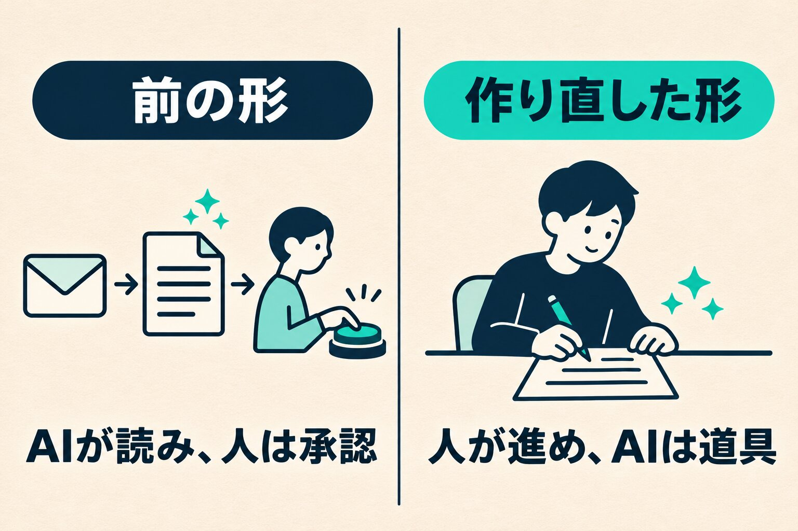

団体の予約を受け付けるための、社内の道具を作っています。最初に目指したのは、届いたメールをAIが読み、人は承認するだけ、という形でした。

使ってみると、読み取りは合っているのに、承認ボタンを押し終えた後に違和感が残りました。この記事では、その違和感をどう受け止めて、作りをどう変えたかを書きます。違和感の正体は、まだ分かっていません。分かっていないまま書きます。

## 目指したのは「人は承認だけ」

団体の予約の問い合わせは、メールで届きます。来る日、帰る日、人数、食事、使う場所。担当はメールを読んで、予約の内容を一つずつ書き起こしていきます。やり取りが進むと人数や時間が変わるので、そのたびに読んで直します。

ここをAIに任せたい、と考えました。読んだ内容を道具に反映させ、人間は承認だけする。これが最初の構想です。読む手間も打つ手間も消えて、人は確かめるだけになります。

## 合っているのに、押し終えた後に残るもの

形になったので、まず自分で通しで試しました。届いたメールの下に、AIが読み取った項目が「確定する」「違う」のカードで並びます。一枚ずつ確かめて、押していく形です。

触ってすぐに思ったのは、このカードの並びが、たぶんいちばんのストレスだ、ということでした。そこで、読み取った値は入れるべき欄に直接入れ、その場で「これで確定」「直す」を選ぶ形に変えました。

それでも、残るものがありました。

メールの原文から欄が埋まり、どの文から導いたかも横に並びます。見比べれば、合っていると分かります。AIの読み取りも信用しています。なのに、承認ボタンを押し終えた後に、言葉にできない不快さが残るのです。

自分でメールを読んで打ち込んだ場合と、出来上がりは同じです。同じなのに、違いました。

## その違和感に、まだ名前が付いていない

何が引っかかっているのか、考えてみました。

- 自分で読んで打ち込んでいないので、自分の仕事をした感じがしない
- 間違っていたら自分の責任になるのに、確かめた手応えが無い
- 何をしたのか、後から思い出せない

どれもある気がします。ただ、どれが答えなのかは、まだ自分の中で分かっていません。

## 抵抗が大きかったのは、作った私のほうだった

現場の担当にも試してもらい、AIをどこまで使うかを話しました。

担当からは、AIでやるところとやらないところを決めれば便利になる、という前向きな言葉をもらいました。その場で「自分のほうが抵抗がある」と口にしたのは、私でした。試した人からも、私の違和感に近いことを聞いています。

このままの形では本番に出さない、と決めました。試した人が「すぐ使いたい」と言う道具に、まだなっていなかったからです。

振り返ると、前の作りはAIに一気に振りすぎていました。仕事をAI前提に変えることへの抵抗は、作った私も感じました。私が感じるのなら、ほかの人はもっと大きいはずです。

## 仕事は人が進め、AIは楽にする道具

そこで、AIの出番を狭めて作り直しました。

案件を立てるのは人です。問い合わせは、メールだけでなく電話や口頭でも来ます。人が確かめて、台帳に案件を立てます。立てたあとは、AIを使っても使わなくても進められます。手で直して保存してもいいし、届いた文を貼って登録すれば、AIが読んで欄に入れます。

AIが入れた値には印が付きます。人が確かめると印は消えます。登録は取り消せます。書類の発行のような最後のボタンは、人が押します。

|                  | 前の形                           | 作り直した形                             |
| ---------------- | -------------------------------- | ---------------------------------------- |
| 仕事の始まり     | 届いたメールをAIが読むところから | 人が案件を立てるところから               |
| 人の役目         | AIが読んだものを承認する         | 自分で進める。楽をしたい所でAIを使う     |
| AIが入れた値     | 一つずつ承認を求められる         | 欄に入り、印が付く。確かめると印が消える |
| 使う人への言い方 | AIが提案して、人が承認する       | 仕事は人が進め、AIは楽にする道具         |

_仕事の始まりを、AIが読むところから、人が案件を立てるところへ移しました。_

狙ったのは、使ううちに「AIを使うと便利だ」と感じてもらうくらいの釣り合いです。

AIを表に出さず、裏に置く作りにすると、あの不快さは和らぎました。

## まだ分かっていないこと

作り直した形を、使う人がどう感じるか。これはまだ聞けていません。

違和感の正体も、分かっていません。読み取りが合っているときにも残ったので、正しさとは別のところにあるようです。

最近は、AIを「使ってください」と配るより、道具の中に組み込んで渡すほうがいいのではないか、とも考え始めています。まだ方針ではなく、考えの途中です。

「人は承認だけ」は、いちばん楽な形のはずでした。私の場合は、そこに違和感が残りました。今回は、AIの出番を狭めるほうを選びました。
