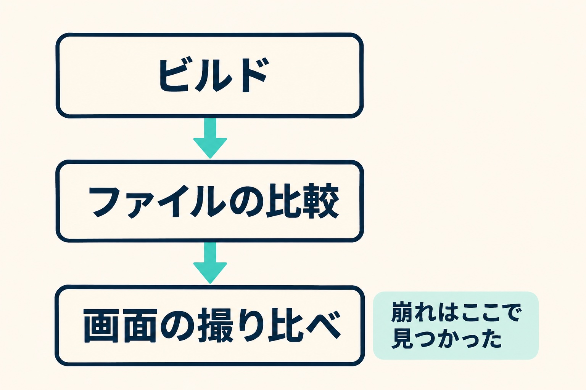

Astroで作ったサイトは、作ったあとに放っておいても普通に動きます。WordPressのように管理画面が更新を促してくることもありません。だから、気づくと版が2つ遅れている、ということが起きます。

私の手元がそうでした。会社の4つのサイトとこのブログを含めて、Astroで作った7つのサイトが全部5系のままでした。この記事では、7系へ上げたときに何を確かめたかと、これからの更新の頻度をどう決めたかを書きます。

Astroを選んだ理由は「[WordPressからAstroへ移した理由](/blog/wordpress-to-astro)」に、WordPressの更新の話は「[WordPressのバージョンアップは、サイトを止めずにできる](/blog/wordpress-version-up)」に書いています。

## 上げる理由は、新機能ではなく守り

きっかけは、Astro 7.4のニュースを読んだことです。手元を見ると全部5系で、5系の更新は5月末で止まっていました。6月に7.0が出てからの直しは、7系にしか出ていません。5系の最後の直しすら入っていないサイトもありました。

7つのうち、サーバー側で処理が動くのは日帰り温泉のサイトだけです。混み具合の表示や管理画面があるので、守りの本命はここです。ほかは出来上がったページを配っているだけなので、急ぎ度は下がります。

新機能で今すぐ使いたいものはありませんでした。ビルドが速くなるのはおまけです。なので目的は1つに絞りました。見た目と動きを変えずに、中の道具だけ新しくすること。版上げと一緒に見た目や文言の直しを混ぜると、何が原因で変わったのか分からなくなるので、版上げ以外の変更は入れないと決めました。

## 「前と同じ」を3段で確かめる

版上げで確かめたいのは、前と同じかどうかです。これを3段に分けました。

1. **ビルドが通るか。** エラーや警告が出ないか。テストがあるサイトはテストも通るか
2. **出来上がったファイルが同じか。** 上げる前と後でファイルの一覧を比べ、URLが1つも増減していないことを確かめる
3. **画面が同じか。** 本番と試しの画面を、幅1440・820・390で撮って見比べる

_ビルド、ファイルの比較、画面の撮り比べの順に確かめました。_

3段目は7サイトで111ページ、3つの幅なので333画面になりました。基準は「1〜2ピクセルのずれは気にしない。大きな崩れが無いこと」です。全部を同じにしようとすると終わらないので、見る前に線を引いておきました。

このブログは記事の読み込み方が丸ごと変わったので、記事のURLが1本も変わっていないことを、前後の一覧で突き合わせました。URLが変わると、検索やSNSから来る道が切れるからです。

## ファイルの比較では見つからなかった崩れが2件

3段目まで作っておいてよかったのは、2段目を通ったのに崩れていたものが2件出たからです。

1つは、お知らせ一覧の写真が13ピクセル低くなっていたことです。Astro 6から、画像に幅と高さの両方を指定すると、その比率で切り抜くのが既定になりました。それまであまり効いていなかった高さの指定が効き始めた形です。幅だけの指定に戻して直しました。

もう1つは、ブログ記事の目次の余白です。原因は、対応するブラウザの指定でChromeの版が1つ違っていたことでした。87を指定すると、新しい書き方の代わりに古い書き方が一緒に出力され、そのせいで指定の強さが変わって、目次の指定が負けていました。88にしたら直りました。

どちらも、HTMLを比べただけでは「違いはあるが問題かどうか分からない」ものです。崩れとして見えるのは画面だけでした。

## 新しい既定に合わせず、前の動きを設定に書く

版が上がると、既定の動きが変わります。Astro 7では要素のあいだの空白の詰め方が変わり、CSSの出力も新しいブラウザ向けになりました。そのままだと、ボタンのあいだのすき間が消えたり、古いiPhoneで画面幅の切り替えが効かなくなったりします。

ここでは、見た目のほうを新しい既定に合わせて直すのではなく、設定に前の動きを書くことにしました。`compressHTML` と `vite.build.cssTarget` の2つです。見た目を触らないので、直す場所が設定の数行で済み、確かめる範囲も増えません。

## これからの上げ方を、種類ごとに決めた

今回の遅れは、上げる頻度を決めていなかったのが原因です。そこで更新を3つに分けました。

| 更新の種類                               | 頻度                               |
| ---------------------------------------- | ---------------------------------- |
| 小さい更新（先頭の数字が変わらないもの） | 月1回まとめて                      |
| 大きい版上げ                             | 出て数か月以内に1回。遅れは1つまで |
| セキュリティの直し                       | 出たらすぐ                         |

更新が出たことに気づく部分は人がやりません。GitHubのDependabotを全部のサイトに入れて、更新の案を自動で作るようにしました。案はVercelのプレビューでビルドまで確かめられ、本番に出すかどうかは人が決めます。

小さい更新を月1回にしたのは、部品ごとに毎回見ていられないからです。案が種類ごとに1件にまとまって届くので、1回確かめて入れれば済みます。

## 決めて2週間で分かったこと

更新の案は、決めたとおり届きました。小さい更新は11月1日に、サイトごとに1件ずつまとまって。セキュリティの案は、見つかったときに。

ただ、この記事を書くために確かめて分かったことがあります。セキュリティの案が、2週間ほど開いたままになっていました。案を自動で作るところまでは決めていましたが、届いた案を誰がいつ見て入れるのかを決めていなかったからです。「出たらすぐ」は方針で、手順ではありませんでした。

開いていた案は確かめて入れ、見る日も決めました。小さい更新は月の最初の週に、セキュリティの案は届いたその週に入れます。自動で作れるのは案までで、入れる日は人が持っておくことになります。

## 版は、遅れるほど上げにくくなる

今回は2つ遅れていて、そのぶん確かめることが増えました。遅れが1つまでなら、変わる点も1つ分で済みます。

Astroで作ったサイトをお持ちで、版がしばらく止まっている場合は、まず今の版と最新の版の差を見てみてください。上げるときは、ビルドが通るかだけで終わらせず、画面を見比べるところまでやるのをおすすめします。
