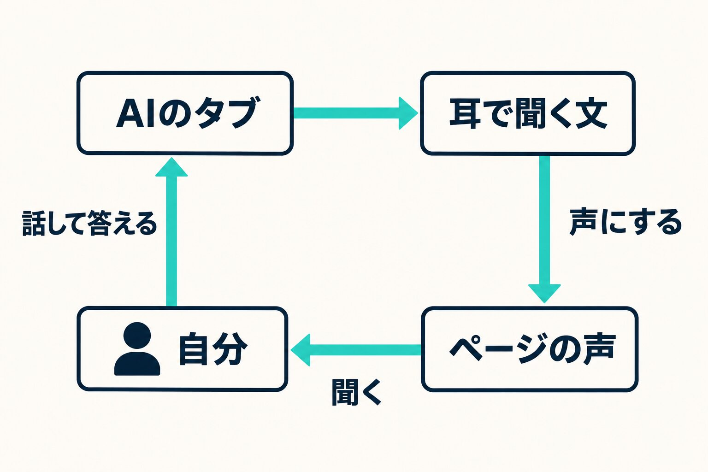

AIの新しい入口が、毎月のように出てきます。声で話せる常駐のボット、画面の出来が評判の開発アプリ。私もここ最近で一通り触りました。

最初にお断りしておくと、新しいボットのほうは深く使い込んだわけではありません。いちばん時間をかけたGrok Botでも半日ほどで、Muse CodeとDotsはそれほど触っていません。製品の良し悪しを比べる記事ではなく、触ってみた範囲で、今の自分にはどの形が合うのかを書いたものです。

今回のきっかけは、YouTubeで見たGrok Botです。声で頼めるなら、いま使っている作業の入口をこれに替えられるのではないか、と思いました。

結論から書くと、替えませんでした。今の私には、入口をOrcaのままにして、足りなかった声だけを足す形のほうが合っていました。何を試して、何を足したら楽になったのかを書きます。

## 試す前の形：入口はOrca、記録はObsidian

Orcaは、AIのエージェント（指示すると手元で作業まで進めるAI）を何本も並べて動かすデスクトップアプリです。私は仕事ごとにタブを分け、1日に10前後の仕事を並行で回しています。

タブの中で動かすAIは、Claude（Claude Code）、Codex、Grok、Cursorを仕事に合わせて替えます。仕事の背景や判断の記録はObsidianのノートに置いてあるので、AIを替えてもノートを読めば話が続きます。

つまり、頼む場所と、覚えておく場所と、実際に動くAIが分かれています。新しいAIが出ても、増えるのは3つ目だけです。

## Grok Bot：声は魅力。ただ、私の組み方では返事が戻らなかった

いちばん長く試したのがGrok Botです。常時動く個人向けのボットで、声で話しかけられます。半日ほどかけて、頼める範囲を段階的に広げました。

最初は、開いているタブの題を声で答えてもらう。次に、話した相談をOrcaのタブへ渡してもらう。そのあと、用意した質問を読み上げてもらい、答えをタブへ届けてもらう。ここまでは、どれも動きました。

止まったのは、実際の片付けをボットだけで進めようとしたときです。

> 伝えてるんだけど、すげえ時間かかる、返事が来ないまま待たされている

これが、そのときの私の言葉です。私が組んだ形では、ボットは話を渡すところまでで、タブ側の返事はボットに戻りませんでした。毎回必ず読ませる決まりの置き場も見つけられず、ノートを読み直してと頼むと断られたり、中身が変わっているのに「変わりはない」と答えたりしました（全文をチャットに貼れば、正しく答えました）。半日の試しなので、組み方を詰めれば違ったのかもしれません。

安全の面も、判断できませんでした。手元のMacで動かした結果がどこまでクラウドへ渡るのかは、私が調べた範囲では公式の説明に見つかりません。許可を毎回取らない設定で試すと、ファイルに紛れ込ませた命令は動きませんでしたが、止めたのがボット自身なのか、別の審査なのかは分かりませんでした。

渡す先が1社増えること自体が問題なのではありません。私は、止める仕組みを自分で確かめられる形のほうが落ち着きます。そのときの感想は「裏側がわからなすぎる」でしたが、これはボットの欠点というより、半日触っただけの私にはそこまで見えなかった、という話です。

## Muse Code・Dots・Cursor：今の私には、今の形が合っていた

Metaの Muse Code は、Orcaのタブの1つとして少し動かしました。ノートを読んで、頼んだことに正しく答えてくれました。入口が替わるというより、Orcaの中で使えるAIが1つ増えた形です。

OpenAIのDotsも、そこまで深くは触っていません。たとえば会社のチャットに連絡が届くと、ちょうどよいタイミングで教えてくれて、どうしますかと聞いてくれる、という動きでした。私の場合は、同じことをすでに今の形でしています。連絡が届いた瞬間にどうするか、私が作業中かどうか、私が判断すべきことかどうかを、自分の好みに合わせて組んできました。Orcaと Claude Code、Obsidian、各アプリの連携の組み合わせで足りているので、いまは変える必要を感じていません。もっとよいやり方が見つかれば、今の仕組みをそちらに合わせればいいと思っています。

Cursorは事情が少し違います。VS Codeから乗り換えて、開発環境としてずっと使ってきました。自分でコードを書くなら、今はCursor一択だと思っています。Xで画面の使い心地を褒める声もよく見かけます。ただ、いくつもの仕事を並べて回す毎日の入口としては、Orcaのほうが手になじんでいます。

## 足りなかったのは、読む側の声だけだった

触ってみて分かったのは、私がボットに本当に求めていたのは声のやり取りだけ、ということでした。それ以外は、今の形のほうが自分のやりたいことに合っています。

しかも、話す側はすでに足りていました。入力はAqua Voice（話した言葉を文字にするアプリ）です。キーボードだと面倒で背景を削ってしまいますが、喋れば削りません。

詰まっていたのは、AIの返事を読むほうでした。並行の数が増えるほど、読む量がそのまま負担になります。短くさせれば済むかというと、そうでもありません。要約しても、読むという作業は残るからです。

## 足したもの：耳で聞く文

そこで、Orcaの側に声を足しました。

作業をしているAIのタブが、読む文とは別に「耳で聞く文」を書きます。長さは30秒ほど、170字くらいです。記号やファイルのパス、表は読みません。人に送る文案も読み上げず、「文案はページにあります」とだけ言います。これをElevenLabs（文章を声にするサービス）で音声にします。

あわせて、タブごとにHTMLのページを1枚持たせました。上から「聞く」のボタン、今の状態、私への質問1つ、結論と文案、やり取りの履歴という並びで、Orcaの内蔵ブラウザで開きます。

やり取りはこうなります。「聞く」を押して聞く。答えはAqua Voiceでタブに話す。文案を直したいときだけページを読み、画面のコメントで直しを書く。

これで、文章を読む労力がかなり減って、めちゃくちゃストレスがなくなりました。

同じ声でも、私の場合は、今の形に声だけ足すほうが合っていました。話しているのは作業をしているタブ自身なので、何をしたかはいつでもタブを開いて見られます。

## 私が今の形で安心できる理由

安心できるのは、何が起きているかを自分の画面で確かめられるからです。タブを開けば、AIが打った命令が見えます。パスワードはパスワード管理アプリに置いて、送信や公開、支払いの最後のボタンは自分で押します。声のために足した鍵も、読み上げの権限だけに絞りました。

## 今のところの最適解

入口はOrca、記録はObsidian、動くAIは仕事で替える。打つのはAqua Voice、聞くのはElevenLabs。これが今の私の答えです。

もう1つ大きいのは、Orcaなら各AIのサブスクリプションの範囲で回せることです。

「今のところ」と書くのは、変わりうるからです。出先で声だけで回せるかは、まだ試せていません。もう少し深く触れば見え方が変わるかもしれませんし、裏側の説明が揃えば、ボットを見直すこともあると思います。

新しいAIが出るたびに乗り換えを考えるより、先に自分の流れのどこが詰まっているかを見る。私の場合、それは読む側の1か所でした。
