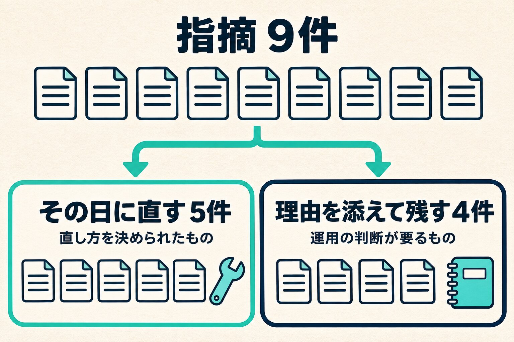

自分で作って社内で使っているアプリは、動いていれば手を入れません。出す前に見るのも、画面が出るか、数字が合うかです。権限を外したあとに何が見えるか、担当を引き継いだあとに誰が読めるかまでは、なかなか見ません。

先週、コードを本番に出すたびに自動で穴を探す点検を入れました。この記事では、一度は見送ったものを翌日に見直した理由と、全部のコードを読ませて出た9件をどう分けたかを書きます。

社内で使う道具の守りの考え方は「[社内ツールを内製するときのセキュリティ](/blog/in-house-tools-security)」に書いています。

## 一度は「試さなくていい」と見送った

きっかけはニュースです。Vercelに、pushのたびに変更の差分を読んで穴を探す機能（Security Review）が公開ベータで出ました。

最初の判断は見送りでした。手元には、出す前にコードを点検する手順がすでにあります。同じ役目はそれで足りていて、新しく足されるのは「pushに自動で掛かる」ことだけ、と見たからです。

## 翌日、手順が回った回数を数えた

次の日に、その判断をもう一度見直しました。前提にしていた「手元の手順で足りている」を、実際の記録で数えてみたのです。

出す前の点検の手順は、直近の約1か月で一度も回っていませんでした。秘密の値が紛れ込んでいないかを見るスキャンも、入っていたのはメモを置いている場所だけで、アプリのコードには入っていませんでした。

手順は決めてありました。足りなかったのは、それを回すきっかけです。自分が思い出したときに回す形だと、急いで出す日ほど回りません。「自動で掛かることだけ」と見ていた部分が、いちばん欠けていたところでした。そこで、まず1本で試すことにしました。

## 有効にしただけでは、過去のコードは読まれない

入れてみて分かったのは、この点検が読むのは変更の差分だということです。変更の無いpushでは何も読みません。すでに動いているアプリは、有効にしても、これまでに書いたコードは点検されないままです。

そこで、全部のコードを一度読ませました。空の状態から今のコード全体を「差分」として見せる枝を別に作り、そこへ出します。本番に出る枝には触らないので、動いているアプリには影響しません。

これを、仕事で使っているアプリとサイトの6本にかけました。

## 指摘は9件。どれも気づいていなかった

出た指摘は9件です。重大度は9件とも「中」でしたが、これは点検の側の推定です。

9件を並べて見て、自分で気づいていたものは1つもありませんでした。その日に直した5件は、次のような種類です。

- 担当を引き継いだあとも、前の担当が記録を読めた
- 許可を外したアカウントが、ログインの期限が切れるまで数字を見られた
- 大きな画面に映す表示が、入力された文字をそのまま出していた
- 宛先に括弧を付けると、配信停止の指定をすり抜けた
- 設定が空のままだと、合言葉なしで内容を書き換えられる入口があった

どれも、普通に使っているあいだは表に出ません。画面は正しく動き、数字も合っています。外した人、引き継いだ人、変わった形の入力、設定し忘れ。ふだんの確認で通らない道にだけ出るものでした。

## その日に直す5件と、残す4件に分けた

9件を全部その日に直したわけではありません。直したのは5件で、4件は残しました。

_9件を、その日に直すものと、理由を添えて残すものに分けました。_

直した5件は、その日のうちに直し方を決められたものです。直したあとは、テストを通すか、本物の処理を別の保存先で動かして直す前と後を比べるかで確かめました。本番に向けて穴を突く試しはしていません。

1件は、点検が示した直し方をそのまま使いませんでした。示された案だと、別の場合の扱いを新しく決める必要が出ます。機能を1つ絞るほうが決めることが少なく、そちらを選びました。点検は穴の場所を教えてくれますが、どう直すかは使い方を知っている側が決めることになります。

残した4件は、直し方に運用の判断が要るものです。直していない穴なので、中身はここには書きません。残すといっても放っておくのではなく、それぞれのアプリの記録に、指摘の内容と残した理由を書いてあります。次にそのアプリを触るときに、そこから始められます。

もう1つ分かったのは、直したあとに点検をかけ直しても、画面の指摘は自動では閉じないことです。直したかどうかは、自分の側の記録で持っておく必要があります。

## これからの回し方

試した結果、この点検は続けることにしました。対象は、ログインや権限、データの書き込みがあるアプリです。出来上がったページを配るだけのサイトは、基本は対象にしません。

同じ時期に、プルリクエストを起点にするレビューの機能も見ました。私は確かめたものをそのまま本番の枝へ出しているので、今の出し方には合わず、取り入れていません。

まだ決めていないこともあります。無料の期間が終わったあとの費用です。1週間ほど使用量を見てから、続け方を決め直します。

## 手順があることと、回っていることは別

今回の出発点は、新しい道具ではなく、数えたことでした。点検の手順は持っていて、それで足りていると思っていました。回った回数を数えたら、ゼロでした。

自分でアプリを作って使っている場合は、出す前の点検を最後に回したのがいつか、一度数えてみてください。思い出して回す形になっているなら、出すたびに勝手に走る場所へ置き直すのをおすすめします。すでに動いているアプリには、最初に一度、全部のコードを読ませるところまでやっておくと、差分の点検だけでは出てこないものが見つかります。
