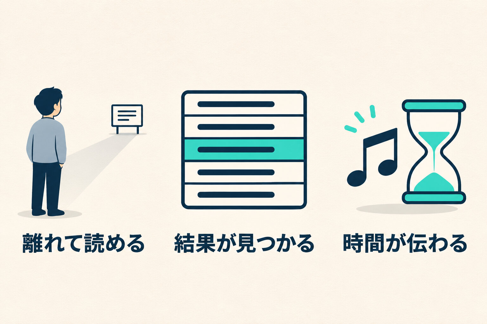

社内の催しで使う進行アプリを作っています。受付、進行役の手元の画面、大画面、順位の表がつながっていて、机の上の確認では全部動いていました。

その進行アプリを、実際に使う体育館に持ち込みました。現場のスタッフ4人と、受付から大画面の順位まで約70分かけて通しています。

見つかったのは、動かないところではありませんでした。動いているのに、会場では役に立っていないところです。

## 順位の表が、後ろから読めない

大画面の順位の表は1列で並べていました。体育館で映すと、文字が小さくて読めません。

見る人は画面の前に座っていません。離れた場所に立って見ています。2列にして文字を大きくし、上の余白も詰めることにしました。今日の順位と累計の順位も、1つの画面に詰めず、別の画面にして交互に切り替えます。

大画面の隅に出していた受付用のQRも消しました。映すと崩れていたからです。受付の場所に紙で貼り出せば済むものを、画面に載せる必要はありませんでした。

## 自分の記録が、どこにあるか分からない

挑戦が終わったチームは、まず自分の記録を探します。順位の表が長くなると、どこに入ったのかが見つかりません。

現場からは「自分たちのチームの記録どこに行ったのかパッと分かるように」と言われました。最後に挑戦したチームの行だけを目立たせることにしました。

机の上では、自分で入れた点を自分で確かめるので、探す場面がありません。挑戦した本人の目線は、人が挑戦して初めて出てきました。

## 終わりが近づいても、緊張感が無い

挑戦には制限時間があり、残り1分で声が流れます。通してみると、声は聞こえても、終わりが近づく感じはありませんでした。

そこで、残り30秒で音楽を変え、画面も赤くすることにしました。残り10秒は声で数えます。順位の画面にも音楽を入れます。

時間の使い方は、仕様に書くと「残り時間を表示する」の1行で終わります。その1行の中に、会場の空気を動かす仕事が入っていました。

## 得点は、声に出して読み合わせる

種目ごとの得点の設定も、その場で1つずつ読み合わせました。2つの種目で点の設定を直しています。

ある種目は、上限に届いた時点で終わりにして、超えた分は切り捨てることにしました。別の種目の終わり方と揃えるためです。画面の上では正しく動いていても、競技のルールとして揃っているかは、やる人と話さないと分かりませんでした。

## 机の上で決めておいて、効いたこと

逆に、会場で迷わなかったところもあります。

準備です。進行役の画面を1つ開けば、受付のQRも大画面の画面も出るようにしてありました。覚えておくのは1つの入口だけなので、持ち込んだその場で通し始められました。会場の通信が弱いときは、スマートフォンの回線につなげばよいことも確かめました。

## 通して確かめたこと

自分の場合、机の上では確かめられなかったのは、次の3つでした。

- 離れた場所から読めるか
- 挑戦した人が、自分の結果をすぐ見つけられるか
- 音と画面で、時間の流れが伝わるか

_机の上では確かめられなかった3つです。_

どれも、機能が足りないという話ではありません。人が離れて立ち、音が響く場所で、時間に追われて初めて分かることでした。

直すと決めたものは反映しました。体育館のスピーカーでの聞こえ方はまだ確かめていないので、次に会場で通すときに見ます。映す面やプロジェクターの置き場は、現場で詰めてもらっています。
