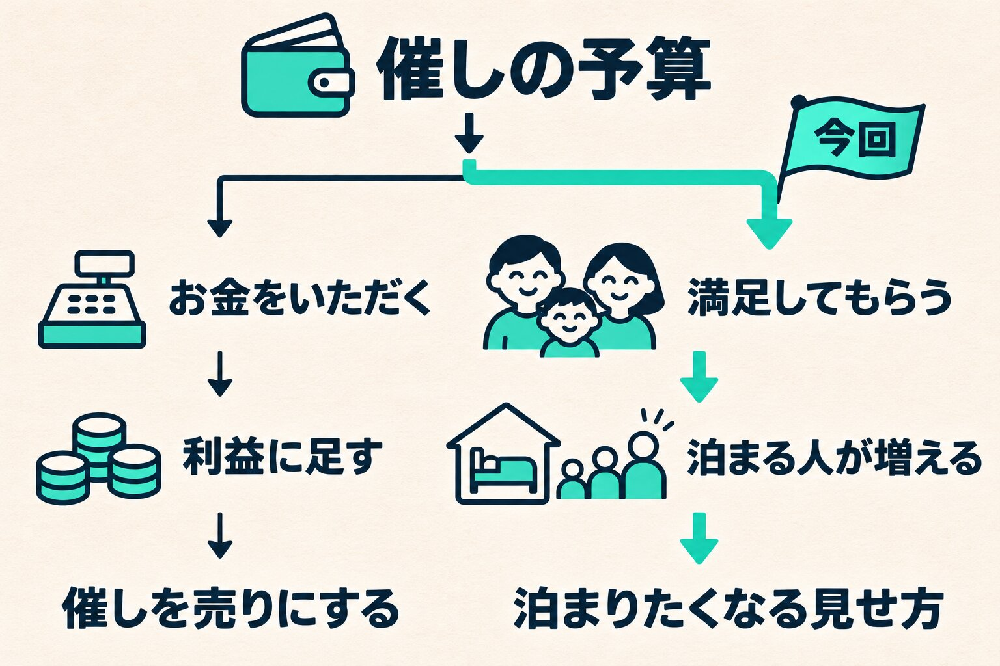

年末年始の催しを、ホテル・キャンプ場・日帰り温泉の3つの施設で準備しています。中身は現場が集まって決めていきました。集まる前の話は「[現場が「集まって決める」と言ったので、先に意見を返さなかった話](/blog/hold-back-until-asked/)」に書いています。

その集まりの終わりに、私は一つだけ問いを置きました。催しでお金をいただくのか、満足してもらうことに使うのか。この記事では、なぜそれを聞いたのか、何が返ってきたのかを書きます。

## 予算を出すときに、先に話していたこと

催しには、会社から予算を出しています。準備が始まったころ、予算について補足をしました。

予算を使えば、そのぶん利益は単純に減ります。ただ、ホテルに泊まるお客さまが例年より数組増えれば、取り戻せる大きさです。そして、うまくいかなくても、考えた人を責めることはしない。

そこまで話して、中身は現場に任せました。

## 中身は決まっていくのに、お金の話が出てこない

集まりでは、催しの中身がどんどん決まっていきました。初日の出をどう案内するか、郷土料理を作る体験をどう受け付けるか、写真をどうそろえるか。どれも現場が自分たちで詰めていきます。

一方で、予算の使い道の話は、最後まで出てきませんでした。

そこで最後に、こう伝えました。

- 催しの中でお金をいただく仕組みを考えているなら、その分は利益に足せる。そこを強く打ち出す手もある
- 満足してもらうためだけに使うなら、泊まる人が増えることで取り戻すことになる。見せ方が変わる

次に集まる日に、各施設の考えを聞かせてほしい、とお願いして会を終えました。

## 「正解の話ではない」と先に言った

次の集まりで、この問いの番が来ました。答えを聞く前に、前置きをしました。

> 正解の話ではなく、どちらの見せ方で行くかを揃えたい。数字を考えていないと責める話ではない

役員が現場にお金のことを聞くと、それだけで責める話に聞こえかねません。聞きたかったのは、どちらで行くか、だけでした。それが分かれば、私の側でやることが決まります。

数字のことを現場に頼むときは、頼み方でつまずいたこともあります（[現場に数字を見せても動かなかった話](/blog/frontline-numbers-how-to-ask/)）。今回は、顔を合わせる場で、問いを一つだけ置く形にしました。

## 3つの施設とも「満足度」だった

答えは、3つの施設とも満足度の側でした。お金をいただくものがあっても、かかった分を取り戻す程度です。

| 施設       | 考え方                                             | お金をいただくもの                               |
| ---------- | -------------------------------------------------- | ------------------------------------------------ |
| ホテル     | 満足してもらう                                     | 夕食時の飲み物と、夜のバーだけ。その場でお支払い |
| キャンプ場 | お菓子代とトントン                                 | 1回100円のおみくじと、お菓子がもらえる輪投げ     |
| 日帰り温泉 | 利益は狙わない。長く過ごしてもらい、また来てもらう | 少額のくじ。中身は次に使える割引券やサービス券   |

キャンプ場の話を聞いて、私は「100円でお菓子がもらえるなら全然うれしい」と返しました。

## 揃うと、私の側のやることが決まる

_どちらが正しいかではなく、どちらで行くかを揃えました。_

催しで利益を取りに行くなら、催しそのものを売りとして打ち出します。満足度で行くなら、泊まる組が増えるように見せる。今回は後者で揃ったので、それが私の側の仕事になりました。

見せる場所は、年末年始の案内ページです。このページには、もともと、予約した人への案内と、まだ迷っている人に来てもらう役を、1枚で持たせています。

## 結果は、年が明けてから

催しは年末年始です。泊まる人が本当に増えたかは、まだ分かりません。キャンプ場は全部レジを通すので回数が分かり、温泉はくじの中の券がどれだけ使われたかが分かります。どちらも来年の材料になります。

予算を出したとき、私がまず話したのは、どれだけ泊まる人が増えれば取り戻せるか、でした。今回の問いは、その続きです。どこで取り戻すかが揃えば、どちらに転んでも、次にやることは決まります。
