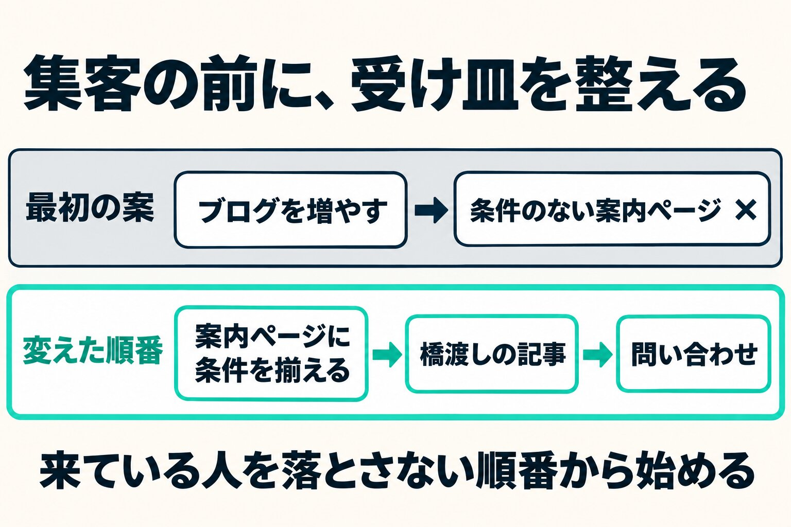

私たちの会社（HAMAYOUリゾート）は、山梨県の西湖でホテル、日帰り温泉、キャンプ場（キャンプビレッジノーム）を営んでいます。私は常務をしていて、会社の財務やWebまわりを担当しています。

10月のある日、営業の担当から相談が届きました。「数年前に比べてキャンプ場の撮影やイベント貸切の案件が減った。今後の売上を考えると平日の撮影案件は大事なので、ブログで記事を書けないか」という内容でした。

相談を受けたとおりにブログを書き始めることもできました。けれど、先に現場の事実と数字を確かめた結果、ブログを増やすのではなく、すでにある案内ページを直すところから手をつけることにしました。今回は、提案の順番を入れ替えるまでの経緯を書きます。

## すぐ記事を書き始めず、まず現場と検索を確かめた

キャンプ場で増やしたいのは、平日の稼働です。撮影やイベントの貸切は平日に入ることが多く、営業の担当の目線はもっともでした。

ただ、一つ引っかかりがありました。撮影の案件を探しているのは、週末に泊まりに来る個人のキャンパーではなく、制作会社や広告代理店の担当者です。一般のお客さんと同じように「キャンプ場 貸切」といった言葉で検索して探しているとは限りません。

そこで、記事のテーマを決める前に、2つのことを先に調べました。

1つは、キャンプ場の現場スタッフへの聞き取りです。ここ数年で受けた撮影や貸切の種類、どこから話が来たか、いつ頃から減ったと感じるか、先方によく聞かれること、これまで試したことの5点を聞きました。

もう1つは、撮影場所を探す言葉がどれくらい検索されているかの調査です。

## 撮る側は検索しておらず、見に来た人がページで落ちていた

翌日、現場から答えが返ってきました。検索の数字とサイトのアクセス解析を並べてみると、最初の見立てとは違う姿が見えてきました。

まず、現場の答えから分かったのは次の点です。

- これまでに受けてきたのは、車や飲料、アウトドア用品などの撮影で、平日の湖畔サイトが多い
- 話の入り口は、制作会社からの直接連絡、ホームページの問い合わせフォーム、知り合いの紹介が多い
- 減ったのは撮影全体ではなく大型の貸切で、キャンプブームが落ち着いた時期と重なっている。小さなサイト撮影は大きく変わっていない
- 問い合わせでよく聞かれるのは、撮影できる時間帯、夜間撮影ができるか、駐車場の広さや車の台数

次に検索を調べると、「キャンプ場 撮影」や「撮影 貸切」といった撮る側の言葉は、月に数十回ほどしか検索されていませんでした。「ロケ地」という語は多く検索されているものの、中身はテレビ番組の名前がついた「見る側（ファン）」の検索がほとんどです。ブログ記事をいくつ書いても、検索から制作担当者を大きく集める道は細いことが分かりました。

一方で、ホームページのアクセス解析を見ると意外な数字が出ていました。団体利用やロケ撮影の案内ページは、すでに月に数十人ほどが見に来ていたのです。ところが、そのページから問い合わせフォームへ進んだ割合は5%にも届いていませんでした（約4%）。

実際に直近でフォームから届いた撮影の問い合わせを見返しても、最初の質問は「撮影できるか、使えるエリアの制限はあるか」でした。今の案内ページを確認すると、利用シーンの欄に「ロケ撮影」というタグが1つあり、料金表に1行だけ載っている状態です。制作担当者が下見の前に知りたい条件が、ほとんど書かれていませんでした。

## 数字を見る前に線を引いて、順番を入れ替えた

以前の記事（[『イシューからはじめよ』を読み直して、今の自分に効いたこと](/blog/rereading-issue-driven)）にも書いたとおり、私は「減っている」「困っている」という訴えをそのまま施策にせず、仮説に置き直してから1つに絞るようにしています。

今回の候補は3つありました。紹介や掲載などの経路が細ったのか、ホームページまで来ているのに条件が書かれていなくて問い合わせ前に候補から外れているのか、あるいは撮影ではなく企業イベントを狙うべきなのか。現場の答えでは、ロケ地サイトへの登録はすでに済んでおり、ホームページも入り口の1つになっていました。そこで、2つ目の「条件が足りずに落ちている」に絞りました。

アクセス解析を詳しく見る前に、判定の線も先に引きました。案内ページに一定の閲覧があるのに、問い合わせへ進む割合が1割未満なら、先に案内ページを直す。逆に、そもそも見に来ていないなら別の手を考える、という線です。

途中で「もし見に来ていなかったら、ブログで撮る側の人を集める手もあるのではないか」と自分でも思いました。そこも感覚で済ませず、関連する検索語を追加で調べましたが、撮る側の言葉を全部足しても月に100回には届きませんでした。仮に見に来ていなかったとしても、本命はブログではなく制作会社への直接の営業や紹介になる、と出口まで先に決められました。

結果として、ページは毎月見られているのに、問い合わせへ進む割合は1割を大きく下回っていました。ここで、集客のブログを書き連ねる前に、すでに来ている制作担当者を落とさない受け皿を整える、という順番に切り替えることにしました。

_まず案内ページに条件と写真を揃え、ブログはページへつなぐ橋渡し1本に位置づけ直しました。_

発案してくれた営業の担当には、「ブログだけでは集まらない」と突っぱねるのではなく、現場の答えとページの数字をそのまま伝えました。そのうえで、①まず案内ページに条件と写真を足す、②ブログは1本だけ書いて案内ページへつなぐ、という順番にすることと、営業で声をかけた制作会社がページを見てすぐ確かめられる形にしたいことを共有しています。

## 「できないこと」まで下見の前に全部書いた

順番が決まってからは、現場のスタッフに撮影の細かな条件を聞き取り、先に橋渡しの紹介記事を1本公開しました。続いて11月に、本命の案内ページを改修して公開しています。

案内ページに足した中身は、大きく4つです。

1. **ページの上部から撮影案内へすぐ飛べる導線**
   企業研修や団体利用の案内も同じページにあるため、既存の構成は壊さず、撮影目的で来た担当者が途中で迷わず該当の欄へ移れるようにしました。
2. **撮れる場所の実写写真**
   湖畔サイト、広い芝生のエリア、林間サイトの3か所について、現地の抜け感や広さが下見の前に伝わる実写写真を並べました。
3. **下見の前に知りたい4つの条件**
   撮影できる時間帯（9時〜17時）と、ご宿泊のお客さまへの配慮や安全管理のため夜間は案内していないこと。車は各サイト1台までで、台数が多い場合は全体貸切になること。湖畔だけの単独貸切はできず、全体貸切での対応になること。電源や控室は相談のうえ有料で用意すること。
4. **規模別の料金目安と、相談時に添えてほしい6項目**
   一部サイト、エリア貸切、平日全体貸切の3段階に分けて料金の目安を載せました。あわせて問い合わせの直前に、希望日と時間帯、場所と規模、車の台数、人数、電源と控室、撮影内容の6項目を並べ、「未定の項目はそのままで大丈夫です」と添えています。

ここで意識したのは、夜間は案内していない点や、湖畔だけの貸切はできない点、駐車場に限りがある点といった「できないこと」まで先に正直に書くことです。

ロケ地の候補を並べて検討している制作担当者にとって、条件や料金の目安が書いていない場所は「問い合わせてから断られ、段取りをやり直す」手間がよぎります。制約が先に分かっていれば、条件に合う案件だけが安心して相談に進めます。

## 答え合わせはこれから。手段から入らず順番を確かめる

案内ページの公開にあわせて、ページを見たあとに問い合わせフォームへ進んだことが分かる計測も整えました。改修前の約4%からどう変わるかは、数週間後に答え合わせをする予定です。

ちなみに、今回のように相談が来たときに、すぐ返事や実行に入らず数字で線を引き直す動きは、広告費の判断などでも続けています（[広告の枠の相談に、「売上の3%まで」と線で返した話](/blog/ad-budget-line-three-percent)）。

現場から「これをやりたい」と提案が来たとき、言われた手段からそのまま動き出すほうが一見は早く進みます。けれど、一度立ち止まって現場の事実と数字を並べてみると、詰まっている場所は別のところにあることが少なくありません。

提案の奥にある「平日の稼働を増やしたい」という目的は同じまま、効く順番へ組み替える。これからも、手段から入らず順番を確かめてから手を動かす進め方を続けていきます。
