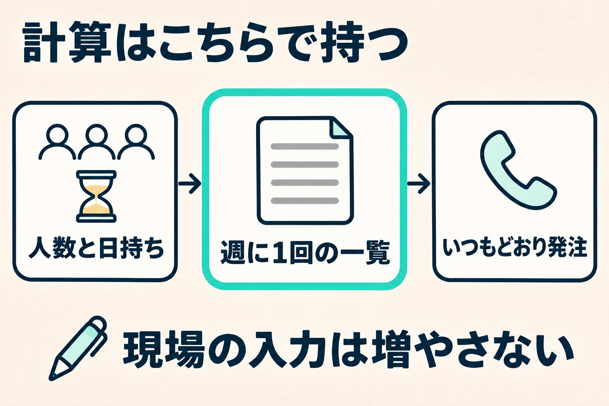

私たちの会社（HAMAYOUリゾート）は、山梨県の西湖でホテル、日帰り温泉、キャンプ場を営んでいます。私は常務をしています。

10月に「[食品ロスは「ゼロ」より「小さく」](/blog/ryokan-food-loss-reduction/)」という記事で、ホテルの調理場の廃棄を2年分並べて見えたことを書きました。最後には、調理場との打ち合わせはこれからで、何が分かったかはまたここに書く、と書いています。

その打ち合わせを10月の終わりに開きました。この記事は、そこで聞いた話と、その後の3週間で決めたことです。まだ試す前なので、「こうして減った」という話ではありません。

## 決める会ではなく、聞く会にした

打ち合わせには、料理長をはじめ調理場から4人と、現場をまとめている責任者、私の6人が集まりました。相談したかったのは、廃棄を減らすために、アプリや仕組みで楽にできるところがないか、です。アプリを作るかどうかも決まっていない段階だったので、決める会ではなく、聞く会にしました。

聞いた話の多くは、前の記事の見立てに沿っていました。予備をどれだけ持つかに決まりはなく、泊まる人数などで時と場合によります。団体の人数は1か月半ほど前に一度出て、その数で一度発注します。確定するのは早くて1週間前、遅いと前日です。冷蔵のサラダ類や卵は、日持ちが短くても多めに取ります。急に多く出た日に足りなくなるのが、いちばん困るからです。

いちばん強く出たのは、冷蔵庫と冷凍庫の話でした。夏は入口までいっぱいになり、在庫を確かめるにも、奥の物を取るにも、手前の物を全部出すことになります。たまにしか使わない物ほど奥に行きます。置き場所を決めていても、入りきらなくなると、空いている所に詰めるしかありません。

## 「どこに何があるか」が分かっても、奥の物は出てこない

会の締めに私は、アプリを増やすと覚えることが増えるので、本当は冷蔵庫や冷凍庫のような物の側で解けるのがいちばん筋がいいのかもしれない、と話しました。

持ち帰って整理すると、根っこにあるのは、期限が近い物を見つけて取り出す手間でした。夏は、業者さんが入れた品が入口に積み上がります。そこに手間を足す余裕はありません。アプリで「どこに何がいくつあるか」が分かっても、奥の物を掘り出す手間は変わりません。これはアプリでは解けない、と考えました。

いちばん効くのは、冷蔵庫や冷凍庫を広げることです。ただ、廃棄が減る分では、その費用を取り戻せません。そこで、今の冷凍庫の反対側にも扉を付けられないかを、調理場に聞きました。後ろから入れて前から取る、コンビニの飲み物の棚のような形です。会でも、今の造りなら扉は付けられそう、という声が出ていました。

答えは11月の半ばすぎに来ました。業者さんに現地を見てもらった結果、今の置き場所では、両側に扉を付けるのは難しいということでした。この案は、ここで外れました。

## 廃棄の重さは冷蔵の物。冷凍庫は別の話として残した

同じころ、2年分の廃棄を、冷蔵・冷凍・常温の置き場所で分け直しました。品目の名前から分けた大まかな数字ですが、廃棄の半分ほどは冷蔵の物で、冷凍の物は1割ほどでした。廃棄を減らす本筋は、冷蔵の物をどう発注するかです。

そうなると、冷凍庫の話は、廃棄にはあまり効きません。それでも、外さないことにしました。現場の困りごととして出ている話を、廃棄に効かないからと捨てるのは違う、と考えたからです。冷凍庫は廃棄とは別の話として残し、広げる場合の見積もりを、調理場で取ってもらっています。

## 冷蔵の物は、毎月のように出る9品に絞った

冷蔵の物の細かいことは、調理場の人たちと私が入るチャットを作って、直接聞きました。何度か質問すると、どれもその日のうちに料理長が答えてくれました。

分かったことは3つです。人数が減ったときは、キャンセルできないことが多く、業者さんに在庫として保管してもらっています。人数が増えたときは電話で追加し、届くのは中1日ほどです。夏は、ほとんどの品を業者さんに取り置いてもらっています。保管してもらった分は品によって残り、一般のお客さまのバイキングで何とか使っているそうです。

対象は、廃棄の記録に毎月のように出てくる9品に絞りました。冷蔵のサラダ5種類、ヨーグルト、卵、ベーコン、ロースハムです。調理場の手間が小さく、効いたかどうかが毎月の記録ですぐ分かるからです。品目は後から足せるようにします。

形は2つ考えて、調理場に相談しました。

- **団体が抜ける週だけ、パックで取る。**この先2週間の人数で、1ケースを日持ちのうちに使い切れないときは、パックに切り替えます。業者さんへの取り置きも増やしません
- **先の人数で出す分は控えめにして、増えたら電話で足す。**1か月半前の人数で出す分は、確定している人数分と少しの予備までにします。増えたら、使う日の2日前の朝までに電話で足します。前日に人数が決まる団体は、今どおり多めに取ります

相談の文には、現場の細かいところまでは分かっていないので、無理なことは遠慮なく言ってほしい、と添えました。

## 計算はこちらで持ち、現場の入力は増やさない

前の記事に書いたとおり、これまでに入れた道具は、2回とも入力や直しの手間で止まっています。それで、この2つの形も、現場に任せきりにはしないことにしました。

切り替えに要る計算は、こちらで持ちます。新しい仕組みを考える前に、調理場で今使っている表を一度全部並べました。人数は食事の指示の表に、「1袋で何人分か」と日持ちは在庫を確かめる表に、もう入っています。そこから9品ごとに「来週はケースかパックか」「何パックくらい要るか」を出します。それを週に1回の一覧にして、発注をまとめる日の前日にチャットで届けます。

現場にお願いするのは、一覧を見て、いつもどおりFAXやアプリ、電話で発注することだけです。新しく何かを入力してもらうことはありません。人数が増えたときの追加も、今どおり電話です。道具を作るかどうかは、この形で続けると決まってから考えます。

_計算はこちらで持ち、現場はいつもどおり発注するだけにします。_

現場に頼むことを絞った話は、売上の会議のことでも書いています（「[現場に数字を見せても、動かなかった話](/blog/frontline-numbers-how-to-ask)」）。

## 料理長からの返事と、今いるところ

返事は2日後に、料理長から来ました。どうすれば続けて実行できるか、業者さんとも細かく取り決めてやりたい、という内容でした。調理場の中で共有して意見を送る、取り置いてもらっている物の一覧も作る、とも書いてありました。

私は、一覧と意見をもらってからこちらの作業を進める、時間がかかっても大丈夫、と返しました。最初に試すのは年末年始の明けなので、それで間に合います。

話を聞いて分かったのは、奥の物を出す手間はアプリでは減らせないことと、現場の手間が増える形は続かないことでした。前の記事では、人がやらなくていい仕組みを目指す、と書きました。まずは、現場に新しい作業を足さないところから始めます。試して数字がどう動いたかは、またここに書きます。
