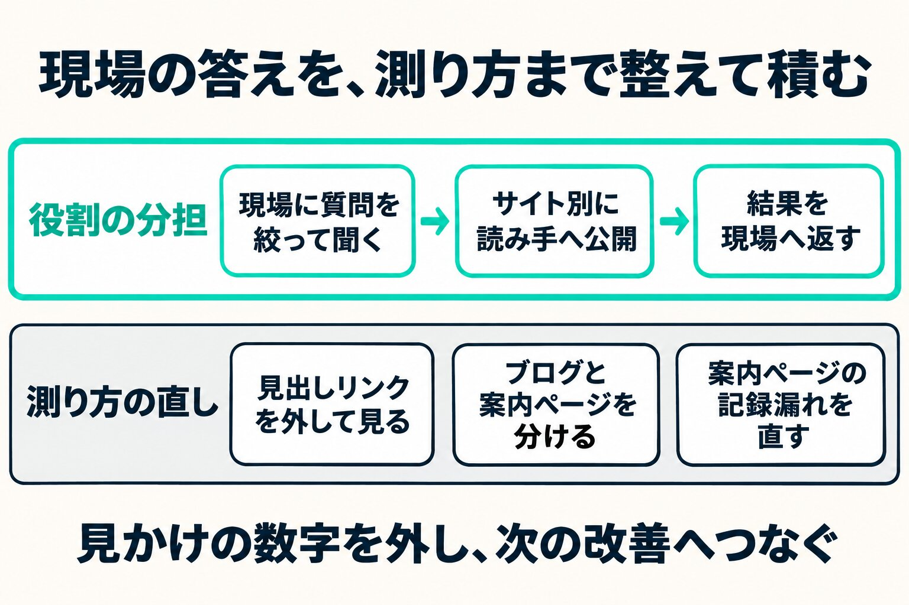

私たちの会社（HAMAYOUリゾート）は、山梨県の西湖でホテル（光風閣くわるび）、日帰り温泉（いずみの湯）、キャンプ場（キャンプビレッジノーム）を営んでいます。私は常務をしていて、会社の財務やWebまわり、採用などを担当しています。

9月に会社のホームページを4つのサイトに分けて作り直したあと、9月末からすべてのサイトでブログの運用を始めました。それから約2か月、11月下旬までに4サイト合計で110本以上の記事を公開しています。

今回は、私がどこを担い、現場のスタッフとどう分担したのか。そして2か月で何が変わり、途中でどんな「見かけの数字」を外して測り方を直したのかをまとめます。

## 120本のお知らせより、疑問に答えた10本のほうが読まれていた

ブログを始める前、リニューアル前の旧サイトで検索のデータを確かめました（サイトを作り直した経緯は[WordPressからAstroへ移した理由](/blog/wordpress-to-astro)に書いています）。

そこで見えた差ははっきりしていました。旧サイトのお知らせ欄には120ページ以上の記事がありましたが、年間の検索クリックは全部足しても数百回ほど。1ページあたり年に数回で、半数以上はクリックがゼロでした。

一方で、研修や合宿について「誰かが実際に検索する疑問」に答えていた上位10本だけで、年間4,000回以上の検索クリックを生んでいました。差を生んでいたのは文章の量ではなく、読み手が探している疑問に答えているかどうかでした。

この事実を土台に、新しい4サイトでは「日記やお知らせ」ではなく、お客さまや求職者が実際に検索する疑問に答える記事だけを積み上げる方針にしました。

## 4サイトの役割を決め、現場とは質問で分担した

最初に取り組んだのは、4つのサイトごとに「誰を連れてきて、何を増やしたいか」を分けることです。同じ会社でも、施設ごとに抱えている課題は違います。

- **ホテル**：秋から春の閑散期に向けた、団体・研修・合宿の問い合わせ（夏はもともと埋まるため、夏の合宿の言葉は狙わない）
- **キャンプ場**：ファミリー利用を主軸に、平日や閑散期の利用を増やす
- **日帰り温泉**：周辺の登山帰りや地元の人、団体利用の問い合わせ
- **会社サイト**：採用候補に集中する（求人で見つけて会社名で調べに来た人に、働く日常や仕事の中身を伝える）

特に会社サイトの採用ページは、開始前の3か月間で検索からの流入がほぼゼロでした。ホテルのサイトも、ほとんどが施設名での検索に限られていました。

進め方で気をつけたのは、現場のスタッフに「ブログを書いてほしい」と丸投げしないことです。現場は日々の接客や施設管理で手がいっぱいです。書き手まで背負わせると、すぐ止まってしまいます。

そこで、役割をはっきり分けました。

- **現場のスタッフが担うこと**：お客さまによく聞かれることや、施設のルール・実態といった一次情報に答えること。負担が重くなりすぎないよう、1回の質問は5問まで・週1回までに絞りました。
- **私が担うこと**：4サイトの役割分け、検索の需要をもとにしたテーマ選びと質問づくり、公開前の検品（料金やルールがホームページと合っているかの確認）、そして月2回の計測と結果の共有です。

検品の段階では、「もし現場の答えとホームページの記載が食い違っていたら、記事を合わせるのではなくホームページ側を直す」という基準にしました。実際に聞き取りを進めるなかで、サイトの古い表記がいくつも見つかり、その都度直すきっかけにもなっています。

_現場には一次情報の回答に集中してもらい、設計・検品・計測・結果の共有をこちらで持つ分担にしました。_

## 2か月で確かめられた変化

9月末の開始から11月下旬までの約2か月間で、4サイト合計110本以上（112本）の記事を公開しました。毎月10日と25日に検索とアクセス解析の数字を取り、変化を追っています。

施設名を含まない言葉で検索から記事が開かれた回数（クリック数）は、次のように変わりました。

- **開始初期（9月末〜10月中旬）**：施設3サイトの合計で1日約4回、会社サイトを含めた4サイト合計でも1日約11回
- **10月末**：施設3サイトで1日約28回（開始初期の約7倍）、4サイト合計で1日約40回
- **11月（上旬〜下旬）**：施設3サイトで1日約48〜50回（開始初期の10倍以上）、4サイト合計で1日約67〜70回（開始初期の6倍以上）

サイト内の記事閲覧数も、4サイト合計で開始初期の1日約57回から、11月下旬には1日約160回超（約3倍）まで増えています。

変化が目に見えて出たのは、大きく2か所です。

1つは、会社サイトの採用記事です。開始前は旧サイトから残っていた研修系の記事ばかりが読まれていました。10月から、現場の仕事内容や面接・身だしなみなど、応募前の不安に答える記事を重ねた結果、11月下旬には新しい採用記事だけで会社サイトブログの検索クリックの約7割（73%）を占めるまでに定着しています。

もう1つは、季節や周辺の動きに合わせた記事です。日帰り温泉のサイトでは、11月中旬に公開した近隣の登山に関する記事がすぐ読まれ始め、直近の半月で検索クリックが約2割伸びました。キャンプ場のサイトでは、秋向けの服装記事が落ち着くのと入れ替わるように、冬キャンプの記事が伸び始めています。

一方で、ここは正直に現在地も書いておきます。検索から記事が読まれる土台はできましたが、ブログから大きな団体受注が次々決まる段階にはまだ至っていません。問い合わせへのつながりは、次に書く測り方の見直しと合わせて追っている途中です。

## 「見かけの数字」を外し、測り方を3回直した

2か月の運用で一番大きかった学びは、記事を増やすこと以上に「測り方をごまかさないこと」でした。途中で3回、測る仕組みそのものを直しています。

### 1. 受け渡しをAPIからスプレッドシートに変えた

ブログが問い合わせにつながったかを知るため、Webフォームから送信されたときに「最初に読んだページ」と「ほかに読んだページ」を残す仕組みを作りました。

当初、私はデータの受け渡しをAPIで作ろうとしていました。ところが、集計を一緒に進めるスタッフと打ち合わせると、「自分が休んでも他の人が引き継げるように、絶対にスプレッドシートがいい」という意見が出ました。そこでAPI案をやめ、すでにある問い合わせ一覧の表の右端にURLの列を足す形へ切り替えました。

また、旅行会社や電話経由の問い合わせまで無理に追いかけず、ブログと結びつけられるWebフォームの相談だけで効果を見る線もこのときに引いています。

### 2. 検索表示の「見かけの2倍」を分解した

11月上旬の計測で、施設3サイトの検索表示回数が前回の約2倍に跳ね上がりました。ただ、そのまま喜ぶ前に中身を確かめると、増加分の半分近くは「記事の見出しへ直接飛ぶリンク」が記事本体とは別に数えられたもので、そこからのクリックはゼロでした。

見出しリンクを除いて比べ直すと、実質の伸びは約1.4倍でした。これ以降、表示回数の見かけの大きさに振り回されず、見出しリンクを分けたうえでクリック数を軸に見る基準にそろえています。

### 3. 「ブログ記事」と「案内ページ」を分け、記録漏れを直した

問い合わせの表にURLが溜まり始めると、最初に入ったページが「合宿プランの案内ページ」である相談が、ブログ記事経由と同じ列に混ざっていることに気づきました。

これでは現場の答えで書いた記事の効果が正しく見えないため、11月中旬から「ブログ記事からの問い合わせ」と「プラン・団体案内ページからの問い合わせ」を分けて数え直す形に変えました。10月以降に経路が確認できたのは、ブログ記事から2件（キャンプ場のチェックインや区画に関する質問）、プランや団体案内ページから3件（大学の研究室や高校の宿泊行事の相談など。営業の売り込みや社内テストは除外）です。

さらに、問い合わせの多くでURL欄が空欄になっていた原因を調べ直すと、ブログ記事しか記録しない仕様になっていました。11月下旬に主要なプラン・団体案内ページも記録するよう広げた直後、高校の宿泊行事の相談が団体案内ページ経由として初めて記録されました。

## 月2回、結果を現場へ返して次へつなぐ

毎月10日と25日に取った数字は、どの記事がどれくらい読まれているかをまとめて社内全体へ共有しています。質問に答えてくれたスタッフが、「自分たちの話がちゃんと外で読まれている」と分かる形にしておきたいからです。

記事を読んでくれる人は2か月で確実に増えました。ただ、別の記事（[「撮影の案件をブログで増やしたい」と相談が来て、先に案内ページを直した話](/blog/fix-landing-page-before-writing-blog)）にも書いたとおり、記事だけが増えても、その先にある案内ページや相談の流れが整っていなければ問い合わせには進みません。

現場に丸投げせず役割を分け、見かけの数字を外して測る。この2か月で作れた土台をもとに、次は記事から案内ページ・問い合わせ・応募へどうつながるかを、12月以降の計測で確かめていきます。
