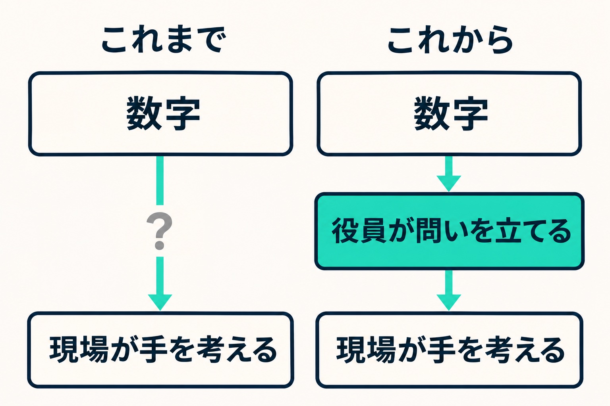

9月から、施設ごとの損益を現場の責任者に見せ始めました。その話は「[施設ごとの損益を現場の責任者に見せ始めた話](/blog/hotel-department-pl)」に書いています。記事の最後には、次の月のミーティングで現場からどんな意見が出てくるのか楽しみにしている、と書きました。

その続きです。数字を見せても、現場は動きませんでした。動かなかったのは現場のせいではなく、私の頼み方が原因でした。会議で謝って、頼むことを2つに絞った経緯を書きます。

## 1か月たって、登録は1件もなかった

数字が届いた月に、私は現場の責任者にこう頼みました。数字を読み、振り返りを書き、今回の数字から決めたことを登録してください。

どの施設からも、登録はありませんでした。ある責任者からは、今の項目では打つ手を考えにくい、と言われました。そこで、足りない項目があれば教えてくださいと頼み直しましたが、これも届きません。

同じ頼み方を3回目もするのはやめて、次の会議で口頭で聞くことにしました。無理に登録しなくてよいと伝え、聞く側がボールを取る形にしました。

## 順番が逆だった

会議の前々日、ずっと引っかかっていたことが言葉になりました。

私がやっていたのは、損益を全部見せて「ここから手を考えてください」と頼むことでした。数字が先に立っています。でも、数字から本当に価値のある問いを取り出すのは、もともと役員の仕事です。役員の側が問いを示し、そこから先の具体的な手を現場に考えてもらうほうが、現場もやりやすく、方向も間違えにくい。順番が逆でした。

この日のうちに、仕組みも作り直しました。今月の問いがあり、見る数字があり、現場がやることがある、という順番です。

ところが翌日、作り直したものを見ても、すっきりしません。

> ここまで考えてモヤモヤが消えないってことはやってみないとわからんね

これが、そのときの私の言葉です。仕組みをまた変えて現場に使ってもらうのではなく、現場に操作してもらうことも、仕組みの開発も、いったん止めました。まず顔を合わせて話を聞くことにしました。

## 「皆さんの問題ではなく、頼み方の問題」

会議では、最初に謝りました。数字だけを渡して打ち手を考えてもらうのは、難易度が高すぎました。皆さんの問題ではなく、頼み方の問題です、と。

目的は変えていません。利益を良くして、働いてくれている人に返すことです。変えたのは役割です。

|                | これまで                                       | これから                                           |
| -------------- | ---------------------------------------------- | -------------------------------------------------- |
| 現場に頼むこと | 数字を読む、振り返りを書く、やることを登録する | 毎月の人数の入力と、困っていることを会議で話すこと |
| 数字の分析     | 現場と役員の両方                               | 役員の側                                           |
| 問いを立てる人 | はっきりしていなかった                         | 役員の側                                           |

_問いを立てるところを、現場から役員の側へ戻しました。_

数字そのものは、見たい人はこれまでどおり見られます。見ることと、見て手を考えることを切り離しました。

## 顔を合わせて聞くと、数字に無い話が出てきた

会議で聞いて分かったことがあります。

ある施設で、燃料費が大きく増えて見えた月がありました。ところが現場の手元の記録では、増え方はずっと小さいものでした。納入の時期がずれて、翌月に使う分が入っている可能性が出てきました。

損益の数字だけを見ていたら、燃料費が増えた理由を現場に尋ねることになっていたと思います。実際は、現場の手元に答えの手がかりがありました。

## 問いを立てる側に回ってみて

毎月の人数が入るようになると、売上を人数と単価に分けて見られます。役員の側で数字と人数を見比べ、仮説を立てて確かめ、次の会議で現場に渡す問いを決めました。

たとえば、「雨の日にどう取りこぼさないか」です。「利益を上げるには」と聞くのと違って、雨の予報が出た日に何を試したか、という場面の話ができます。

そのあと、ある施設の責任者が、こちらから頼んでいない翌月の集計を自分から送ってくれました。

うまくいくかは、まだ分かりません。問いを渡すのは今月の会議が最初です。1か月目の私は、数字を見せることと手を考えてもらうことを、1つの仕事だと思っていました。分けてみて、ようやく次の話ができるところまで来た、というのが今の状態です。

部門別の数字を現場に開いて、動きが見えないと感じている方がいたら、現場に足りないものを探す前に、自分が何を頼んでいるかを見直してみてもいいかもしれません。私の場合は、そこが逆でした。
