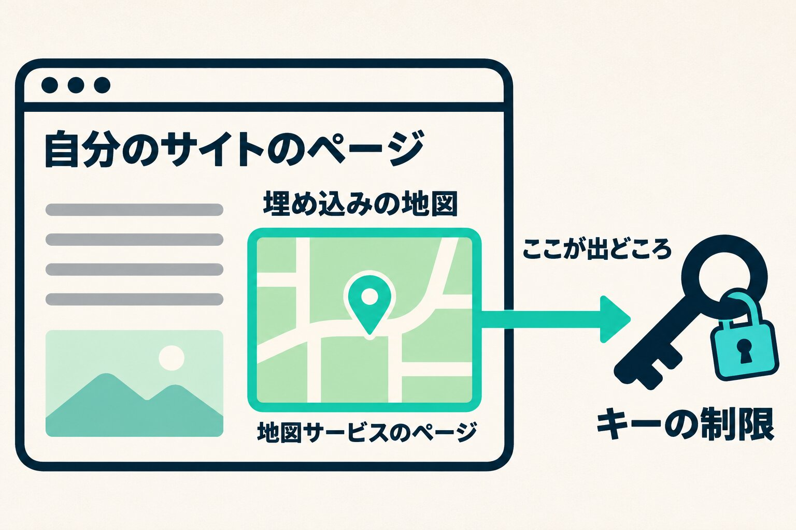

Googleマップを載せたサイトでは、地図を出すためのキー（APIキー）が使われています。このキーは、ページのソースを開けば誰でも見られます。隠すことでは守れません。守りになるのは、Google Cloudの側で「どのページから、どの機能に使えるか」を絞る制限です。

9月に、預かっているサイトの設定ファイルに書かれた地図のキーが、作業中の画面に表示されたことがありました。それをきっかけに、仕事で入っている3つのGoogleアカウント（自分のもの、自分の会社のもの、一緒に仕事をしている制作会社のもの）のキーを全部見ました。地図のキーは17本あり、そのうち10本は制限が掛かっていませんでした。

この記事では、その10本を11月に片付けたときのことを書きます。キーがサイトのファイルではなく地図サービスの側にあったこと、消すか残すかを何で決めたか、制限をどう掛けて、掛けたあとに何を確かめたかです。

## 制限の無いキーは、作った時期で分かれていた

一覧にして作った日の順に並べると、分かれ目は作った時期でした。2022年までに作った6本は、5本に出どころを絞る制限が掛かっていました。2023年以降に作った11本では、制限があるのは2本だけでした。

9月の時点では「全部のサイトを開く次の作業のときに、一緒に片付ける」と決めました。ところが10月にその作業をしたとき、キーのことは一緒に進まず、11月まで残っていました。

## キーは、サイトのファイルの中に無かった

11月に、キーの使い先を探しました。10月の作業で取っておいたサイトのファイルの写しを、Googleのキーが必ず始まる文字（AIza）で探しました。ところが、ほとんど出てきません。出てきたものの中には、テーマやプラグインに最初から入っている見本のキーも混ざっていました。配布元が動作の例として入れているもので、こちらのキーではありません。

理由は、地図の出し方にありました。11のサイトの14枚の地図は、地図の見た目を整えるサービス（Snazzy Maps）で作ったもので、サイトには埋め込み（iframe）で載っていました。キーはサイトのファイルではなく、そのサービスの側に預けてあったのです。

そこで、どのキーがどのサイトのものかは、ファイルではなく2つの記録で突き合わせました。1つは埋め込みの名前で、キーのあるGoogle Cloudのプロジェクトと同じ名前が付いていました。もう1つはGoogle Cloudの指標で、キーごとに直近30日の使用回数が出ます。使われているキーは、1か月に10回足らずから1,800回ほどでした。

## 消すのは、確実に使っていないキーと、困っても自分で直せるキーだけ

10本のうち1本は、9月に別の件で先に作り直していました。残りの9本を、消すか、制限を掛けて残すかに分けました。基準は2つです。

- 消してよいのは、確実に使われていないキーと、消して困っても自分で直せる自分の会社のキー
- お客さんのサイトで使われているキーは、消さない

「使われていない」は、30日の使用回数が0回なのを2度確かめ、どのサイトの地図にも入っていないことを、写しと公開中のページで確かめてからにしました。

消したのは3本です。2本は30日で0回でした。残る1本は自分の会社のキーで、30日で2回使われていましたが、自分の会社のサイトのコードにも写しにも見つからず、どこから使われているのか分かりませんでした。自分の会社のものなら、地図が消えても自分で直せます。それで消しました。消したキーは、30日以内ならGoogle Cloudの画面から元に戻せます。

## 制限は、自分のサイトではなく地図サービスの出どころで掛ける

使われている6本には、消さずに制限を掛けました。

いちばん気をつけたのは、出どころに何を入れるかです。埋め込みの地図を読み込んでいるのは、自分のサイトのページではなく、埋め込まれた地図サービスのページです。だから「ウェブサイト」の制限には、自分のサイトのドメインではなく `https://snazzymaps.com/*` を入れます。前から制限が掛かっていて問題なく地図が出ているキーが、ちょうどこの形になっていました。そちらに揃えました。

_埋め込みの地図では、キーを使う出どころは地図サービスのページです。_

もう1つは、使えるAPIの指定です。今のGoogle Cloudの画面では、使えるAPIを1つ以上選ばないと制限を保存できません。6本のうち5本が使っていたのは地図の表示（Maps JavaScript API）だけだったので、それだけにしました。残る1本は、サイトのテーマも同じキーで場所の検索をしていたので、そのサイトのドメインと、場所の検索（Places API）も足しました。

## 掛けたあと、5分待って地図を開いた

制限は保存してから効くまでに少し時間がかかります。保存から5分ほど待って、各サイトの地図のあるページを開き、地図が今まで通り出ることと、埋め込みにエラーが出ていないことを見ました。どのサイトも、問題なく出ていました。

出なかったときは、その場で制限を外して保存し直せば、元の状態に戻ります。消すのと違って、制限は後からいつでも外せます。

## ほかの会社のアカウントのキーは、持ち主に聞いてから

6本のうち2本は、一緒に仕事をしている制作会社のアカウントにありました。どちらも今サイトで使われていました。アカウントの持ち主は向こうなので、こちらの判断では触りません。

「消さずに、そのサイトの地図からしか使えない制限を掛けたい。地図の見え方は変わらず、費用もいらない」と伝えて、了承をもらってから掛けました。掛けて地図を確かめたあと、済んだことを一言返しました。

これで、3つのアカウントにある地図のキーで、制限の無いものは無くなりました。

## 最初に、地図の出し方を確かめる

制限を掛ける前に確かめるのは、そのサイトの地図をどう出しているかです。サイトのコードで地図を出しているなら、出どころは自分のサイトのドメインです。埋め込みのサービスで出しているなら、出どころはそのサービスのページになり、キーもサイトのファイルには見つかりません。

サイトの守り全体の優先順位は「[WordPressセキュリティ対策ガイド](/blog/wordpress-security-measures)」に、コードを出す前の点検は「[出す前のセキュリティ点検を、pushのたびに自動で走る形にした](/blog/code-security-review-on-every-push)」に書いています。

Googleマップを載せたサイトをお持ちの方は、Google Cloudの「認証情報」の画面で、キーの横に制限が出ているかを一度見てみてください。
