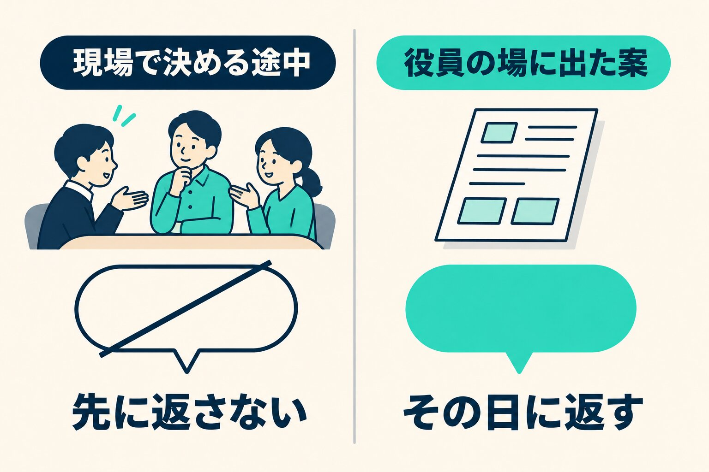

年末年始の催しの準備を進めていたときの話です。現場の責任者が「皆で集まって骨組みを作る」と動き始めたので、私は先に意見を返さないことにしました。何を見てそう決めたのか、逆にどんなときはその日に返すのかを書きます。

## 「集まって、骨組みを作る」

催しの中身は、施設ごとに案を出してもらう形で進んでいました。案が出そろう前日、責任者の一人と立ち話をしました。

その場で、案が出たら皆で集まる時間を作ろう、という話になりました。チャットの文章だけでやり取りすると、どうしても角が立って見えます。直接話したほうがいい、というのが私の考えでした。責任者からは、誰かが強引にまとめるしかなくなるのは避けたい、集まって骨組みを作り、細かい段取りは皆で考える、という言葉がありました。

日時も、誰が声をかけるかも、その場では決めていません。そろったのは向きだけです。

## 一言返すか、迷った

チャットには、返事をしていないやり取りが一つ残っていました。催しの一部について私が投げかけた問いに、立ち話の数日前、その責任者が案を返してくれていたものです。

翌日、これに返すかどうかを決めることになりました。一言返すのは簡単です。「それでいきましょう」でも「こういう案もある」でも、書こうと思えば書けます。

でも、返しませんでした。そのときの私の言葉はこうです。

> そこまで動くなら私の声が無い方がフラット。相談を受けてから考える

## 先に出した案は、結論になりやすい

皆で集まって骨組みを作る、と現場が決めたのなら、考えるのはその場です。そこへ役員の私が先に「これがいい」と書けば、集まる前から一つの案が置かれた状態になります。私は一つの意見のつもりでも、役員の言葉は結論として受け取られやすい。

集まる場で考える余地を残しておきたかった。だから、その問いは、集まる場か、責任者からの相談が来たときに考えることにしました。

## いつも黙っているわけではない

任せたら何も言わない、と決めているわけではありません。

少しあとに、役員のチャットへ、現場から仕事のやり方を変える提案が上がってきました。そのときは、役員の側で前から考えていたことと方向が同じだと確かめたうえで、その日のうちに賛成を返しました。

|              | 先に返さなかった                   | その日に返した                 |
| ------------ | ---------------------------------- | ------------------------------ |
| 案のある場所 | 現場がこれから集まって決める       | 現場が役員の場に出してきた     |
| 返すと       | 集まる前に、役員の案が一つ置かれる | 出された案に、賛成が伝わる     |
| 決めたこと   | 相談が来てから考える               | 方向が同じなので、その日に返す |

_同じ「返事をするか」でも、案がどこにあるかで分けました。_

違いは、現場が決めている途中に入るのか、現場が出してきた案に答えるのか、でした。前者は、相手が考える場所に先に足を入れることになります。後者は、相手の問いかけに答えることです。

## 相談が来たら、考える

その後どうなったかは、ここでは書きません。

黙っていると決めたあと、私がやったのは待つことだけでした。返さなかった問いは、相談が来たときの話として取っておきました。

現場が自分で場を作って動き始めたら、私の場合は、先に答えを置かない。今回の場面で、そう決めました。
