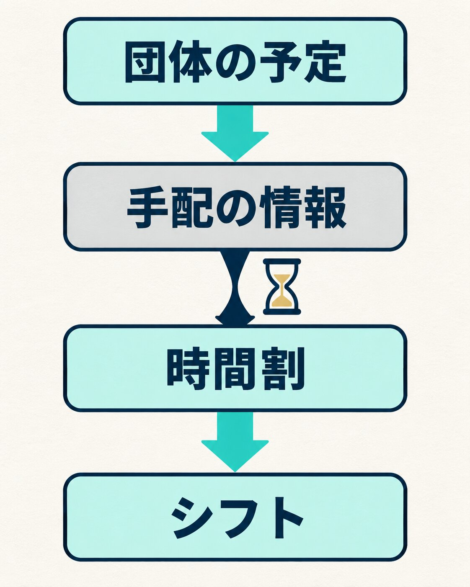
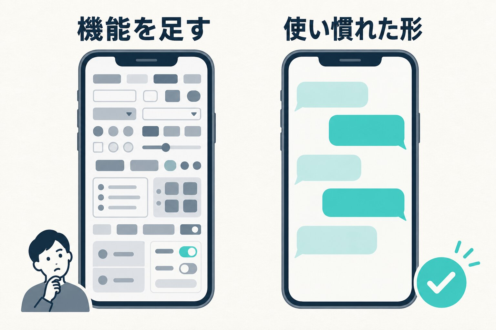

私たちの会社（HAMAYOUリゾート）は、山梨県の西湖でホテル、日帰り温泉、キャンプ場を営んでいます。私は常務をしています。

ホテル（光風閣くわるび）には、修学旅行や合宿などの団体のお客さまが多く泊まります。その現場で長く続いている悩みが、日別のシフトが前日の夜にならないと出せないことです。

シフト作成を効率化したい、と考えるのは自然なことだと思います。ただ、原因を手前へさかのぼっていくと、手を入れるべき場所はシフトを組む作業そのものではありませんでした。この記事では、何が見えて、今どう動いているかを書きます。まだ途中の話です。

## 「もっと前に知りたい」という声

きっかけの一つは、現場のスタッフから直接受けた相談でした。自分が何時から何時まで働くのかは、本来もっと前に分かっているべきではないか、という声です。

もっともな話です。帰る時間が直前まで分からなければ、自分の予定は立てられません。

会社としては、働き方のルールを整えるところから始めています。以前作ったものが古いまま残っている部分があり、それを今の時代に合わせて整えているところです。

ただ、ルールを整えるだけでは解決しません。団体のお客さまの予定は、相手のいることだからです。到着や出発の時刻、食事や会場を使う時間が決まらないうちは、こちらだけでシフトを固めることはできません。

## さかのぼると、遅いのはシフトの手前だった

シフトを組むのに要るのは、団体の一日の時間割です。何時に着いて、何時に食事をして、何時から会場を使うのか。それがそろわないと、何時に何人いればよいかが決まりません。

その時間割は、旅行会社や学校とのやり取りの中で、少しずつ集まってきます。ここに問題がありました。

- 何を、いつまでに聞くかが、会社として決まっていない。やり取りの細かさと期限が、担当する人それぞれに任されている
- 1件の団体ごとに書類が分かれていて、どの団体の、どの項目が、まだ埋まっていないかを、まとめて見る場所がない
- だから、まだ届いていない情報を取りに行けるかどうかが、それぞれの忙しさに左右される

一方で、団体の旅のしおりは、多くの場合1〜2か月前にはできています。決まっていないのではなく、取りに行けていないだけ、ということが多いのです。

シフトが前日の夜になるのは、シフトを組む人が遅いからではありません。手前で情報がそろうのが遅く、そろってからでないと組めないからです。

_シフトが遅れる原因は、シフトのひとつ手前にありました。_

## だから、二本立てで動いている

いま、二つの方向から進めています。

一つは、上に書いた働き方のルールの整備です。

もう一つは、団体の予定の確認を、人が忙しいかどうかに左右されずに、今より早い段階で取れるようにすることです。人の頑張りで催促するのではなく、仕組みで回せないかを試しています。

考え方の中心は二つです。

一つ目は、まだ埋まっていない項目と、宿泊日までの残りの日数を、すべての団体をまたいで一覧で見られるようにすること。どこが空いているかが見えていれば、催促は誰かの熱意ではなく、決まった手順になります。

二つ目は、お客さま側が書き込んだ値と、ホテルが確認して決めた値を分けて持つことです。お客さま側はいつでも書き直してよい。ただし現場に流れるのは、ホテルが確認して決めた値だけ。二つが並んでいれば、人数が1人変わったことにも、違っていること自体で気づけます。

## 作った仕組みを、自分で説明できなかった

この考え方で、手配の情報をやり取りするアプリを作りました。9月に、ホテルの現場の人と一緒に実際に触ってみました。

そこで私自身が、説明に詰まりました。久しぶりに触ると、どこを押すと何が起こるのか、すぐに分からなかったのです。作った側がすぐに説明できない時点で、設計としてよくない。そう判断して、ホテルで使うのはいったん止めることにしました。

詰まった理由は、ひとことで言えば、アプリが複雑になりすぎていたことに尽きます。

画面の上に便利な機能を取り入れるのは簡単です。思いつくことを足していくのは楽しい作業でもあるので、ついそうなりやすい。けれど、使うのは人間です。人の癖、考え方、目線の動き、普段使い慣れているものとの差。そういうところまで配慮できていなかった、というのが正直な印象です。

## 画面は、使い慣れたものに寄せる

そこから考えているのは、画面をどれだけシンプルにできるか、です。

特に感じたのは、今の人たちはLINEのようなチャットや、SNSの画面に慣れているということです。まったく新しい画面を作るより、そちらに寄せた方が、覚えることが少なくて済むはずです。

もう一つ大事なのは、使う人を見ることです。自分たちの職場で働いているのはどういう人たちなのかを見て、そこに合わせる。ここをないがしろにすると、作っても使われない状態になってしまいます。私が今いちばん気をつけているのは、ここです。

_機能を足すより、使い慣れた形に寄せる方が覚えることは少なくなります。_

## 同じように仕組みを考えている経営者の方へ

いまは、仕組みを作るハードルがずいぶん下がりました。AIに頼めば、画面もすぐに出てきます。ただ、画面の作りや使い心地については、一発で良いものが出てくることは少ないと感じています。

そこには、デザイナーやプロの開発者の知見を取り入れることをおすすめします。そういう人たちは、いつもそのことばかり考えています。過去の失敗もたくさん経験しているので、こうするとこういう不満が出る、こういう使いにくさが出る、ということを知っています。知っている人の知識は、やはり大きいと思います。

もう一つ、セキュリティの面でもプロの手を借りる方がいいと考えています。現場で使う仕組みには、スタッフの名前やシフト、お客さまの団体の情報が入ります。誰がどこまで見られるのか、データがどこに置かれるのか、外からの入り口をどう守るのかは、作っている本人からは見えにくいところです。使い心地と同じで、そこをいつも考えている人の知見を借りる方が安心だと思います。

## これから：まずは日帰り温泉で使ってもらう

ホテルの分を止めて、先に日帰り温泉（いずみの湯）の団体予約の台帳から動かすことにしました。

いまは、できたものを現場の人に触ってもらい、感想を待っているところです。使われ方で何が分かったかは、まだこれからです。

そこで分かったことを土台にして、ホテルの手配の仕組みに戻るつもりです。シフトを前日の夜から少しでも前に出せたら、そのときはまた、ここに書きます。
