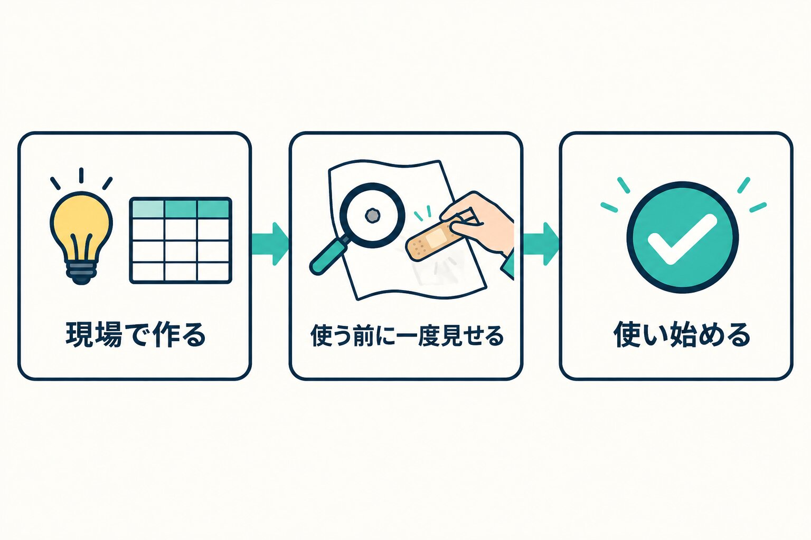
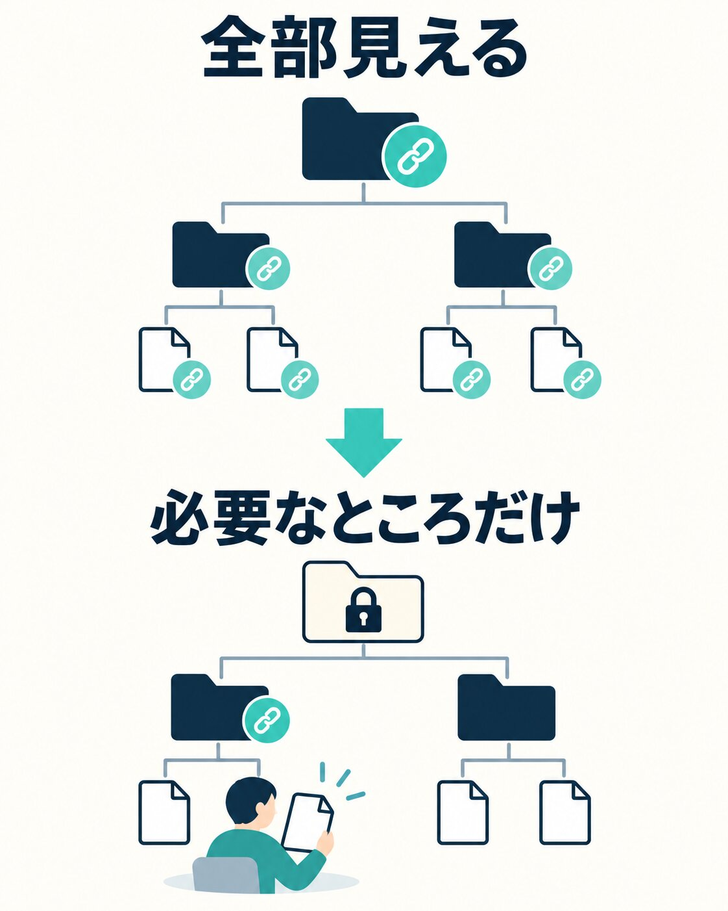

私たちの会社（HAMAYOUリゾート）は、山梨県の西湖でホテル、日帰り温泉、キャンプ場を営んでいます。私は常務をしています。

ここ最近、現場のスタッフが自分で業務の仕組みを作るようになりました。紙の書類をフォームに置き換えたり、表のボタンひとつで次の人に依頼が飛ぶようにしたり。作るのは、毎日その仕事をしている本人です。

この記事では、その仕組みを経営側がどう見ているか、何を確かめているかを書きます。

## きっかけは、止まった仕組みだった

9月に、ホテルの問い合わせが届くと社内のチャットに自動でタスクが立つ仕組みが止まりました。スタッフが前に作ってくれていたものです。

直す作業の中で、いくつか気になる点が見えてきました。そして同じ日に、私の側も同じような失敗をしていました。私が作った表とスクリプトを個人の場所に置いていて、ほかの人が開けなかったのです。

一人で書いたものには、必ず抜けが出ます。誰かを疑う話ではありません。

そこで、スタッフにこう伝えました。業務で使う仕組みは、使い始める前に一度こちらで確認させてほしい、と。

## 「全部こちらで作る」にしなかった理由

禁止することも、全部こちらで引き取ることもできました。そうしなかった理由は三つあります。

一つ目。作っている本人は、たぶん楽しくてやっています。私も作るのが好きなので分かります。それを取り上げる必要はないと思いました。

二つ目。一次情報は現場にあります。私は普段、現場に出ていません。「ここが面倒」「こういうものがあったら便利」という気づきは、毎日その仕事をしている人からしか出てきません。その芽を摘みたくありませんでした。

三つ目。動くものを作るだけなら、今は誰でもできます。差が出るのは、その先です。何も言わなければ抜けやすいところ、使い始めてから言われること、そしてセキュリティ。普通に動くものを作るとき、セキュリティまで考える人はほとんどいません。けれど、穴があいたときの怖さと、そのあとにどんな作業が待っているかは、私は仕事の中で何度も見てきました（[WordPressが乗っ取られたとき](/blog/wordpress-hijacked)にも書いています）。

ひらめきは現場からどんどん出してもらい、穴は知っている側がふさぐ。この二つを混ぜると、自然に「作ってよい、使う前に一度見せて」になりました。手元で自分だけが使うものは自由です。すでに動いているものも止めません。確認のために手間が増える形にもしていません。

_作るのは現場、使う前の一度だけ、知っている側が穴をふさぎます。_

## 見ているのは「動くか」ではない

確認では、動くかどうかは見ません。動くかどうかは、作った本人がいちばんよく分かっています。見るのは、9月の件で実際に踏んだことから作った項目です。たとえば次のようなことです。

- 置き場所が個人ではなく、会社の共有の場所になっているか
- 合言葉（パスワードや鍵）を、仕組みの中に直接書いていないか
- 作った人がいなくなっても回るか
- 外から誰でも使える入り口になっていないか

10月には、スタッフから3件の確認の依頼が届きました。どれも、事務所に戻る手間や紙を減らすための、よく考えられた仕組みでした。その中で見つかったのは、たとえばこういうことです。

- フォームを「リンクを知っている全員」が送れる設定になっていて、リンクが外に出ると、誰でも社内に予定やタスクを立てられた
- 仕組みが作った人のアカウントで動いていて、その人がいないと止まる作りだった
- 表の共有が、ファイルではなく上のフォルダに付いていて、中にある見せなくていい表まで、リンクで見られる状態だった

最後の件は、フォルダごと閉じれば済む話ではありませんでした。そのリンクで、毎日シフトを見ているスタッフがいたからです。閉じる前に誰が見ているかを聞き、共有を一段下のフォルダにだけ付け直しました。見ている人の見え方は変えずに、見せなくていいものだけを閉じています。

_共有を外すのではなく、一段下げました。_

## 返すときは「使い始めて大丈夫です」から

3件とも、返事は「このまま使い始めてもらって大丈夫です」から書きました。直してほしい点がある場合もです。

まず受け止めてもらいたいからです。最初に指摘が並ぶと、そのあとの話は頭に入りません。心が閉じてしまいます。一度受け止めてから、事実として伝える。気を遣って言わないのではなく、伝える順番の話です。

直してほしい点は、「この操作をするとこうなって、ここが困るから、ここを直してほしい」の順に書きます。問題がなかったところの説明は省き、頼むことだけを書きます。

もう一つ、見ている場所の違いがあります。役割が違えば、入ってくる情報も、決めなければいけないことも違います。今はこれでよくても、会社がこう動いていくと困る。その「この先」は、作った本人からは見えにくいものです。見えなくて当然だと思います。だからこそ、知っている側が言うべきです。それは知っている側の責任だと考えています。

## 作れる人は、どんどん増えてほしい

現場に、自分で仕組みを作って仕事を楽にする人が出てきたことは、とてもうれしく思っています。もっと増えてほしいです。

会社では、スタッフ全員が仕事のアカウントで生成AI（Gemini）を使えるようにしています。動くものを作るだけなら、今は誰にでもできます。あとは、やるかやらないかです。

極端に言えば、全員が自分の仕事を楽にするものを作って、少しずつ時間を生み出していけば、労働時間をどう収めるか、人が足りないのをどうするかという悩みは、ずっと解決に近づくはずです（人手不足と業務の見直しについては[こちらの記事](/blog/ryokan-staff-shortage-review)に書きました）。

同じ立場の経営者の方に一言で言うなら、「止めずに、使う前に一度だけ見る」です。作る環境は会社が用意する。気づきは現場から出してもらう。穴は知っている人がふさぐ。そのほうが、チームとして強くなると思っています。
