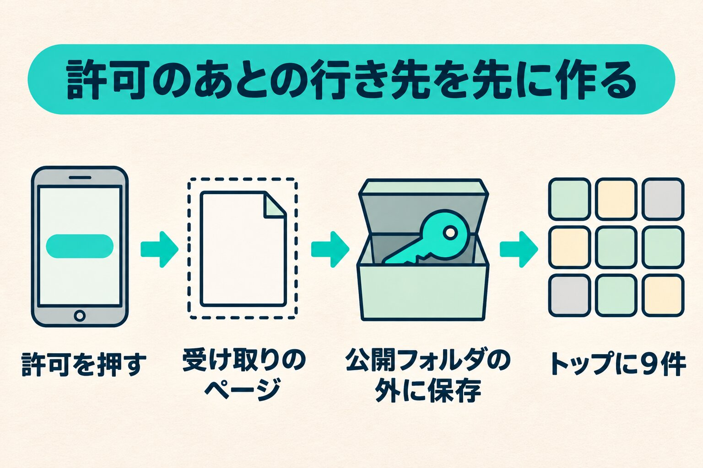

一緒に仕事をしている制作会社から、お店のサイトのトップに、Instagramの新しい投稿を並べたいと相談を受けました。お店はこれからInstagramを始めるところで、トップの下のほうに投稿が並ぶ見た目の案は、デザイナーがもう作っていました。サイトはWordPressではなく、手書きのHTMLです。

制作会社がお店に出したかったのは、「公式の方法ならいくら、ウィジェットならいくら、月々はいくら」という比べでした。

この記事では、何と比べて公式のAPIで作ることにしたか、作る途中で引っかかったこと、止まってもページが崩れないようにしたところを書きます。

## 埋め込みコード、ウィジェット、公式のAPIを比べた

前に別のサイトで、無料のプラグインを使ってInstagramの投稿を並べたことがあります。そのときは調子が悪く、いくつものサイトでアカウントのつなぎ直しをしました。今回はWordPressではないうえ、外の部品はなるべく入れたくありません。

そこで、並べ方を4つに分けて比べました。

| 並べ方                   | 費用                                                        | 見た目                    | 止まる・手間がかかるところ                                     |
| ------------------------ | ----------------------------------------------------------- | ------------------------- | -------------------------------------------------------------- |
| 投稿ごとの埋め込みコード | 無料                                                        | 1件ずつ大きなカードで出る | 投稿のたびに貼り直す                                           |
| 無料のウィジェット       | 無料                                                        | サービスの型の範囲        | 月の表示回数が上限（数百〜千数百回）を超えると、翌月まで止まる |
| 有料のウィジェット       | 海外のもので月数ドル相当から、国内のもので月1,500円前後から | サービスの型の範囲        | 不具合のとき、直る時期はサービス次第                           |
| 公式のAPIで自前          | 公式の説明に利用料の記載が無い                              | 案どおりに作れる          | 連携の期限切れと、お店の側での連携の解除                       |

埋め込みコードは、案のように並べられません。無料のウィジェットは、お店のトップに置くには止まる心配が大きすぎました。

残る2つのうち、公式のAPIを選びました。月々の費用がかからないこと、見た目を案どおりに作れること、外のスクリプトを読み込まないので表示が軽いことが理由です。もう1つは制作会社の考えで、止まったときに「公式の側の変更です」と説明できることです。ウィジェットだと、こちらが選んだサービスが止まった、と受け取られやすくなります。

お店にお願いすることは2つだけでした。Instagramをプロアカウント（ビジネスかクリエイター）にすることと、連携のときに一度だけ許可を押すことです。Facebookページは要りません。自分たちのアプリで、預かったアカウントの投稿を読むだけなら、Metaの審査も要りません。

## 見積もりの前に、自分のアカウントで取れるかを試した

説明を読むだけでは、本当に投稿が取れるかまでは分かりません。見積もりを出す前に、Metaの開発者の画面でアプリを1つ作り、自分のInstagramをクリエイターに切り替えて、そのアプリのテスターに登録しました。問い合わせると、新しい投稿6件の日時・種類・リンク・本文がそのまま返ってきました。

このとき分かったのが、画像のアドレスの期限です。返ってくる画像のアドレスには、4〜5日ほどの有効期限が付いていました。取ったデータを控えたまま何日も置くと、画像が切れます。そこで作るときは、控えを長く置かずに取り直す形にしました。

## 新しく作ったアプリには、前と同じ設定が出なかった

発注が決まり、本番用のアプリを新しく作りました。ところが、試したときと同じ設定の画面がありません。代わりに、こう出ていました。

> InstagramログインによるAPI設定は、新しいアプリでは利用できません。代わりに、アプリは統合ログインを使用したAPI設定を使用します

統合ログインは、Facebookのビジネス向けのログインを使う形です。お店に伝えてあった「Instagramで許可を押すだけ」とは、手順が変わってしまいます。

変更の発表が見つからなかったので、まず自分の設定を疑って調べ直しました。分かったのは、違いがアプリを作った時期にあることです。10月に試しで作ったアプリには、同じ場所に「InstagramのログインによるAPI設定は引き続き機能しますが、これはレガシー設定となります」と出ていました。ほかの開発者の報告でも、10月の終わりごろから、新しいアプリで同じことが起きていました。

そこで、試しのアプリの名前を本番向けに変えて使いました。お店の側の操作と画面は変わりません。前の型を止める日は発表されていないので、前の型を使っていることは、作りの記録に残しました。

## 許可を押したあとの行き先を、先に作った

試しのとき、許可のあとに戻る先は、仮のアドレス（`https://localhost/`）のままでした。自分で試すなら、アドレス欄に出た許可のしるしを手で拾えば済みます。ところがお店が許可を押すと、つながらない画面が出るだけで、しるしはこちらに届きません。しるしは1時間で切れ、1回しか使えないので、人の手で受け渡すこともできません。

そこで、お店に頼む前に、テストサイトに受け取りのページを置きました。しるしが届いたら、その場でサーバーから連携の合言葉（アクセストークン）に換え、公開フォルダの外に保存します。保存してよいアカウントは、お店のものだけに絞りました。リンクを知った別の人が許可を押しても、上書きされません。

_許可のあとに戻る先を、お店に頼む前に用意しました。_

置いたあと、自分のアカウントでリンクから完了の画面まで通し、その合言葉で投稿が読めるのを確かめてから渡しました。通してみて分かったこともあります。ログインし直しを求める指定（`force_reauth=true`）をリンクに付けると、ログインのあとにInstagramのふつうの画面へ行ってしまい、許可の画面が出ませんでした。指定を外し、手順書の最初に「お店のアカウントでログインした状態で開く」と書きました。

お店に渡したのは、画面つきの手順書のページ1枚です。お店の操作は、テスターの招待を承認することと、ボタンから許可を押すことの2つでした。

## 「済んだ」の連絡より、サーバーの記録が先だった

許可の予定日の翌朝になっても、「済んだ」という連絡はありませんでした。間に入っている制作会社に聞いても、まだ連絡は無いとのことでした。

そこで受け取りのページの記録を見ると、連携は前の日の夕方に済んでいて、お店の投稿も読めました。お店から制作会社への連絡が、まだ届いていなかっただけでした。連絡を待たずに、そのまま表示を作り始めました。

## 止まっても、ページが崩れないようにした

表示は、新しい順に最大9件を3列で並べます。デザイナーの案との位置の差は、パソコンでもスマホでも2px以内に収めました。

止まったときの備えは3つです。

- 投稿が取れない、0件、画像が全部読めないときは、区画ごと出さない。画面にエラーを出さない
- Instagramへの問い合わせは1時間に1回まで。失敗したら、24時間以内の控えで代わりにする
- 合言葉には60日の期限がある。トップが表示されるついでに、7日ごとに延ばす（延ばすと、そこからまた60日）

延長は、サーバーの定期実行には入れませんでした。同じサーバーにはほかのサイトも多く同居していて、この件のためだけの設定が1つ増えると、忘れやすくなるからです。お店のトップは毎日だれかが開くので、7日ごとでも期限までの余裕は十分あります。

それでも止まるのは、お店がパスワードを変えたときと、連携を外したときです。そのときは、お店にもう一度許可を押してもらいます。これは見積もりの段階で伝えてありました。

本番には、お店の確認をもらってから入れました。入れる前のトップのファイルは控えを取り、戻すときはそれを写すだけにしてあります。

## 頼む前に、アプリを作った時期と戻る先を確かめる

作る側が、お店に頼む前に確かめることは2つです。新しく作るアプリでは設定の形が変わっていること、許可のあとに戻る先を先に用意しておくことです。

外のサービスに鍵を預ける形の注意は「[Google Maps APIキーの制限を、預かっているサイトの分まで見直した](/blog/google-maps-api-key-restriction)」に、WordPressではない作りを選ぶ考えは「[WordPressからAstroへ移した理由](/blog/wordpress-to-astro)」に書いています。

お店のサイトにInstagramの投稿を並べたいと考えている方は、先にInstagramの設定の画面で、アカウントがプロアカウントになっているかを見てみてください。
