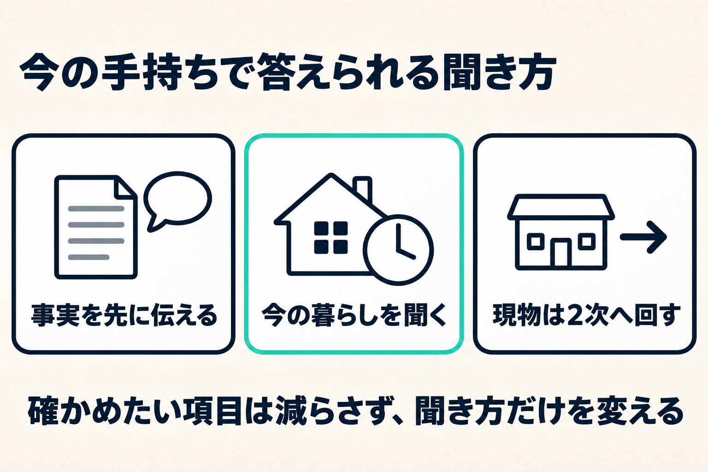

私たちの会社（HAMAYOUリゾート）は、山梨県の西湖でホテル、日帰り温泉、キャンプ場を営んでいます。私は常務をしていて、正社員の採用では1次面接を担当しています。

パートやアルバイトの採用は現場の責任者に任せていますが、正社員は責任も大きく、長く一緒に働くことになるため、私が最初にお話しし、2次面接では現場の責任者にも同席してもらう流れにしています。

この秋、面接を重ねるなかで、自分の質問の仕方にいくつか引っかかりが出てきました。今回は、採用面接の「聞き方」と「現場への渡し方」をどう見直したかを書きます。

## まず、こちらから条件と実態をすべて話す

面接の場では、応募してくださった方が選ばれる側であると同時に、会社を選ぶ側でもあります。こちらの説明が薄いまま質問ばかり重ねると、面接がただの詰問になってしまいます。

それで、私たちの1次面接では、最初にこちらから会社の考え方や施設の客層、現場の1日のリズム、働き方の実態を話す時間を必ず取っています。求人票に書いている条件も、聞かれる前にこちらから全部お伝えします。伏せてしまうと、後から実態と違うと受け取られるからです。

あわせて、1次でも2次でも「この先どうなりたいか、何を実現したいか」を正面から聞くようにしています。人材マネジメントの本を読んで、人は集めるものではなく、働き手が自分の将来を形にできる場として集まるものだと感じたからです。会社がその人のやりたいことに場を用意できるかを、採る側として確かめるために欠かせない問いになりました。

## 見たいことを、そのまま直接聞かない

方針ははっきりしていたのですが、実際に面接を重ねると、聞き方の壁にぶつかりました。

たとえば「急な予定変更にも対応できますか」「ほかの部署の仕事を手伝うことになっても大丈夫ですか」といった聞き方です。こちらが本当に確かめたいことをそのまま尋ねても、面接の場では「できます」「やれます」と返ってくるのが普通です。用意してきた模範解答では、その人の普段の判断が見えません。

そこで、見たいことを直接聞くのをやめました。代わりに採り入れたのが、2つの聞き方です。

1つは、現場で起きうる具体的な場面を1つ出して「あなたならどう思いますか」と聞くことです。正解を当てるクイズではなく、その場面をどう捉えるかの会話から人柄や価値観を見る狙いです。

もう1つは、「できますか」と将来の意気込みを聞く代わりに、これまでの職場で似た場面があったとき、実際にどう動いたかを時間の順に話してもらうことです。意見や決意より、過去の具体的な行動のほうが、その人の普段の姿に近いと考えました。

## 相手が答えようのない聞き方をしていた

ところが、ある面接の前に質問の一覧を読み返していて、はっとしました。その時点で相手が答えられるわけがない聞き方が、いくつも混ざっていたのです。

いちばん分かりやすかったのが、朝早く始まるシフト（早番）についての質問でした。「早番の日はどんな朝になりそうですか。家を出るところから時刻の順に教えてください」という形になっていました。

過去の経験を時間の順に聞くやり方を、そのまま「これから起きる未知の朝」に当てはめてしまっていたのです。その日の面接で初めて早番の時間を聞いた相手に、家を出るところから時刻の順に答えられるわけがありません。

同じ目で質問を1つずつ見直すと、似た問いが次々に出てきました。

- 動画や求人を見ただけの相手に「自分がそこで何をしているところを思い浮かべましたか」と聞く
- 会社のシフトの組み方をまだ知らない相手に「人の決めたシフトで動くことをどう考えますか」と聞く
- 職場を見たこともない相手に「休憩の空き時間はどう過ごしそうですか」「うちでどう形にしたいですか」と聞く

どれも、こちらが知りたいこと自体は大事な項目ばかりでした。けれど、相手がまだ持っていない情報を前提に想像させていては、答えが詰まったり、当たり障りのない返事しか返ってこなかったりするのは当然です。うまく答えられない原因は、相手ではなく聞く側にありました。

## 確かめたい項目は減らさず、聞き方だけを3つに直す

そこで、確かめたい項目は1つも減らさず、聞き方だけを3つの型に直すことにしました。

1. **先に事実を伝えてから、気になるところを聞く**
   早番の話であれば、まず「今は朝何時ごろに起きていますか」と今の暮らしを聞きます。そのうえで早番の時刻をこちらから伝え、「今の暮らしと比べて気になるところはありますか」と尋ねる順番に変えました。
2. **これからの想像ではなく、今の暮らしやこれまでの経験の事実を聞く**
   「人の決めたシフトをどう思いますか」と聞くのをやめ、「今の職場では勤務時間や休みはどう決まっていますか。やりやすいこと、やりにくいことは何ですか」と変えました。自分のこれまでの事実なら、相手もそのまま話せます。
3. **現物を見ないと答えられないものは、見学や2次面接へ回す**
   職場の空き時間の過ごし方や、入社後にどう形にしたいかといった話は、1次面接では「これまでに似た働き方をしたことはありますか」までにとどめます。具体的な過ごし方や細かなすり合わせは、現地を見る2次面接の段へ回しました。

_確かめたい項目は減らさず、相手が今の手持ちの情報だけで答えられる聞き方に直しました。_

これからは面接の質問を用意したら、毎回1つずつ「相手は今この瞬間、手持ちの情報だけで答えられるか」を見直してから臨むことにしました。振り返ってみると、これは採用面接に限った話ではなく、社内の面談や打ち合わせで誰かに意見を求めるときにも、同じ見当違いが起きやすいと感じています。

## 2次面接の同席者には、質問まで書いて渡さない

聞き方とあわせて、2次面接の進め方も見直しました。

2次面接は現地で行い、現場の責任者にも同席してもらっています。最初は、1次面接で聞いた内容の記録と一緒に、「2次ではここをこう見る」「こういう質問をしてほしい」という細かい一覧まで私が作って渡していました。

けれど出来上がったものを見返すと、全体が長すぎて読むだけでも負担になります。それ以上に、現場で一緒に働く責任者には、渡された質問を読み上げるのではなく、自分の頭で質問を考えるところからやってもらいたいと思いました。

そこで、1次で聞いた事実と私の所感はそのまま渡しつつ、2次で見てほしい点は抽象度を上げて短くまとめ、具体的な質問は同席する現場の責任者に任せる形に変えました。

現場に任せる線引きについては、日々の催しや会議の進め方でも試行錯誤しています（「[現場に任せる、口を出さない](/blog/hold-back-until-asked)」「[現場に渡すお題を役員で決めたら、「少し疑問がある」と返ってきた話](/blog/keep-the-theme-hand-over-the-meeting)」）。採用の場でも、枠と背景だけをしっかり渡して、具体的なやり方は現場に委ねるほうが自然だと感じています。

## 聞く側の準備を見直し続ける

面接は、こちらが一方的に相手を測る場ではなく、お互いに合うかどうかを確かめ合う場だと思っています。

直接聞いても本音は出てきませんし、相手が知らないことを前提に想像させても答えようがありません。まずは事実を伝え、今の暮らしやこれまでの経験を聞き、現場を見ないと分からないことは2次へ回す。そして2次では、現場の責任者が自分の言葉で聞ける余白を残す。

採用の面接は、毎回同じ型で終わるものではありません。これからも1回ごとに自分の聞き方を見直しながら、お互いにズレの少ない場に近づけていきます。
