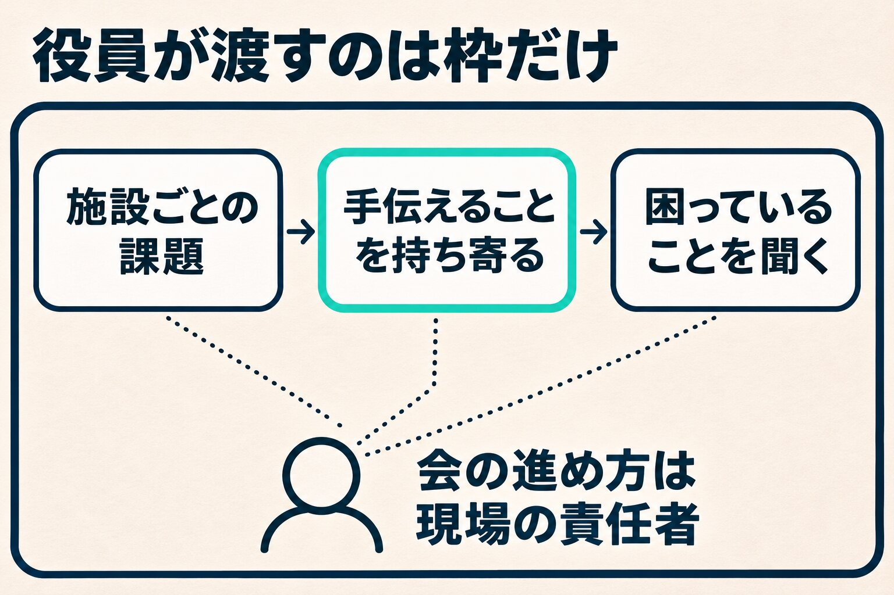

私たちの会社では、毎月、現場の責任者と売上や利益の話をする会議を開いています。前の記事「[現場に数字を見せても、動かなかった話](/blog/frontline-numbers-how-to-ask)」では、その会議で現場に渡す問いを立てるのは役員の仕事に戻した、と書きました。毎月の数字を見て、施設ごとに取り組んでほしいお題を役員の会議で決め、現場との会議で渡す形です。

その形に、現場をまとめている責任者の一人から返事が来ました。損益を見せてもらえるのは良い。ただ、役員の側でお題を考えて渡す形には少し疑問がある、という内容でした。反対ではない、とも添えてありました。次の会議の前に一度目線を合わせたい、ということだったので、2時間ほど時間を取って話を聞きました。

## 最初に目指していたもの

会では、今の形を短く説明してから、この会議を始めたときに何を目指していたのかを聞きました。

始まりは今年の春だったそうです。数字をまとめて部署ごとに振り分けてもらい、皆で集まったら、いろいろなアイデアが出て面白かった。社長・専務・常務が同じ場にいることも大きかった、と言います。この前の年末年始の催しを決める会議も、それに近い雰囲気だったそうです（その準備が始まったころの話は「[現場が「集まって決める」と言ったので、先に意見を返さなかった話](/blog/hold-back-until-asked/)」に書いています）。

目指していたのは、現場が自分たちで考えて言い出し、言い出したことを自分たちでやる形でした。失敗してもいい。うまくいけば達成感があって、次もやってみようになる。それを繰り返して、会社のことを自分ごとにしてほしい、という話でした。

## 疑問が出たのは、考えるのが役員の側になったところ

損益を見せること自体は、そこまで見せてもらえるのかという信頼にもなるので、自分なら嬉しいそうです。疑問が出たのは、考えるのが役員主導になったところでした。

もう一つ、気にしていたことがあります。施設ごとにお題を渡すと、施設を下から支えている部署には渡すお題がありません。会議に来ても話す番が無いまま終わり、自分はなぜここにいるのか、と感じてしまうのではないか、ということでした。

## 役員の側でお題を決めた理由

聞いているうちに、私がそうした理由も言葉になりました。

決算のときの手当を、少しでも厚くしたかったのです。決算まで残りは半年で、この会議もあと6回ほどしかありません。遠回りはできないと思い、数字から当たりを付けて、利益につながりそうなものをお題にして渡すのが一番確かだと考えました。

ただ、その見方だと、お客さんの満足やリピートを支えている部署に渡せるものが出てきません。皆が十分に頑張ってくれているので、光熱費をもっと下げてほしいとも言えませんでした。

頼み方も乱暴だったかもしれません。損益を出したので見て考えてきてください、ではなく、もう少し横について一緒に考えるべきでした。私が会議を進めると、皆の声が出にくくなるのかもしれない、とも感じていました。

## 目的を、その言い方では言っていなかった

話の途中で、こう聞かれました。常務の考えを、もっと前に出すのはまずいんですか。

まずくはありません。そこで出た案は、こういう伝え方でした。社員に払うものを増やしたい。そのために売上と利益を上げたい。だから数字を分析してお題を出すので、考えてほしい。うまくいけば、約束はできないけれど、還元できるように会社として努力する。

私は、それを伝えてきたつもりでいました。でも、その言い方では言っていなかったかもしれません。本音は、皆の報酬を上げたいということです。役員の報酬も、皆の分が増えてからでなければ上げられません。隠すつもりもありません。だから売上だけでなく利益も見てほしくて、損益を開きました。話しながら、あまり伝わっていなかったのだと思いました。

## お題は続けて、会議の進め方を任せた

話を聞き終えて、目指している所は同じだと思いました。違っていたのは、そこへ向かう道のりの一部です。むしろ、私に足りなかった所が見えました。

お題を役員の側から出すことは続けます。責任者からも、お題が出ること自体はそのままでいい、方向がころころ変わると付いていくほうが大変だ、と言われました。

変えるのは、会議の進め方です。次の会議の流れと進め方は、その責任者に任せました。責任者の案は、最初に施設ごとの課題を出し、支える側の部署には、その課題にホテルとして何を手伝えるかを考えて持ち寄ってもらう、というものです。最後には全部の部署に、困っていることはないかを聞く時間を取ります。

_役員が渡すのは枠だけにして、その中の進め方は現場の責任者に任せました。_

私が渡すのは、皆の努力の向きが外れないための枠だけです。数字から見て危なそうな所を、現場の人に分かりやすく簡単にした資料を用意し、言われたら出します。資料の見出しも、部署の「困りごと」と書くのはやめて、まだ取れるお客さまがいる、という向きの言い方にしました。数字を見せた直後に「困りごと」と書くと、責められているように聞こえやすいからです。

## 次の会議は、まだこれから

次の会議はまだこれからなので、この進め方でどんな話が出るかは分かりません。

前の記事では、問いを立てるのは役員の仕事だと書きました。そこは変えていません。変わったのは、問いを渡す場を誰が回すかです。本当は、数字を読むところから現場と一緒にやりたい、というのが私の理想です。今回はその手前で、会議の進め方を任せるところから始めます。
