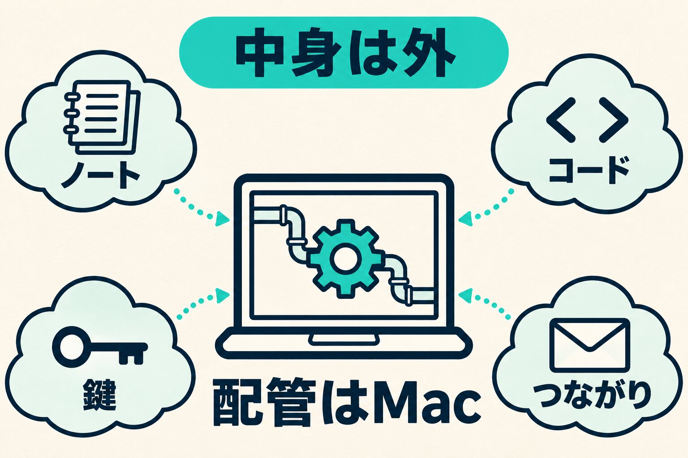

Macの買い替えや故障のことは、いつも頭のどこかにあります。実際に困ったことは、ほとんどありません。それでも、仕事の仕組みを1台のMacの上に積み上げていると、機械の寿命でそれが消えるかもしれない、という不安が残ります。

先日、そのMacのTime Machineが設定されていないことに気づきました。外付けのディスクを買って、まるごと控えることもできました。でも、取らないことにしました。

仕事の中身はMacの外に置き、Macは壊れても作り直せる形にしてあるからです。この記事では、何を外に置き、何をMacに残しているか。控えを取らない代わりに、何を確かめているかを書きます。

## 分け方は「中身は外、配管はMac」

今年の夏、買い替えの不安を口にしたのをきっかけに、Macを作り直すための手順のノートを作りました。分け方は「中身は外、配管はMac」です。

中身は、仕事に要るデータそのものです。

- 仕事のノートは、毎晩GitHubへ控え、同期サービスでも別に持っています。外に2つあります
- コードは、GitHubにあります
- メールやカレンダー、各サービスとのつながりは、それぞれのアカウントの側にあります
- サーバーに入る鍵と、プロジェクトごとの合言葉は、パスワード管理の1Passwordに移しました。Macの中に、合言葉を書いたファイルを置いていません

配管は、それらを使うためにMacの中にあるものです。アプリと各種の設定、毎朝・毎晩自動で動く処理の登録、ブラウザに残るログイン、画面を持たない処理が使う一部の鍵（控えは1Passwordにあります）。作業の入口にしているアプリ（[入口を1つにした話](/blog/back-to-orca-one-entrance-plus-voice)に書きました）も、こちらの側です。配管は消える前提で、入れ直す手順をノートに書いておきます。

_中身はMacの外に置き、Macに残るのは作り直せる配管だけにしています。_

ノートには決まりを1つ付けました。Macに何かを置いたり、設定したりしたら、その都度書き足す。あとでまとめて書こうとしない、です。

## Time Machineは未設定だった。外付けは買わない

確かめると、Time Machineは設定されていませんでした。内蔵のディスクは2TBで、そのうち1.3TBを使っています。まるごと控えるなら、4TBほどの外付けが要ります。

買わないことにしました。いちばんの理由は、中身がもう外にあることです。Macをまるごと控えても、そこでしか守れないものは多くありません。費用のことも、少しはあります。

壊れたら、ノートを見ながら作り直します。その間、仕事は止まります。それでよい、と決めました。

## 控えを取らない代わりに、確かめていること

まるごとの控えが無いので、頼りになるのはノートと、外にある中身です。大事なのは2つだと考えています。ノートを古くしないこと。外にあるつもりのものが、本当に外にあるかを確かめることです。

### ノートは、もう古くなっていた

Time Machineを確かめた日に、ノートも通して見直しました。古くなっていました。

毎朝・毎晩自動で動く処理は、ノートでは5本でしたが、実際は12本ありました。読み上げの声に使う鍵や、乗り換えたブラウザのことも抜けていました。その都度書き足す決まりがあっても、抜けは出ます。その場で足しました。

### 外に出ているはずのファイルが、1か月出ていなかった

仕事の環境は、月に1度点検しています。その点検で、画像入りの資料のファイル1本が、1か月のあいだ毎晩の控えから外れていたと分かりました。

控える前に、鍵やパスワードのような文字列が紛れていないかを調べる仕組みがあります。そのファイルに入っていた画像の断片が鍵に似ていて、毎晩外されていました。鍵ではなかったので、外さない一覧に足しました。

外にあるつもりでも、外れているものはあります。Macが壊れていたら、その1本は消えていました。

### コードも、出していないものは消える

手元のコードの置き場は39個あります。GitHubへ出していないものは、Macと一緒に消えます。買い替えの前には、出していないものが無いかを洗い出します。これもノートに書いてあります。

## 作り直す間は止まる。それでよいとした

まるごとの控えがあれば、新しいMacにそのまま戻せます。作り直すより早いはずです。私はそれを選ばず、止まる時間のほうを受け入れました。その代わり、ノートと外にある中身を確かめるほうに手間をかけています。

仕事を1台のMacでしている方は、一度Time Machineの設定を見てみてください。まるごと控えるか、中身を外に置いて作り直せる形にするか。私は後者にしました。
