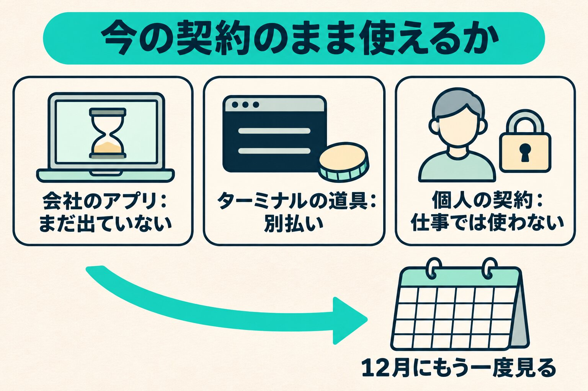

11月18日に、Googleが新しいAIのモデル「Gemini 4 Neon」を出しました。評判がいいと聞いて、私が仕事で使っている環境に取り入れるかを考えました。

最初にお断りしておくと、Neonはまだ触っていません。この記事は使ってみた感想ではなく、使う前に「今の契約のままで、どこから使えるか」を確かめて、今は入れないと決めた話です。モデルの出来を比べる記事でもありません。

## 条件は「会社の契約のままで使えるなら」

仕事のAIは、Orcaというデスクトップアプリのタブで、Claude CodeやCodexを動かす形で使っています。この形にした経緯は「[話題のAIボットを一通り触って、結局Orcaに戻った理由](/blog/back-to-orca-one-entrance-plus-voice)」に書きました。

会社では、Google Workspaceを使っています。スタッフ全員が仕事のアカウントでGeminiを使えるようにしている話は、「[社内ツールを現場が作る時代に、経営側が見ていること](/blog/in-house-tools-security)」で少し触れました。会社の契約の中のGeminiには、入力を学習に使わないという約束が付いています。個人の契約のAIには、この約束が付かないものがあります。それで、仕事の記録は個人の契約のAIには渡さないと、9月に決めていました。

それで、Neonの話を聞いたときの条件は「会社のWorkspaceの契約のままで使えるなら、取り入れたい」にしました。

じつは9月にも一度、GeminiをOrcaに入れるかを考えています。そのときは、会社のアカウントでGemini CLI（ターミナルで使う道具）を使うには、Workspaceとは別のライセンスとGoogle Cloudのプロジェクトが要ると分かりました。それで見送り、「Geminiでしかできないことが出たら考え直す」としていました。

## 入口を1つずつ見た

会社の契約は、WorkspaceのBusiness Standardです。Googleの発表と各ページの説明、会社のアカウントの画面で、Neonを使える入口を1つずつ確かめました。値段は11月19日に公式のページで見たものです。

| 入口                               | 今の契約のままで                 | Neon                                    | 追加のお金                                               |
| ---------------------------------- | -------------------------------- | --------------------------------------- | -------------------------------------------------------- |
| Geminiのアプリ（会社のアカウント） | 使える                           | まだ出ていない                          | なし                                                     |
| Gmailやドキュメントの中のGemini    | 使える                           | どのモデルかの表示なし                  | なし                                                     |
| Workspaceに足すAIの追加の枠        | 買えば足せる                     | 入るかどうか公式に書かれていない        | 公式に値段が出ていない                                   |
| Gemini CLI                         | 使えない（別のライセンスが要る） | 4以降には向いていないと公式に書いてある | 1人月19〜22.80ドル＋Google Cloud                         |
| Antigravity CLI                    | 契約には含まれない               | 使える                                  | 使った分だけ（100万トークンあたり入力3ドル・出力15ドル） |

会社のアカウントのGeminiのアプリでは、選べるモデルは「4 Hydrogen」「4 Hydrogen 思考モード」「3.1 Pro」の3つで、Neonはまだありませんでした（11月19日の夜の時点）。Googleの発表の文でも、使える場所の中にWorkspaceの名前は出てきません。

_会社の契約のままで使える入口は、今はありませんでした。_

## 9月から変わっていたこと

9月に見送った理由は、今も同じでした。そのうえで、2つ変わっていました。

1つは、Gemini CLIが新しいモデルの道具ではなくなっていたことです。6月に、無料や個人の契約の人はAntigravity CLIという別の道具へ移され、Gemini CLIの説明には「Gemini 4以降には向いていない」と書かれていました。

もう1つは、そのAntigravity CLIなら、会社のアカウントでも使えることです。自分でGoogle Cloudのプロジェクトを作って支払いを紐付ければ、使った分だけ払う形で使えます。ただ、「Workspaceの契約にはAntigravityの枠は含まれない」と公式に書かれていて、今の契約のままにはなりませんでした。

## 入れる案も並べて、1つ選んだ

確かめた結果から、案を3つ並べました。

| 案  | 中身                                                                                       |
| --- | ------------------------------------------------------------------------------------------ |
| A   | 今は入れず、会社のアプリの画面に出たら、アプリの中で試す                                   |
| B   | Antigravity CLIをOrcaに1つ入れ、別の目で見直す役に使う。1回の試しは100円もかからない見込み |
| C   | 入れない。見直す日も決めない                                                               |

Bは、お金の面では小さな話です。それでもAにしました。

理由の1つ目は、最初の条件に合わないことです。Bにすると、会社の契約の外に、もう1つ支払いの口ができます。

2つ目は、Geminiでしかできないことが、今の自分の仕事に見当たらなかったことです。Geminiには、動画をそのまま読ませられる強みがあります。ただ、仕事の記録には、動画をAIに読ませたかった場面が見当たりませんでした。別のAIに見直してもらう役も、もうCodexが受け持っています。

3つ目は、前の経験です。以前、話題になっていた別のAIを、Orcaのタブに1つ足したことがあります。きちんと動きましたが、任せる役を決めないまま足したので、試しの1回のあとは仕事で使う場面が無く、11月に契約をやめました。

## 12月にもう一度見る

会社のアプリの画面にNeonが出ていないかは、12月15日にもう一度見ます。出ていたら、まずはアプリの中で試します。Orcaの仕組みには入れません。

評判の中身は、Googleの発表と、それを伝えた記事で見たものです。同じ大きさのモデルより速くて安く、難しい作業ではいちばん大きいモデルと同じかそれ以上、という説明でした。実際に使った人の声は、今回は集めていません。

## 出来を比べる前に、3つで答えが出た

今回決め手になったのは、今の契約のまま使える入口があるか、入力の扱いがどうか、入れたら何の役を任せるか、の3つでした。

この3つで答えが出たので、モデルの出来を比べる前に決めることができました。Neonが会社の画面に出たら、そのときに自分の仕事で試してみます。
