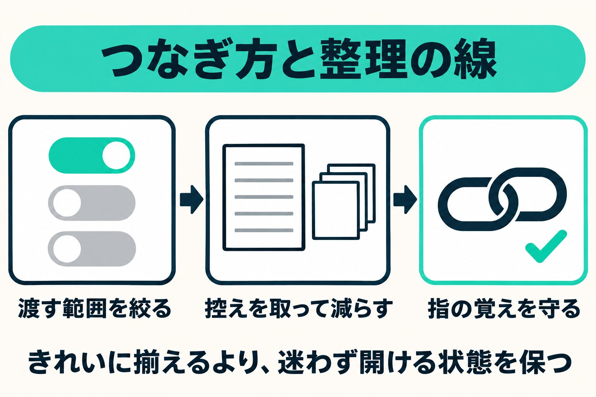

Macでよく開く管理画面や作業ページは、ランチャーアプリのRaycastに登録して呼び出しています。ただ、気づけばクイックリンクが182件まで増え、使わなくなった古いリンクも混ざっていました。

11月18日に出たRaycast 2.13で、AIツールからRaycastの機能を操作できる「Raycast MCP Server」が加わりました。翌19日にClaude Codeへつなぎ、増えすぎたクイックリンクを整理しました。

この記事では、つなぐ前にどこで安全の線を引いたか、182件をどう仕分けて減らしたか、そして「あえて変えなかったこと」をまとめます。

## つなぐ前に決めたこと：渡すのはクイックリンクだけ

Raycastの設定画面でMCP Serverのスイッチを入れると、外部のAIに渡す機能（Shared Extensions）を機能ごとに選べます。今回オンにしたのは「Quicklinks」の1つだけです。クリップボード履歴、ブラウザ連携、Raycastの設定、スニペット、メモ、自動化機能はすべて切りました。

いちばん気をつけたのはクリップボード履歴です。パスワードやAPIの鍵は1Passwordで管理していますが、コピーした直後の履歴には合言葉が一時的に残ることがあります。履歴をAIに渡すと、そのまま読める道ができてしまいます。Macまわりの鍵の置き方については「[Macまるごとの控えは取らないことにした](/blog/mac-rebuild-not-backup)」でも触れています。

つなぎ方でも1点だけ線を引き、設定内容をクリップボードへ写すメニュー（Copy Configuration）は使いませんでした。そこに接続用のトークンが写るためです。代わりに公式の「Connect App」からClaude Codeを選んで自動登録しました。通信先は自分のMacの中だけで完結し、外部のサーバーへは出ません。

なお、つなぐ前から開いていた作業画面には新しい機能が読み込まれませんでした。つないだ後に新しく立ち上げると、一覧の取得・作成・更新・削除の道具がすぐ使える状態になりました。

## いきなり消さず、先に控えを取って中身を調べた

クイックリンクを削除する道具には「元に戻す」機能がありません。そこで、手をつける前にまず182件の控えをJSONファイルで手元に保存しました。名前とURLの形にしておけば、万一消しすぎてもRaycastのインポート機能で戻せます。

一覧を読み取ると、名前やURLに加えて「開いた回数」と「作った日」も取れました。古い項目の多くは2024年6月にアプリ内部で作り直されており、開いた回数が0回のものは少なくともそこから一度も開いていないと分かりました。

ただし、182件すべてを同じ扱いにはしていません。名前に秘密を示す語が付いた5件は、控えにも一覧にも中身を書かず、整理の対象から丸ごと外しました。支払いの管理画面へ飛ぶ期限つきの鍵付きURL3件も、リンク切れの確認のために自動アクセスすることはせず、控えでも中身を伏せています。

そのほかの一般的なサイトや自社ページについては、リンクが開くかだけを機械的に確かめました。相手の証明書の確認でつまずいた1件は、確認を緩めて回り道するのではなく「あとでブラウザで見る」として触らずに残しました。

## 182件から156件へ。消したのは「確かな26件」だけ

一覧をもとに、整理の方針を3つ並べました。

1. 確かな分だけ減らす
2. 減らしたうえで、全件に区分のタグを付ける
3. 減らしたうえで、名前の頭を揃え、つづりの間違いも直す

選んだのは1つ目の「減らすだけ」です。消したのは次の26件で、クイックリンクは182件から156件になりました。

| 消した理由                  | 件数 | 中身                                                               |
| --------------------------- | ---- | ------------------------------------------------------------------ |
| 1年以上、一度も開いていない | 23件 | 古い学習メモや使わなくなったツールなど（領収書まわりの項目は除外） |
| 開けない                    | 1件  | すでにMacから消したアプリを開くリンク                              |
| 別の項目と同じ先            | 2件  | 別の名前で同じURLを指していた重複                                  |

名前を直したのは4件だけです。先頭に余分な空白が入っていたもの、途中に空白が2つ続いていたもの、中身が空の括弧が残っていたもの、そして「X」の名前を「X twitter」に直した1件です。重複していた古い「twitter」の項目を消しても、今までどおり `twitter` と打てばXが開くようにしました。

削除と変更を終えたあと一覧を読み直すと、選んだ分だけが変わっており、意図しない変更は0件でした。

_安全の線と、変えない線を先に決めてから整理しました。_

## あえてやらなかった3つのこと

一覧を前にすると、つい一気にきれいに整えたくなります。今回は、次の3つをやらないと決めました。

### 1. 「2回以下しか開いていない20件」は消さなかった

回数だけ見れば候補に入った20件を、削除から外しました。中身を確認すると、会社の管理画面や年度の売上の表など、年に1〜2回しか開かないが必要なリンクが混ざっていたためです。領収書まわりの項目も、開いた回数が0回でも消さない基準にしました。

### 2. タグは1つも付けなかった

182件の中で、これまで使っていたタグは0個でした。普段使っていない仕組みを整理の勢いで全件に付けても、検索でどう効くか分かりません。必要になってから足しても間に合います。

### 3. 名前の頭を揃えず、つづりの間違いも直さなかった

よく使う上位のリンクは100回以上開いており、打つ言葉としてすでに指が覚えています。たとえば、つづりが少し違う名前のまま普段呼び出している項目を正しく直してしまうと、翌日いつもの癖で打ったときに出てこなくなります。一覧の見た目を揃えることより、考えずに開ける状態を優先しました。

## 整理のあとも「クイックリンクだけ」つないだままにした

整理が終わったあと、接続を切るか残すかも考えました。設定のスイッチを切ったり登録を外したりすれば、次に使いたいときに毎回設定を入れ直し、作業画面を立て直す手間がかかります。

渡しているのはクイックリンクだけで、クリップボード履歴やアプリの設定は切ってあります。通信も自分のMacの中だけです。操作するたびに確認を挟む形を保ったまま、つないだままにすることにしました。

これで、新しいページを登録したいときやリンク先が変わったときも、設定画面を開かずに作業の流れのまま直せます。日々の小さな操作の手間を減らす工夫としては、先日まとめた「[音声入力の「話す・送る・取り消す」を、トラックパッドの3本指に移した](/blog/voice-input-three-finger-trackpad)」と同じ方向です。

## 新しい道具をつなぐときほど、最初に「渡さない範囲」を決める

新しい連携機能が出ると、まずは全部オンにして試したくなります。ただ、ランチャーアプリのように日々の作業がすべて通る道具は、便利な反面、合言葉や鍵に近い情報も通りやすい場所です。

今回は最初に「渡さない範囲」を決めてクイックリンクだけに絞ったことで、整理が終わったあとも切らずに使い続ける判断ができました。整理の中身も、一気に完璧を目指さず「確実に使わないものだけ消す」「指が覚えている名前は変えない」と線を引いたほうが、翌日の仕事が止まりません。
