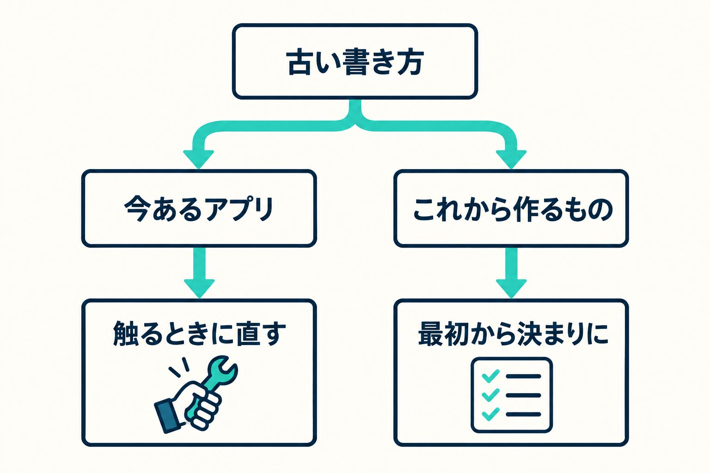

社内で毎日使っている業務アプリを、AIのコーディング支援（Claude Codeなど）を使って作っています。そのうち5本がReactです。

10月、「AIはReactを古い書き方で書きがち」という話を聞きました。自分のアプリでも本当にそうなのかを、実際に数えてみました。この記事では、古い書き方の一覧、数えた結果、そして数えたあとにどう直すと決めたかを書きます。

## 「AIはReactを古い書き方で書く」という話

きっかけは、Reactの作業部会の掲示板に立った「Modern React Guidance」という議論です（2026年5月、Reactを使う側からの要望）。

中身はこうです。AIのコーディング支援は、いまやReactのコードの主な書き手になっている。ところが学習したデータの影響で、古い書き方にかたよる。Chromeのチームは、AIに読ませるためのWeb向けの手引きを出した。Reactのチームからも同じものが欲しい。

挙がっていた例は、データの取得を useState と useEffect で手書きする、useMemo や useCallback をどこにでも付ける、新しいコードで forwardRef を使う、といったものです。Reactのチームからの返事は、まだ付いていません。

Reactの公式サイトには、以前から「You Might Not Need an Effect（そのエフェクトは要らないかもしれない）」というページがあります。議論の例の多くは、このページで「やらなくていい」とされている書き方です。

## 古い書き方の一覧（12項目）

議論の例と公式のページをもとに、古い書き方を12項目に整理しました。Reactの版や組み合わせる枠組みによって当てはまるものが違うので、4つに分けています。

| #   | 古い書き方                                                         | 代わりに                                              | 当てはまる範囲              |
| --- | ------------------------------------------------------------------ | ----------------------------------------------------- | --------------------------- |
| 1   | ほかの値から計算できる値を、useEffect で state に写す              | 描画の中でそのまま計算する                            | どの版でも                  |
| 2   | ボタンを押したなどの反応を、フラグと useEffect で起こす            | イベントの処理の中に書く                              | どの版でも                  |
| 3   | props が変わったときに state を戻すために useEffect を使う         | key を変えて作り直す                                  | どの版でも                  |
| 4   | ブラウザの状態などの購読を useEffect で手書きする                  | useSyncExternalStore                                  | どの版でも                  |
| 5   | useEffect で取得して useState に入れる、データ取得の手書き         | 枠組みの取得の仕組み。React 19 なら use() と Suspense | どの版でも                  |
| 6   | 効果を説明できない useMemo・useCallback・React.memo を念のため足す | 足さない。足すなら理由を残す                          | どの版でも                  |
| 7   | 新しいコードの forwardRef                                          | ref を普通の props として受ける                       | React 19 以上               |
| 8   | 新しいコードの Context.Provider                                    | Context をそのまま使う                                | React 19 以上               |
| 9   | 関数コンポーネントの defaultProps・propTypes                       | 引数の既定値と TypeScript の型                        | React 19 以上               |
| 10  | フォームの送信中・エラーの状態を手で持つ                           | useActionState・useFormStatus・useOptimistic          | React 19 以上               |
| 11  | 理由なく最初から "use client" を付ける                             | サーバーコンポーネントを既定にする                    | Next.js の App Router       |
| 12  | 念のための useMemo・useCallback（6より強く）                       | 書かない。コンパイラに任せる                          | React Compiler が有効なとき |

5本の中には React 18 のものと 19 のもの、Next.js のものと画面だけのものが混ざっています。なので一覧はそのまま全部を渡すのではなく、アプリごとに当てはまる範囲だけを使います。React Compiler はどのアプリでも有効にしていないので、12は今は使わず、6の「足すなら理由を残す」までにしました。

## 5本で数えた結果

一覧を決まりに入れたうえで、今あるコードにどれだけ当たるかを数えました。

- データ取得の手書き（5）：1か所だけ
- フォームの送信中・エラーの状態を手で持つ書き方（10）：3本で十数か所
- 念のためのメモ化（6）：2本で1か所ずつ
- そのほか（2〜4、8、11）：1〜2か所ずつ

いちばんよく言われるデータ取得の手書きは、1か所しかありませんでした。多かったのは、フォームの「送信中です」「エラーが出ました」の状態を、自分で用意した state で持っている書き方です。5本のうち2本は、当たったのが念のためのメモ化1か所だけでした。

## 直すと、画面の動きが変わる

数えたあと、すぐに全部を新しい書き方に直すかを考えました。ここで引っかかったのが、いちばん多かったフォームです。

フォームの送信中を useActionState などに置き換えると、書き方が変わるだけでは済みません。送信が終わったあとに入力欄が空に戻ったり、送信に失敗したときに書いていた内容が消えたりと、使う人から見た動きが変わる所がありました。

予約を扱うアプリのフォームには、速さのために、あえて今の持ち方にしている所もあります。古い書き方に見えても、理由があってそうしている所は、一覧だけで機械的に直すと困ります。

一方で、念のためのメモ化や Context.Provider の書き方のように、直しても動きが変わらないものもあります。同じ「古い書き方」でも、直したときに画面がどう変わるかで重さが違いました。

## 決めたこと：一斉に直さず、触るときに直す

毎日使っているアプリを、まとめて書き換える理由にはならない。そう判断して、決めたのは2つだけです。

1. **今あるアプリは、その画面を触るときに直す。**ほかの用事でその画面に手を入れるときに、当たっている所だけを新しい書き方にして、動きを確かめる
2. **これから作るものは、最初から一覧を決まりに入れておく。**アプリの決まりを書いたファイルに、当てはまる範囲の項目を写してから作り始める

あとから数えて直すと、動きが変わる所が出ます。最初から決まりに入っていれば、そもそも古い書き方で書かれにくく、確認のときにも一覧と照らし合わせるだけで済みます。

## 一覧を使うときに気をつけていること

- **版と枠組みを先に確かめる。**React 18 のアプリに React 19 の書き方を求めても使えません。一覧は「当てはまる範囲」の列で絞ってから渡します
- **数えるのと直すのを分ける。**まずは数えて報告してもらい、直すかどうかは結果を見てから決めます。今回も数えるところまでで一度止めました
- **理由のある書き方は残す。**古く見えても、速さや入力の保ち方のためにわざとそうしている所は、その理由を決まりの側に書いておきます

AIのコーディング支援を使っていると、書かれたコードがいつの時代の書き方なのかは、見ただけでは分かりにくいものです。一覧があると、確認するときの目印になります。

Astroでサイトを作り直したときの話は[WordPressからAstroへ移した理由](/blog/wordpress-to-astro/)に、社内のツールを現場が作るときに見ていることは[社内ツールを現場が作る時代に、経営側が見ていること](/blog/in-house-tools-security/)に書いています。

（参考）

- Modern React Guidance（reactwg/async-react の議論 #12）https://github.com/reactwg/async-react/discussions/12
- You Might Not Need an Effect（React 公式）https://react.dev/learn/you-might-not-need-an-effect
