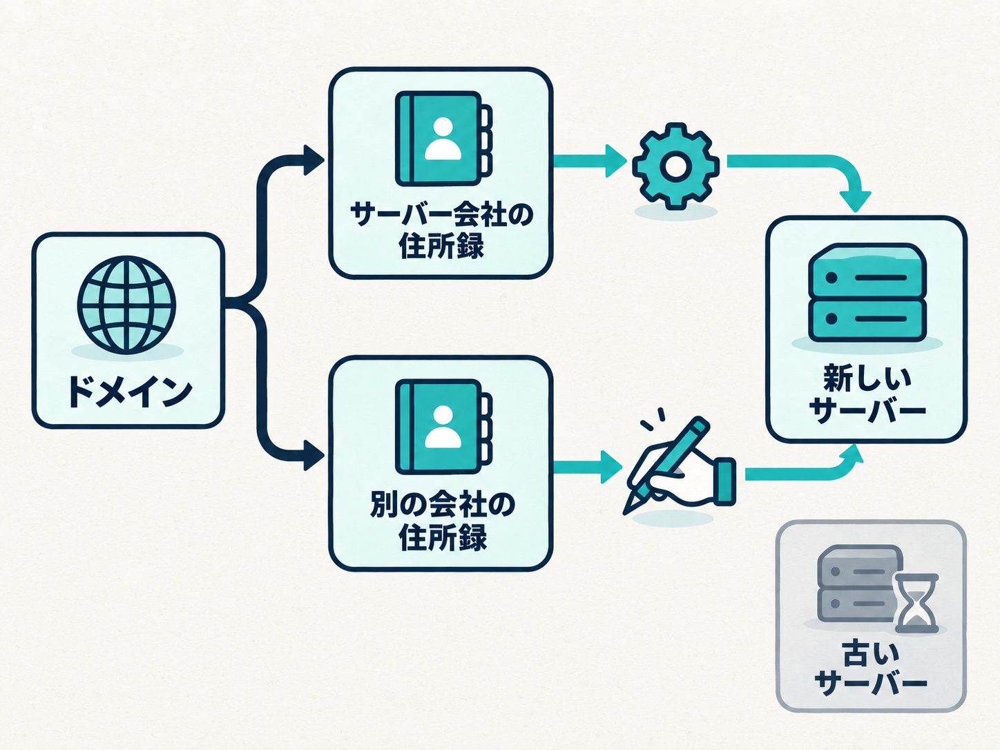

レンタルサーバーの会社から「サーバーの入れ替え（移行）を行います」という案内が届くことがあります。多くの場合、サイトの持ち主が何かをする必要はありません。ただ、案内の中に一文、読み飛ばせないものが混じっていることがあります。

今年の夏、保守で預かっているサイトが載っているサーバーで、Webサーバーの入れ替えがありました。メールサーバー、データベースサーバーに続いて、ひと夏で3回目の入れ替えです（データベースサーバーのときの話は[こちらの記事](/blog/wordpress-database-connection-error)に書いています）。この記事では、そのとき何を見て、何を聞いたかを書きます。

## 案内に混じっていた一文

案内に書かれていた内容は、おおむね次のとおりでした。

- 変わるもの：Webサーバーの名前、FTPの接続先、サーバーのIPアドレス
- 変わらないもの：メールの設定。サイトの表示が止まることもない

ここまでなら「何もしなくてよい」と読めます。気になったのは、その下の注意書きでした。

「外部のDNSをご利用の場合は、IPアドレスが変わるため修正が必要です」

DNSは、ドメインとサーバーの住所（IPアドレス）を結びつける住所録のようなものです。この住所録を、サーバー会社の中に置いているか、別の会社に置いているか（ネームサーバーがどこにあるか）で、入れ替えのあとに起きることが変わります。

- サーバー会社の住所録を使っている → サーバー会社が新しい住所に書き換えてくれる
- 別の会社の住所録を使っている → 誰も書き換えない。古い住所が動かなくなった時点で、サイトが見えなくなる

## まず、全部のドメインの住所録の場所を調べた

案内が届いた翌日、そのサーバーに載っている全部のドメインについて、ネームサーバーの場所と、いま登録されている住所を一つずつ調べました。

結果、ほとんどのドメインはサーバー会社の住所録を使っていて、別の会社の住所録を使っていたのはひとつだけでした。自分の手で直す必要があるのは、そのひとつです。

ただ、サーバー会社の住所録を使っている分も、安心しきれませんでした。中身を見ると、住所が直接書き込まれていて、入れ替えに合わせて自動でついていく形にはなっていなかったからです。数日前のメールサーバーの入れ替えでは、サーバー会社が住所を書き換えてくれていました。それでも、今回も同じように動く保証にはなりません。

_住所録をどこに置いているかで、入れ替えのあとに誰が直すかが変わります。_

## サーバー会社に3つ聞いた

そこで、サーバー会社に3つ問い合わせました。

1. 切り替えは何時ごろか
2. 古いサーバー（古い住所）は、入れ替えのあといつまで動くか
3. サーバー会社の住所録を使っているドメインは、そちらで書き換えてもらえるのか

返ってきた答えは、1は「個別の時刻はお答えできません」。2は「移行のあとも1週間前後は使えます」。3は「お客様側での変更は不要です。そのままお待ちください」でした。

聞いてよかったのは2と3です。3で、自動で直る分は触らずに待てばよいと分かりました。2で、別の会社の住所録にある1件も、当日すぐに書き換えなくてもサイトは落ちないと分かりました。時刻が分からなくても、古いサーバーが1週間動いているなら、当日ずっと画面に張り付く必要はありません。住所録の切り替えを速くするための事前の設定変更も、これで要らなくなりました。

## 書き換えは、手順書にして渡した

自分で直す必要があったドメインは、サイトの持ち主の側で書き換えることになりました。こちらからは、当日の書き換えを誰がやるか、切り替えの確認をこちらでやるか、という選択肢を出し、持ち主の側が自分たちで書き換える形を選んだためです。こちらの仕事は、事前の調査と手順書を用意するところまでです。

手順書では、3つのことに気をつけました。

一つ目は、実際の画面と突き合わせることです。こちらで見られる画面は自分で撮り、先方の住所録の画面は担当の方に撮ってもらって、項目の名前や並びを手順書と照らし合わせました。

二つ目は、入力する値を一つに決めることです。最初は「サーバー会社の画面に出ている値と違ったら、画面の方を優先してください」と書いていました。ところが見直すと、その画面が入れ替えのあとにきちんと更新される確証がありません。古いままの値を写してしまうと、その場では何も起きず、1週間ほどして古いサーバーが止まったときに突然サイトが見えなくなります。いちばん気づきにくい壊れ方です。そこで、入力する値は新しい住所で確定させ、画面の表示は答え合わせに回しました。食い違っていたら、作業を止めて連絡してもらう形です。

三つ目は、相手に合った言葉で書くことです。担当の方は、どこを書き換えればよいかを自分から言える人でした。たとえ話や「慌てなくて大丈夫です」のような言い回しは、かえって失礼になります。必要な手順と値だけを、同業の言葉で書きました。

## 当日と、そのあと

入れ替えのあと、全部のドメインの住所をもう一度調べました。サーバー会社の住所録を使っている分は、すべて新しい住所に変わっていました。先方の書き換えも手順書どおりに済み、書き換えてから数分で新しい住所が返ってくるようになりました。サイトは正常に表示され、証明書の警告も出ていません。

結果は、確かめた内容と一緒に先方へ報告しました。そのとき、もう一つ伝えたことがあります。先方は、住所録を置いていた別の会社のアカウントを「もう使うことはなさそう」と考えていました。けれど、ドメインの住所録は今もそこにあります。使っていないつもりのアカウントでも、パスワードの管理などは続ける必要があります。

## 入れ替えの案内が来たら確かめること

最後に、同じような案内を受け取ったときに確かめることをまとめます。

- 案内に「外部DNS」「ネームサーバー」「IPアドレスの変更」とあれば、自分のドメインの住所録がどこにあるかを確かめる
- サーバー会社の住所録を使っていても、書き換えてもらえるのかを聞いておく
- 切り替えの時刻より、「古いサーバーがいつまで動くか」を聞く。これが分かれば、当日の動き方を落ち着いて決められる
- 書き換えを人に頼むときは、入力する値を一つに決めて渡す。「画面を見て判断して」は、画面が古いときに間違える
- 入れ替えのあと、実際に新しい住所になっているかを確かめる

サイトの持ち主にとって、サーバーの入れ替えは突然届くお知らせです。読んで分からなければ、サーバー会社に聞くか、詳しい人に見てもらうのが確実です。
