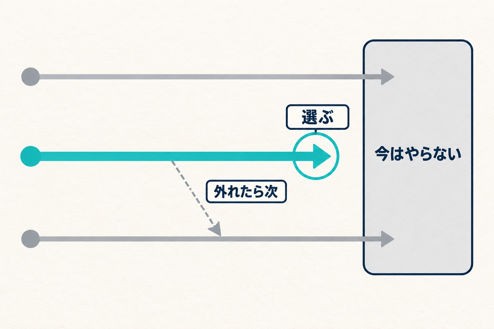

私たちの会社（HAMAYOUリゾート）は、山梨県の西湖でホテル、日帰り温泉、キャンプ場を営んでいます。私は常務をしています。

『イシューからはじめよ』（安宅和人）は、だいぶ前に買って一度読んだ本です。エンジニアにとって「イシュー」は、ふだん課題の管理で使っている馴染みのある言葉なので、手に取りやすかったのを覚えています。

最近、もう一度読み直しました。この記事は本の紹介ではありません。読み直して、自分の仕事に当てはめて、何が変わったかの話です。

## 前に読んだときと、何が違ったのか

前に読んだときも、「イシューから始めることが大事なんだな」と納得はしていました。ただ、頭の隅に残っていたくらいです。

今回は受け取り方がまるで違いました。いちばん大きいのは、会社への関わり方が深くなったことだと思います。

リゾートの経営は、考えることがたくさんあります。お金のこと、人のこと、施設のこと。関われば関わるほど考える機会が増え、そのぶん悩みも増えて、「どれから手をつけようか」が積み上がっていきます。

全部はやっていられません。だから私は「やらないことを決める」という言い方をしています。ところが、その決め方が自分の中でずっと曖昧でした。何をやるかを、何を基準に選ぶのか。そこを筋道立てて学べたのが、今回いちばんの収穫です。

もう一つ違ったのは、当てはめる先です。前に読んだときは、プログラムを一本作るといった、目の前の一つの作業に当てていました。今は、会社としての大きな目的に向かう中で起きていることや、自分が手を動かすのではなく、人に手を動かしてもらうときの舵取りに当てはめて読んでいます。同じ本なのに、学びが全然違いました。

## 仕事で使えるように、6つの段にまとめた

読み直したあと、会社の仕事でそのまま回せるように、手順を6つの段にまとめました。土台は本の前半（イシューを見極めるところと、答えの出し方を組み立てるところ）です。

1. 現場の様子と数字を、同じ紙に並べる
2. 「困っている」「少ない」という訴えを、そのまま問いにしない。「どこで」「何が」を入れて、「〜ではないか」という文に置き直す
3. 置き直した候補を、答えが出たら先の方向が大きく変わるか、仮説に深さがあるか、手元で答えを出せるか、の3つで見る
4. 1つに絞る
5. 問いが大きすぎるときだけ、答えを出せる大きさに分ける
6. 何と何を比べれば答えが出るかを決め、数字を見る前に「どうなっていたら当たりか」の線を引く

本に無くて、自分で足したところが2つあります。4で、外れたときに次にどの候補へ進むかを先に書いておくこと。6で、線を数字として先に引いておくこと。線を先に引かないと、出てきた数字を都合よく読んでしまうからです。逆に、本の後半（結果の見せ方や伝え方）は、今回の使い方では飛ばしています。

会社の話だけでなく、身近なことでも何度か回して、手に馴染ませました。

## いちばん効いたのは「1つ選ぶ」の基準

6つのうち、今の自分にいちばん効いたのは4の「1つに絞る」です。

候補が並ぶと、つい「どれがいちばん筋が通っているか」で選びたくなります。本を読み直して持った基準は、「答えが出たら、いちばん多くのことが決まるのはどれか」です。

筋の通った仮説は、いくつでも作れます。けれど、そのうち答えが出たときに先の打ち手が大きく変わるものは、そう多くありません。そこを選べば、残りは「今はやらない」と決めて置いておけます。私がずっと曖昧にしていた「やらないことの決め方」は、ここでした。

_筋の良さではなく、答えが出たときに決まることの多さで1本を選びます。_

ただ、選ぶ前の2の置き直しがうまくいっていないと、選ぶ候補そのものがずれます。だから2は、現場や数字に実際に触れた人の目で書くようにしています。

## 当てはめた1：調理場の食材ロス

最初に当てはめたのは、ホテルの調理場の食材ロスです。以前、[2年分の廃棄の記録を並べて見えたこと](/blog/ryokan-food-loss-reduction)を書きました。月の数字を決めているのは、たまに出る大きな1件だ、という話です。

そこから先、何に手をつけるかで迷っていました。気づきはいくつもあります。どれも、もっともらしく見えます。

そこで手順どおり、候補を3つの「〜ではないか」に置き直しました。その中から選んだのは「ロスの大半は、発注の段階で決まっているのではないか。日々の調理の無駄ではないのではないか」です。これが当たれば、調理場と話す議題は「発注の量をどう決めるか」の1つに絞れます。外れたら、次に見る候補も決めてあります。

どのくらいの割合なら当たりとみなすかは、記録を集計する前に決めました。答え合わせは、これから調理場の話を聞く場でします。

## 当てはめた2：現場に「案を出してもらう」形を作り直す

もう一つは、施設ごとの数字を現場に見せる仕組みです。[部門ごとの損益を現場と見る話](/blog/hotel-department-pl)で書いたものです。

これまでは、施設ごとの数字を現場の責任者に渡して、「ここから打つ手を考えてください」と頼む形でした。読み直してから、この順番が逆だったと気づきました。

数字だけを渡されても、どこから手をつけるべきかは見えません。「何に取り組むか」を選ぶのは、全体の数字を見ている役員側の仕事です。役員が道筋を立てて、価値のあるテーマを先に示す。そのテーマに対して、現場で何をやるかを考えてもらう。現場に頼むのは、現場にしか見えないこと（どこで何が起きているか、これまで何を試したか）と、その手です。

この仕組みは、継ぎ足しではなく根っこから作り直すことにしました。読み直して、真っ先にやらないといけないと思ったのがここです。どのテーマを選ぶかで、結果の出方はかなり変わります。価値のあるところを見極めずに走ると、会社としての損が大きい。そういう感覚があります。

## 本は、読むときの自分で変わる

本は面白いと思いました。同じ本でも、読むときの自分の状況で、学びがまったく違います。一回読んで終わりにするのは、もったいない。今回それを痛感しました。

これまでたくさん本を読んできましたが、気になっていた本を、また読み直す機会を作ろうと思っています。
