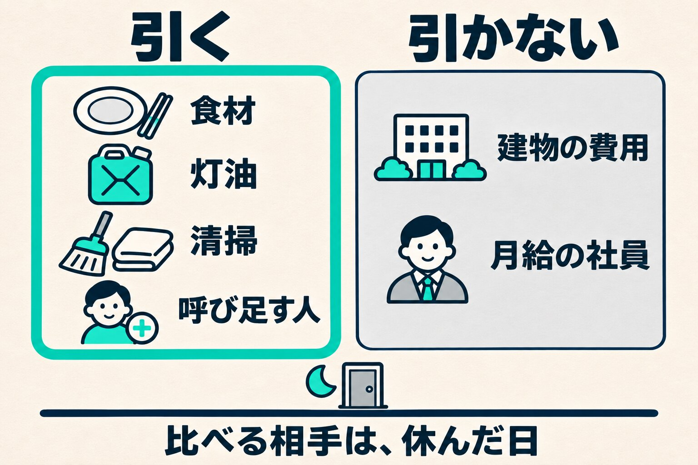

私たちの会社（HAMAYOUリゾート）は、山梨県の西湖でホテル・日帰り温泉・キャンプ場を営んでいます。冬は閑散期で、ホテルに宿泊のお客さまが一組もいない日があります。社内では、そういう日を「ノーゲストの日」と呼んでいます。

そのノーゲストの日に、大学生の団体から合宿の問い合わせが来ることがあります。人数は15〜20人ほどです。この記事では、その問い合わせを何人から受けるかを、役員会議で決めるまでのことを書きます。

## 少ない人数なら、休みにした方がいいと思ってきた

社内には、少ない人数なら、ホテルを開けずに休みにした方がいい、という空気がありました。私自身も、そう思ってきました。

そのため、ノーゲストの日に入る小さな団体には、日程を変えてもらえないかお願いしたり、お断りしたりしてきました。最近も、20人ほどの団体から電話をいただいたのに、ノーゲストの日なので日程を変えてもらう、という流れになったことがありました。

問い合わせは、ブログやホームページ、営業、宿泊プランから来ています。種をまいて芽が出ているのに、自分たちで抜いているように感じました。そこで、本当に休む方が得なのかを、数字で白黒つけることにしました。

## 比べる相手は「休んだ日」

最初に決めたのは、何と比べるかでした。

開けるか休むかを決めるのですから、比べる相手は「休んだ日」です。休んだ日を0として、開けた日にどれだけ残るかを見ます。

そのため、引くのは開けることで増える費用だけにしました。

- 食材と、旅行会社を通したときの手数料
- シーツなどのリネンと、アメニティ
- 光熱と、館内を暖める灯油の増える分
- 客室の清掃
- その日のために呼び足す人の人件費

_開けても休んでも変わらないものは、比べる式に入れていません。_

建物にかかる費用のように、開けても休んでも同じだけ出ていくものは引いていません。それまで含めて1日分を埋めようとすると、小さな団体の話にはならない人数が要ります。それを線にすると、ノーゲストの日はいつまでも休む方がいい、という答えになってしまいます。

月給の社員の給料も、足していません。社員はノーゲストの日も通しで出ているので、団体を受けても費用は増えないからです。

## 線を分けるのは「誰が増えるか」だった

計算してみると、線はほとんど1つのことで決まりました。その日のために、人を呼び足すかどうかです。

いつもの人で回せるなら、数人からでも休んだ日より残ります。反対に、休みの人を何人も呼び足すと考えると、線は20人前後まで上がります。

事前に現場の責任者へ、開けるときに何人要るかを聞いていました。答えは、呼び足す人は特にいない、持ち場ごとに合わせて8〜9人ほど、というものでした。いつもの人の中で足りるという意味にも、その人数を呼ぶという意味にも読めます。そこは役員会議の場で確かめることにしました。

計算には、もう一つ入っていないものがありました。休みの取りやすさのように、数字に出ない現場の負担です。それも、現場の責任者の話を先に聞いてから線を決めるつもりで、役員会議に持っていきました。

## 役員会議で、線が20人から10人に下がった

役員会議では、私から次の線を出しました。20人以上なら、日程の変更をお願いせずに受ける。それより少ない人数は、現場の責任者が判断する。人を一番多く呼び足すと見ても、20人なら休んだ日とほぼ同じか、それより残るからです。

すると社長から、20人を線にするなら、その下を判断に任せるのはなぜか、と聞かれました。

それを受けて、現場の責任者がこれまでのやり方を話してくれました。1か月前にシフトを組むとき、ノーゲストになる弱い土日は、どんどん休みにしてきた。何人ならプラスになるのかが、分からなかったからです。

そこで、誰が増えるのかを、その場で働き方ごとに確かめました。時間で来てもらう人は、その日のお客さまの数に合わせて入ってもらっています。団体を受ければ、この人たちが増えます。一方で、時給でも朝から通しで、休みの日数が決まっている人は、ノーゲストの日も出ています。この人たちは、団体を受けても増える人に数えなくていい。そう数え直すと、10人から休んだ日よりプラスになる、というところに落ち着きました。

その結果、ノーゲストの日の大学生の団体は、次の線で受けることに決まりました。

- 20人以上は、すぐ受ける
- 10〜19人は、基本受ける。現場の責任者が事情で休ませたい日は、断ってよい

大きな団体を優先する方針は変えていません。この線は、お客さまのいない日に限った話です。

## 線を下げたのは、計算の式ではなく現場の働き方だった

試算の式は、私の側で作れました。けれど、誰が増えるのかは、現場の働き方を知らないと決められませんでした。私は重い側に読んでいたので、線が高めに出ていたのです。灯油も同じで、配管のためにボイラーは止めないと現場から聞いて、丸1日分は増えないと分かりました。

数字のことを現場に頼むときに、つまずいたこともあります（[現場に数字を見せても、動かなかった話](/blog/frontline-numbers-how-to-ask/)）。今回は、問いと計算をこちらで用意して、現場には開ける日に何が増えるかだけを聞きました。施設ごとの損益を、現場で動かせない費用を外して見せているのと、置き方は同じです（[施設ごとの損益を現場の責任者に見せ始めた話](/blog/hotel-department-pl/)）。どちらも、その判断で動く費用だけを見ています。

## 結果は、冬が終わってから

この線を言葉にして社内で共有することが、最初からのゴールでした。

12月のシフトは、11月の中旬までに固めたいと現場から聞いていました。線は、その前の役員会議で決められました。冬のあいだにどれだけ受けられたかは、冬が終わってみないと分かりません。
