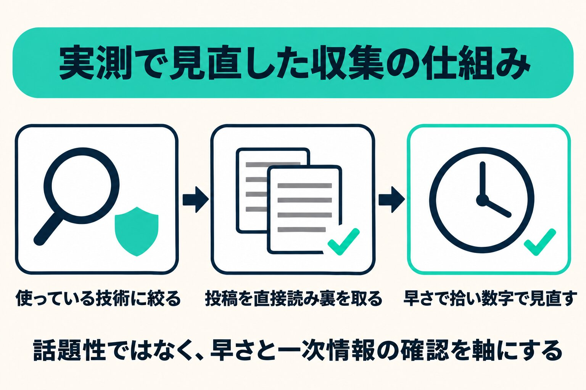

Webサイトや社内アプリをいくつも抱えて運用していると、フレームワークの大きな更新やセキュリティ情報の見落としがそのまま実害につながります。普段は開発者向けの技術解説のまとめを追っていますが、そこに取り上げられるのを待っていると、公式発表から5〜9日遅れることがありました。

そこで10月下旬に、自分たちが使っている技術の公式情報と脆弱性、それにXの話題を毎朝自動で集める仕組みを作りました。ただ、作って終わりにせず、1週間ごとに数字で点検してやり方を入れ替えました。

この記事では、監視する範囲をどう絞ったか、1週目と2週目の実測で何がどう変わったか、そして「反応の大きさで判断が変わった件数は0件だった」という意外な結果をまとめます。

## まず「使っている技術だけ」に絞り、実際の構成から一覧を作った

情報を広く集めすぎると、毎朝読む量が増えて続かなくなります。最初に決めたのは、いま実際に運用している技術だけに絞ることです。

- **公式の更新情報（10か所）**：開発ツール、Astro、Next.js、Vercel、Supabase、GitHubなど、日々の制作と保守で触る先だけ
- **公式のセキュリティ・脆弱性情報（12か所）**：JVN、JPCERT/CC、PHP、WordPress、Node.js、GitHub Advisory、Apple、利用しているレンタルサーバー各社など
- **Xの話題（10語）**：使っている技術や開発ツールに関する過去24時間の投稿

監視先の窓口は、実際に開いて中身を確かめてから選びました。たとえばセキュリティ情報では、別の窓口とまったく同じ件しか出ない先や、日付順に並ばず前日分を追いにくい先は最初から外しています。

一覧を作るときに役立ったのが、頭の中の記憶だけに頼らず、運用している自社サイトや社内アプリの `package.json` をすべて読み直したことです。記憶だけで作った最初のリストからは、実際に社内で使っているフレームワークやUI部品が2種類抜けていました。実際のファイルから部品名を拾い直したことで、初めて抜けのない監視対象が揃いました。

また、処理の組み方では2点だけ工夫しました。1つは、手順本体と「監視対象の一覧」を別々に分けたことです。使う技術が増えても、一覧の表を1行足すだけで済みます。もう1つは、既存のニュース確認とは別の定時処理に切り分けたことです。新しく足した収集の段が途中で止まっても、既存のルーティンに巻き込まれないようにしました。更新の頻度や当て方をあらかじめ決めておく考え方は「[Astroの版上げで、確かめ方と更新の頻度を決めた](/blog/astro-major-upgrade-policy)」と同じ方向です。

## 1週目の実測：要約の食い違いが6件、先取りは0件だった

仕組みを動かし始めてすぐ、1週間後に測る指標を4つ決めました。

1. 外部の解説より先に拾えた件数
2. 既存の解説と重なった件数
3. 対応や検討が必要と判定した重要件数
4. 処理が止まらず回りきったか

1週目（6回分）の結果は、期待していたほど良くありませんでした。

まず、Xの話題をAI検索の要約で取る仕組みが不安定でした。初日は処理の待ち方を誤って記録が残らず、途中でコマンドのミスが1回、さらに最終日はサービスの利用残高が切れてXの件数が0件になりました。

それ以上に大きかったのが、要約の中身のズレです。1週間のうちに、AIの要約と公式の一次情報が食い違っていた件が6件ありました。試作の段階でも、公式が「秘密鍵が漏れた」と公表していた件を「弱い鍵」と要約してしまうズレが出ていました。そのまま信じてしまうと、深刻さを見誤ります。

そして、外部の解説より先に拾えた件数は0件でした。毎朝、前日24時間分を集める流れにしていたため、同じ日の夕方に配信される解説より時間の上で後になっていたのです。

## やり方を変えて2週目を測ったら、先取りは5件に増えた

1週目の数字を見て、公式の更新と脆弱性の収集はそのまま続け、Xの集め方だけを作り直すことにしました。

変えたのは次の3点です。

- **AI検索の要約をやめ、ブラウザでXの投稿を直接読む形にした**（追加の利用料がかからない方式へ切り替え）
- **検索する言葉を見直した**（たとえば「Astro」だけだと別のAIモデルの投稿に埋もれるため、公式アカウントや版名を含む指定に変更）
- **「拾う役」と「一次情報で確かめる役」を分け、公式ページで確認できないものは必ず「未確認」の札を付けることにした**

あわせて、「Xでどれだけ反応が集まっているか」を判断材料にするつもりで、いいね数や表示数などの反応を書き出す列も足しました。そのうえで、もう1週間（7回分）同じ指標で測り直しました。

| 測った項目                   | 1週目（6回・AI要約）     | 2週目（7回・直接読み取り）          |
| ---------------------------- | ------------------------ | ----------------------------------- |
| Xの収集が止まった日          | 2日（うち1日は残高切れ） | 0日                                 |
| 外部の解説より先に拾えた件数 | 0件                      | 5件（数時間〜最大約3日半先）        |
| AI要約による公式とのズレ     | 6件                      | 0件（投稿自体のズレは裏取りで検出） |
| 実行時間                     | 約8〜10分                | 約11〜19分（平均約14分）            |

実行時間は前の週より少し伸びましたが、止まった日は1日もありませんでした。そして、外部の解説より先に拾えた件数が0件から5件に増えました。5件のうち3件はX経由、2件は公式の変更履歴から拾えたものです。新しいモデルの発表やプラン変更などを、数時間から最大で約3日半早く把握できるようになりました。

_仕組みを分けて実測し、2週目でXの収集方法と裏取りの線を切り替えました。_

なお、投稿を直接読む形にしても、SNSの投稿そのものと公式ページの記述が食い違うことは2週目も何度か起きました。また、X経由の64件のうち26件は一次情報が見つからず「未確認」の札が付いています。SNSはあくまで「気づく入口」に留め、判断は必ず公式ページを見てから行う線が欠かせません。

## 意外だった実測結果：「話題性」で判断が動いた件数は0件

2週目の点検でいちばん意外だったのが、わざわざ足した「反応数」の結果でした。

変える前は「Xでどれだけ反応が集まっているかを見れば、重要な話題を見分けやすいだろう」と考えていました。ところが、1週間分の記録をすべて見返すと、**反応の大きさによって取り入れ判断が上がった件数は0件**でした。

実際には、反応が大きくても自分の運用環境に関係がなく見送った件が7件ありました。逆に、自分の仕事に取り入れる候補に挙がった投稿の中には、いいねが2件、表示が55件しかない静かな投稿もありました。

この数字が出たことで、迷いがなくなりました。Xの収集を続ける理由は「世間でバズっている話題を知ること」ではありません。「公式ブログに載る前の早さ」と「公式の一覧には出てこない現場の具体的な知見を拾うこと」の2点です。もし実測していなければ、反応数の多さにつられて不要な話題ばかり追っていたかもしれません。

## 仕組みが動き続けて分かったことと、実際の対応

2回の実測を経て、この収集の仕組みは本決まりとして毎朝回し続けています。

効果をいちばん実感したのは、セキュリティ更新の場面です。11月中旬にNode.jsとmacOSのセキュリティリリースが出たときは、朝の収集で自分の手元の版が対象に入っているとすぐ分かり、その日のうちに更新まで終えました。その翌週にWordPressの緊急セキュリティ更新が出た朝も、管理している各サイトの版を朝のうちに確かめ、自動更新がまだ当たっていなかった分をその場で手動更新できました。

自動で集められるのはあくまで「気づくところ」までで、自分の環境に当てはまるかを見て手を動かすのは人の仕事です。ただ、毎朝決まった形で一覧が手元にあるだけで、「気づいたときには数週間放置していた」という状態を防げます。出すたびに自動でコードの穴を調べるようにした「[出す前のセキュリティ点検を、手動の手順から自動の仕組みに変えた](/blog/code-security-review-on-every-push)」と同じく、人の記憶力に頼らない土台になりました。

## 情報収集の仕組みも、作って終わりにせず数字で見直す

情報収集の自動化は、一度動くと「これで安心」と思って放置しがちです。今回のケースでも、もし1週目の実測をしていなければ、要約のズレに気づかないまま残高切れで止まり、先取りも0件のまま使い続けていたはずです。

1週間単位で「何回止まったか」「どれだけ早く拾えたか」「どの項目が本当に判断に効いたか」を数字で確かめたことで、残すものと変えるものがはっきりしました。日々の運用を支える小さな仕組みほど、作ったあとに短く測って見直す一手間が効いてきます。
