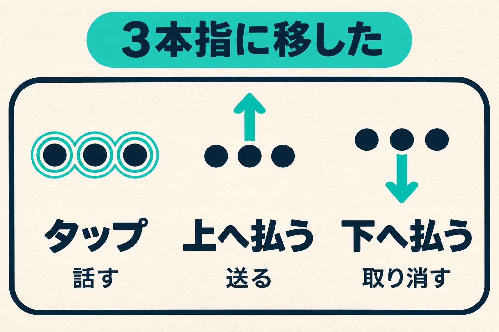

仕事の入力は、ほとんど声です。AIとやり取りするときも、話した言葉を文字にするAqua Voiceで打っています。この形にした経緯は「[話題のAIボットを一通り触って、結局Orcaに戻った理由](/blog/back-to-orca-one-entrance-plus-voice)」に書きました。

入力がほぼ声なので、キーボードで文字を打つことはあまりありません。それでも、手と目は思ったより動いていました。両手でキーボードを触る。トラックパッドとキーボードを行き来する。キーを目で探して、画面に目線を戻す。1回ずつは小さな動きですが、重なると、それがストレスになっていました。

この記事では、その動きの元を数えて、機器を買わずに今のトラックパッドで片付けた話を書きます。

## キーボードへ行くのは、3つのキーだけだった

まず、仕事の画面で何のためにキーボードへ手が行くのかを書き出しました。作業の切り替えやページを開く操作は、もともとトラックパッドで済んでいます。キーボードへ行くのは、次の3つだけでした。

| 操作                               | いまの押し方                 | 起きていたこと                         |
| ---------------------------------- | ---------------------------- | -------------------------------------- |
| 話し始める・止める                 | Fnを押している間（左下の角） | 両手になる                             |
| 送る・確認に「はい」と答える       | Enter（右の端）              | 右手がトラックパッドを離れ、キーを見る |
| 取り消す・確認に「いいえ」と答える | Esc（左上の端）や数字        | 同じく、手が離れてキーを見る           |

これで、欲しいものの条件がはっきりしました。手前で使えて、ポインターも動かせて、ボタンが少なく、直感的に声を始められること。3つの操作をそこへ移せれば、キーボードは文字を打つときだけになります。

## 買う機器も比べた

条件に合いそうな機器も比べました。値段は11月12日に公式の画面で見たものです。

| 案                                       | 値段             | 合うところ                     | 引っかかったところ                                                                      |
| ---------------------------------------- | ---------------- | ------------------------------ | --------------------------------------------------------------------------------------- |
| 外付けのトラックパッド（Magic Trackpad） | 18,800円         | 正面の手前に置ける             | MacBookが正面から外れた所にあるときに効く道具。本体のトラックパッドで足りるなら要らない |
| トラックボール（MX ERGO S）              | 17,800〜19,580円 | ボタンを押した手応えがある     | トラックパッドからの持ち替えに慣れが要る                                                |
| 足のペダル（Stream Deck Pedal）          | 14,780円         | 手がトラックパッドから離れない | 踏んでいる間だけ話すには、追加の部品が要りそう。足の操作に慣れるかも読めない            |

ほかに、持っているStream Deck +を使い直す案と、「send it」と声で言って送るAqua Voiceの機能も見ました。Stream Deckの画面つきのボタンは、見て押す道具です。目線を動かしたくないという条件と合いませんでした。声で送る機能は、Aqua Voiceの上位の契約だけで使えるものでした。

## 選んだのは、今のトラックパッドの3本指

トラックパッドの設定を見ると、3本指の動きはどれも使っていませんでした。4本指は画面の切り替えに使っているので、3本指ならぶつかりません。そこで、3つの操作を3本指の動きに移しました。

_3本指のタップで話し、上へ払って送り、下へ払って取り消します。_

指の動きをキーに置き換えるのには、BetterTouchToolを使いました。Setappの契約の中で入れられたので、追加の支払いはありません。

話すキーは少し工夫しました。Aqua Voiceの話すキーに、キーボードに無い予備のキー（F19）を1つ足し、3本指のタップでそのキーが押されるようにしています。Aqua Voiceには、キーを押しっぱなしにせず、手を離したまま話せる使い方があります。それに合わせて、タップ1回で話し始め、もう1回で止まる形にしました。今までのFnもそのまま残してあるので、キーボードから話すこともできます。

確認に「はい」と答えるときは上へ払い、「いいえ」は下へ払います。これで、キーボードを触るのは文字を打つときだけになりました。

## 最初の1通と、全部のアプリへ広げたこと

設定してすぐ、指だけで1通送ってみました。3本指でタップして話し、もう一度タップして止め、文字が入ったのを見て上へ払います。送られたのは、次の1文です。

> これは音声入力のテストで、トラックパッド指3本で操作しています。

最初は、AIとやり取りするアプリ（Orca）を開いているときだけ効く形にしていました。とても便利だったので、その日のうちに、どのアプリでも効く形に広げました。

## 気をつけていること

どのアプリでも効く形にすると、上へ払う動きはどこでもEnterになります。チャットやメールでは、上へ払うとそのまま送信や決定になる点は、覚えておく必要があります。

もう1つは、Macを再起動した後です。BetterTouchToolがMacの起動と一緒に立ち上がる設定はまだ入れていないので、開くまで指の動きが効きません。

Macを買い替えたときのために、指の動きの設定は書き出して、Macの外のノートに置きました。Aqua Voiceの予備のキーは機械ごとの設定で同期されないので、作り直しの手順に1行足してあります。Macを作り直せる形にしている話は「[Macまるごとの控えは取らないことにした](/blog/mac-rebuild-not-backup)」に書いています。

## 機器を探す前に、どのキーへ行っているかを数えた

手と目が動くのがストレスだと感じたとき、最初は手前に置く機器を探そうとしていました。実際に数えてみると、元は3つのキーでした。3つなら、今あるトラックパッドで足ります。

機器を比べる前に、手がどのキーへ行っているかを書き出したことで、何も買わずに済みました。
