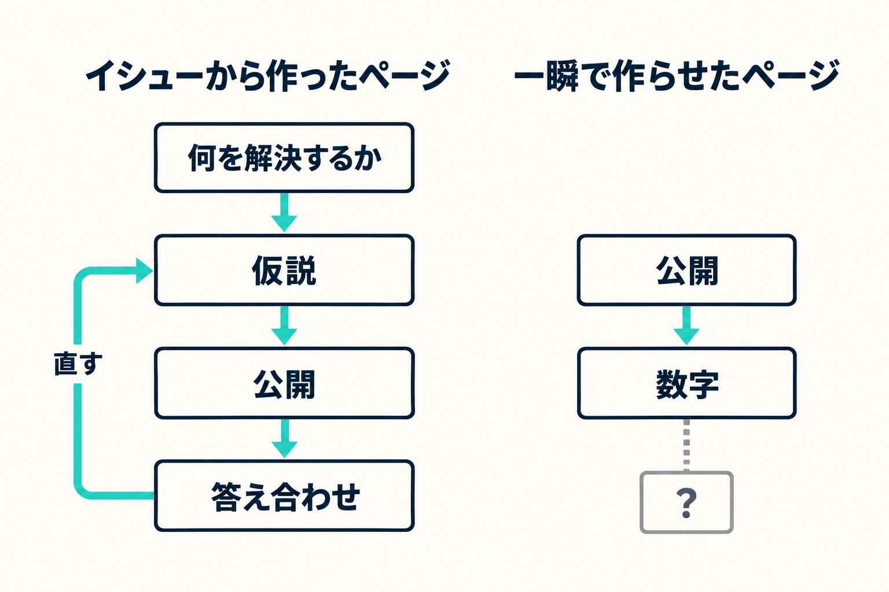

先日SNSで、ある団体のホームページの見積もりが話題になっているのを見かけました。初期費用が60万円、毎月の費用が2万5千円。そこに「今はAIで一瞬で作れるのに、ぼったくりでは？」という声がたくさん付いていました。

その見積もりが高いか安いかは、中身を知らないので私には分かりません。ただ、Webサイトを作る側として、「一瞬で作れるのに」という言い方には考えておきたいことがありました。この記事では、作る側が何にお金をいただいているのかを書きます。

## 一瞬で作れたページに、作った人の価値は無い

最初に書いておくと、AIに頼んで一瞬で出てきたページに、頼んだ人の価値はほとんどありません。すごいのはAIのほうです。見た目の整ったページが数分で出てくるのは本当で、それだけなら、誰が頼んでも似たものが出てきます。

だから、ページを形にする作業だけにお金を払うと考えれば、高く感じるのは当然だと思います。お金をいただく理由があるとしたら、それは形にする作業の前と後にあります。

## 始まりは「Webで何を解決するか」を決めること

作る前にやるのは、何が本当の問題で、そのうちWebで解決するのはどこかを決めることです。これを「イシュー」と呼んでいます（イシューの考え方は、[『イシューからはじめよ』を読み直した記事](/blog/rereading-issue-driven)に書いています）。

「ホームページを新しくしたい」は、まだイシューではありません。電話の問い合わせが多くて現場が回らないのか、採用の応募が来ないのか、予約を取りこぼしているのか。同じ「新しくしたい」でも、何を解決したいかによって作るものがまったく変わります。

私が常務をしている会社（HAMAYOUリゾート）でサイトを作り替えたときは、1つのサイトにホテル・日帰り温泉・キャンプ場が同居していて、キャンプ場を探して来た人がほかの施設のページで迷ってしまう、というのが問題でした（作り替えの経緯は[こちらの記事](/blog/wordpress-to-astro/)に書いています）。

## イシューが決まると、仮説が立つ

イシューが決まると、「こうすれば解決するはずだ」という仮説が立ちます。

### 構造の仮説

どんなページを用意して、どの順に、どうつなぐか。これはワイヤーフレーム（線だけで描いたページの骨組み）の段階で、なぜこの並びなのかを説明できる状態にします。

会社の例では、施設ごとにサイトを分けました。キャンプ場を探して来た人は、キャンプ場のサイトの中だけで用が済む、という仮説です。

### デザインの仮説

見た目にも仮説があります。キャンプ場のサイトには、周辺のお店や観光地を地図で探せるページがあります。ここでは、キャンプ場からの距離を隠さずに書くと決めました。西湖のまわりは、お店がたくさんある場所ではありません。来てから「思ったより遠い」と感じさせるより、先に分かっているほうが安心して来ていただける、と考えたからです。

もう一つ、地図の中だけに情報を置かず、お店や観光地の一覧を本文にも文字で載せています。地図の中にしか無い情報は、検索から見つけてもらえないからです。

見えているページの一つ一つに、こうした「なぜそうしたか」があります。

## 公開してからが、答え合わせ

仮説は外れることもあります。だから公開したら、アクセス解析（Googleアナリティクス）、Googleサーチコンソール、SEOの分析ツールで答え合わせをします。

会社のサイトでも、答え合わせで分かったことがいくつもあります。たとえば、書いた記事のうち、月に数十〜数百回ほど検索される言葉では、公開から1〜2週間で検索結果の上のほうに出始めました。一方で、もっと大きな言葉では、まだ届いていません。それなら次は、小さな言葉で読まれる記事を増やしながら、大きな言葉の記事をどう育てるかを考えます。

サーチコンソールでは、同じ記事が、末尾に「/」がある住所と無い住所の2つに分かれて出ていることにも気づきました。評価が2つに割れてしまうので、どちらで来ても1つの住所にまとまるように直しています。

問い合わせのフォームには、その人が最初に読んだ記事が残るようにしてあります。記事を読んでから問い合わせてくださった方が、どの記事から来たのかが分かれば、次にどんな記事を書くかの手がかりになります。

仮説があるから、数字を見て「当たった」「ずれた」が判断でき、ずれたら直せます。

一瞬で作らせたページは、出発点にイシューがありません。イシューが無いので仮説も無く、計測して数字が出ても、それが良いのか悪いのか判断できません。判断できないので、直しようもありません。見た目が似ていても、出来上がっているものは違う、というのはこういうことです。

## 見えないところの守りと、責任

もう一つ、見えないところにも手間がかかります。AIを使えるのは作る側だけではありません。サイトを攻撃する側も、AIを使って弱いところを速く、たくさん探せるようになっています。

そうした攻撃に耐える作りにしておくこと、公開したあとも手を入れ続けること、何か起きたときに対応すること（サイトが乗っ取られたあとの流れは[こちらの記事](/blog/wordpress-hijacked)に書いています）。そして、ここまで書いたこと全部に責任を持つこと。私は、それも含めての金額だと考えています。

## 差を生むのは、道具ではなく使い方

AIは誰でも使えます。作る側も同じAIを使っています。差が出るのは、道具ではなく使い方のほうです。これまでの失敗や成功を、どれだけ使い方に織り込めているか。どこで迷いやすいか、何を先に確かめておくべきか、公開したあとどこでつまずきやすいか。そこは、同じ道具を使っていても人によって違います。

逆に言えば、ここまでを自分でできるなら、自分で作ればいいと思います。何を解決したいかが決まっていて、公開したあとに数字を見て直していけるなら、AIで十分に作れます。

見積もりを見て迷ったときは、その金額に「何を解決するか決めること」「公開後の答え合わせ」「守りと責任」がどこまで含まれているかを、作る側に聞いてみてください。

## まとめ

- AIで一瞬で出てきたページに、頼んだ人の価値はほとんど無い。お金をいただく理由は、形にする作業の前と後にある
- 前にあるのは、Webで何を解決するか（イシュー）を決めること。そこから構造とデザインの仮説が立つ
- 後にあるのは、公開してからの答え合わせ。仮説があるから、数字を見て判断し、直せる
- 攻撃に耐える作り、公開後の手入れ、何か起きたときの対応、その全部への責任も金額に入っている
- 差を生むのは道具ではなく使い方。自分でできるなら、自分で作ればいい

いまのサイトで何を解決したいのか一緒に整理したい方、サイトの作り替えを考えている方は、いまの状況をお聞かせください。
