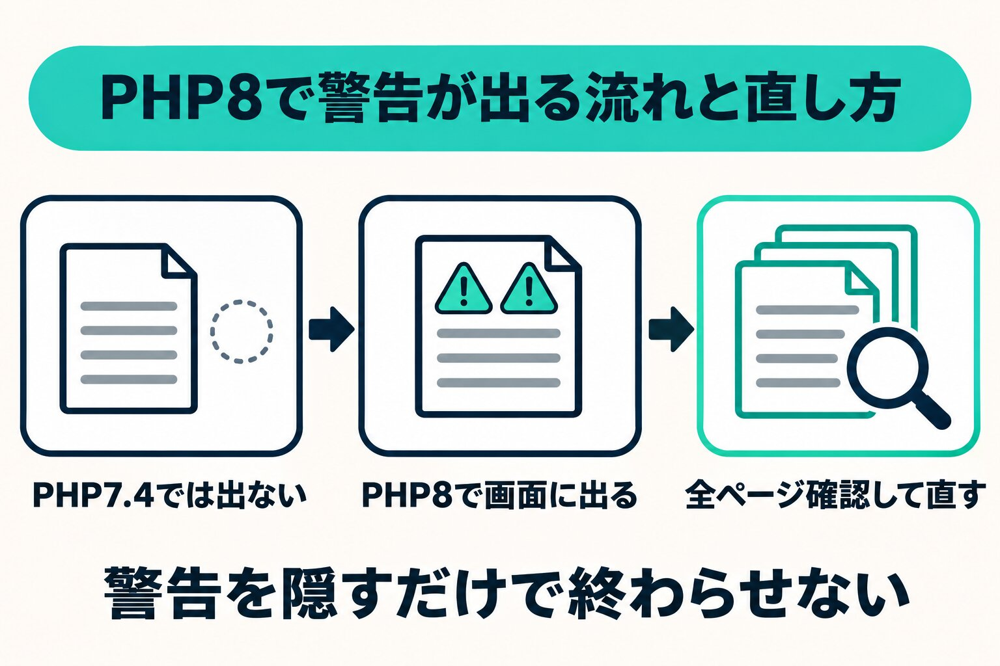

10月に、預かっているWordPressサイトのPHPを7.4から8.4へ上げました。ところがその約1か月後、一緒に仕事をしている制作会社から連絡が来ました。「お客さんが新しいお知らせを投稿したら、カテゴリーを選んでいるのにエラー表示になり、過去の記事にも同じ表示が出た」という内容です。

送られてきた画面の写真を見ると、記事のタイトルの下や一覧の中に、`Warning: Undefined variable`（未定義の変数）というPHPの警告が出ていました。

この記事では、なぜPHPを上げて1か月たってから気づいたのか、なぜ警告を隠す設定だけで済ませずにコードを直したのか、そして同じ時期にPHPを上げたほかのサイトまで調べた経緯を書きます。

## 投稿は正常で、1か月前のPHP更新がきっかけだった

連絡を受けた時点では、お客さんの側では「記事の投稿でエラーが起きた」という見え方になっていました。そこで、まず投稿の状態から確かめました。

新しい記事そのものは問題なく公開されていて、一覧にも選んだカテゴリー付きで出ていました。投稿の処理やデータベースの不具合ではありません。

続いて、サイトマップに載っている公開ページをすべて機械的に読み込み、画面の中に警告の文字が出ていないかを調べました。すると、トップページには1つも出ていない一方で、20以上のページに警告が出ていました。お知らせの一覧・各記事・カテゴリー別の一覧に加えて、別のカスタム投稿の一覧では、写真と文字の上に警告が何十行も重なり、内容が読めない状態になっていました。

前の記事の投稿から1か月ほど間が空いていたため、お客さんは新しい記事を投稿して表示を確かめたタイミングで、初めて画面の崩れに気づいたとみられます。

## なぜPHP 7.4では出ず、8系で画面に出たのか

原因は、数年前にサイトを作ったときからテーマの中にあった小さな書き間違いでした。

たとえばお知らせのテンプレートでは、中身を入れていない変数をそのままカテゴリーのリンク先に使っていました。前後の記事の案内や別のカスタム投稿の一覧でも、関数の中に存在しない変数を参照する書き方になっていました。

PHP 7.4では、未定義の変数を参照しても「Notice（注意）」という扱いになります。WordPressでデバッグ表示をオフにしていれば、Noticeは画面に出ません。過去のウェブの保存記録を見ても、切り替える前のページに警告は出ておらず、カテゴリーのリンク先が空のままになっていただけでした。

ところがPHP 8からは、これが「Warning（警告）」に格上げされます。サーバーの設定で警告が画面に出る状態だったため、PHPを8.4へ上げた日から、そのテンプレートを通るページすべてに警告が表示されるようになっていました。

## PHP 7.4に戻さず、警告を隠す設定にもしなかった理由

画面から警告をすぐ消すだけなら、ほかにも方法は2つありました。ただ、どちらも採りませんでした。

1つ目は、PHPを7.4に戻す方法です。警告はすぐ消えますが、PHP 7.4はすでに公式のサポートが切れていて、重大な脆弱性の修正が来ません。安全のために上げたPHPを古い版に戻す選択肢はありませんでした。

2つ目は、サーバー側の設定（`display_errors`）を切って、警告を画面に出さないようにする方法です。見た目はすぐ元に戻りますが、テーマの書き間違い自体は残ります。しかも今回のお知らせ一覧のテンプレートには、カテゴリーを選んでいない記事が1本でも入ると、PHP 8では一覧ページごと止まってしまう書き方も含まれていました。表示を隠して終えると、次の投稿でページ全体が落ちる危険を残すことになります。

_警告を隠すだけで終わらせず、テーマのコード側を直してから全ページを確かめました。_

そこで、原因になっていたテーマの5ファイルをテスト環境で直し、対象のページすべてで警告が0になったのを確かめてから本番へ当てました。記事や設定、データベースには一切触っていません。本番へ当てる直前にデータベースの控えを取り、元のテーマファイルもすぐ戻せる形で残しています。

本番に当てたあとは、公開中の全ページをもう一度読み込み直して警告が0になったことを確かめ、ブラウザでも各画面を目で見ました。制作会社へは、記事の中身には触っていないことと、空のままだったカテゴリー名のリンクが本来どおりカテゴリー一覧へ移るようになった点を先に伝え、お客さんが「動きが変わった」と驚かないようにしました。

## 同じ時期にPHPを上げた、ほかのサイトも全ページ調べた

今回の原因は、テーマの書き方そのものでした。同じ制作会社が預かり、10月に同じようにPHPを上げたほかのサイトでも、似た書き方のテーマが使われている可能性があります。

そこで、同じ時期にPHPを上げたほかの預かりサイトも、サイトマップの全URLを読むだけで一通り調べました。ほとんどのサイトは警告0でしたが、複数のサイトで同じ形の警告が見つかりました。前後の記事の案内で未定義の変数を使っている箇所や、カテゴリーが付いていない記事で変数を初期化せずに使っている箇所など、どれも同じ系統の書き間違いでした。

これらは新しく頼まれた作業ではないため、勝手に本番を触らず、制作会社へ事実を伝えました。「こちらの確認漏れなので費用はいらない。同じように直させてもらってよいか」と先に聞き、了承をもらってから作業に入りました。

直し方は最初のサイトと同じです。テスト環境でテーマの該当ファイルを直して全ページの警告0を確かめ、データベースの控えを取ってから本番へ反映し、最後に全ページで警告0とブラウザでの表示を確かめて完了を報告しました。

## PHPを上げるときに、トップと数ページだけで終えない

今回いちばんの見落としは、10月にPHPを切り替えたときの確認範囲でした。トップページとログイン画面、下層の数ページだけを見て「問題なし」と判断してしまい、お知らせやカスタム投稿の一覧を見ていませんでした。

PHPを7.4から8系へ上げるときは、次の3つを外さない形に変えました。

- サイトマップに載っている全URLを機械的に開き、警告の文字や途中で切れたページが無いかを一覧で確かめる
- カスタム投稿の一覧や記事詳細、カテゴリーが付いていない記事など、普段の更新が少ないページも確認から外さない
- 警告が出たときは表示を隠して終わらせず、テーマのコード側をテスト環境で直してから本番へ反映する

テスト環境で先に更新を確かめてから本番へ反映する手順は「[WordPressのバージョンアップは、サイトを止めずにできる](/blog/wordpress-version-up)」に、PHPや本体の更新を止めない理由は「[WordPressセキュリティ対策ガイド](/blog/wordpress-security-measures)」に書いています。

PHPを8系へ上げたあとにトップページだけ見て終えたサイトがある方は、お知らせや一覧のページも一度開いて、見慣れない英語の警告が出ていないか確かめてみてください。
