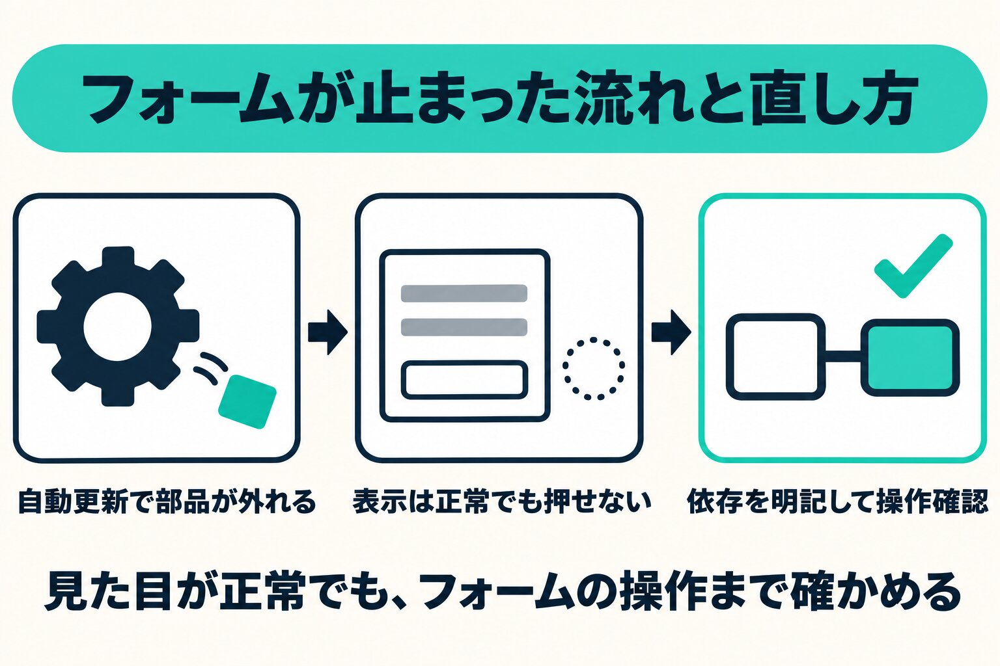

10月にセキュリティ対策としてプラグインの自動更新を有効にしていたWordPressサイトで、一緒に仕事をしている制作会社から連絡が来ました。「Web予約フォームがうまく機能していないと、この1週間でお客さんから複数回指摘があった」という内容です。

サイトを開いてみると、予約ページ自体はエラーもなくきれいに表示されていました。ところが実際に項目を入力してみると、「確認画面へ進む」ボタンを押してもまったく反応せず、申し込みを完了できない状態になっていました。

この記事では、ページが正常に見えるのにフォームだけ止まっていた原因、テスト環境ですぐに再現しなかった落とし穴、そして今回の件を受けて変えた確認の手順を書きます。

## ページは正常に表示されるのに、予約が完了できない

連絡を受けたあと、まず公開中の画面を3つの段階に分けて調べました。

1. **ページの表示**：各ページがエラーなく開くか、電話やメールの案内が出ているか
2. **入力から送信まで**：項目を入れて確認画面へ進み、申し込みを完了できるか
3. **通知メールの到達**：送った予約が店側の受信箱に届くか

1つ目の表示は問題ありませんでした。トップページも予約ページもすべて正常に開き（HTTP 200）、PHPのエラーや警告は1つも出ていません。電話やメールの案内もそのまま見えていました。

止まっていたのは2つ目です。必須項目をすべて入れて同意チェックを付けても、「確認画面へ進む」ボタンを押したときに何も起きません。本来の送信ボタンは確認画面のモーダルの中から押す作りになっていたため、通常の手順では申し込み完了まで到達できない状態でした。

あわせて、日時を選ぶカレンダーが開かず、選んだ項目に応じて表示される追加の入力欄も出なくなっていました。見た目やステータスコードだけを確認していても気づけない止まり方です。

## 原因はプラグインの自動更新で消えた「jQueryの相乗り」

公開ページのHTMLを読み込んで調べると、ページ内で `jQuery` が1本も読み込まれていませんでした。

このサイトの予約フォームでは、日時カレンダーの初期化、条件に応じた入力欄の出し分け、確認画面の表示と送信の実行を、すべてテーマ側に入れたJavaScriptファイルが担っています。そのファイル全体が jQuery を使う書き方になっていました。

にもかかわらず、テーマの `functions.php` でスクリプトを読み込む指定（`wp_enqueue_script`）には、依存先として `'jquery'` が書かれていませんでした。

これまで問題なく動いていたのは、フォームの入力欄を増やすための追加プラグインが旧版（2系）で jQuery に依存していたためです。そのプラグインがあるおかげでWordPressがページへ自動的に jQuery を読み込んでおり、テーマ側のスクリプトはいわばそれに相乗りする形で動いていました。

ところが約1週間前、その追加プラグインが自動更新で 3系へメジャーバージョンアップしました。公式の変更履歴を確かめると、フロントエンドの jQuery 依存を削除した、と明記されていました。ページ上で jQuery を要求するプラグインが1つもなくなった瞬間、HTMLから jQuery の読み込みが消え、テーマ側の予約フォーム処理が丸ごと止まったのです。更新の日時も、お客さんから指摘が出始めた時期と一致していました。

_別のプラグインが読み込んでいた部品に相乗りしていると、更新のタイミングで急に動かなくなります。_

## jQueryを読み込むだけでは足りない：イベント仕様の変更

追加プラグインの3系の変更履歴を最後まで読むと、もう1つ大事な仕様変更が書かれていました。利用者がボタンを押して入力欄のグループを増やしたときの通知が、jQuery独自の形式からブラウザ標準の `CustomEvent` へ切り替わっていたのです。

元のテーマ側のスクリプトは、旧形式の引数で追加された要素を受け取る書き方になっていました。そのため、`functions.php` で jQuery を読み込むように直すだけでは、2件目以降の入力欄を初期化する受け口が素通りしてしまいます。

そこで、テーマに入っているほかのJavaScriptファイルも一通り読み、jQueryを使っているのが予約フォーム用の1本だけであることを確かめたうえで、修正する範囲を次の2ファイルに絞りました。

- **`functions.php`**：予約フォーム用スクリプトの `wp_enqueue_script` に依存先として `'jquery'` を明記し、古いファイルがキャッシュで残らないようバージョン番号を上げる
- **予約フォーム用のJavaScript**：入力欄を追加したときのイベントを、ブラウザ標準の `CustomEvent`（`e.originalEvent.detail.group`）でも受け取れるように直し、旧形式とも両立させる

原因と影響範囲、そしてこちらの自動更新の設定変更がきっかけのため費用はいただかずに直すことを制作会社へ伝え、テスト環境での確認から本番反映・送信テストまでの了承をもらいました。

## テスト環境で再現しなかった落とし穴と、本番反映までの手順

了承をもらってからテスト環境で確かめようとしたところ、最初の段階で予想外のことが起きました。テスト環境では、予約フォームが壊れず普通に動いてしまったのです。

確認すると、テスト環境にはBasic認証をかけていたため、WordPressの定期処理が外から動かず、自動更新が止まっていました。本番は追加プラグインが3系に上がっているのに、テスト環境だけは旧版の2系のまま残っていたのです。テスト環境が本番と同じ状態だと決めつけて確認すると、不具合を再現できないまま作業を終えてしまいます。

そこで手順を一段戻し、テスト環境のバックアップを取ったうえで本番の環境をテストへ写し直しました。版がそろったところで、テスト環境でも本番と同じく確認画面やカレンダーが止まる状態を再現できました。

その状態に2ファイルの修正を当て、次の項目がすべて動くことを確かめました。

- 日時を選ぶカレンダーが開くこと
- 選択内容に応じて追加の入力欄が出ること
- 入力欄を増やした2件目以降でも同じように動くこと
- 必須項目を入れて「確認画面へ進む」を押すと、内容が並んだ確認画面が開くこと

確認のあと、本番は直前にデータベースの控えを取り、元のテーマファイルもすぐ戻せる形で残してから2ファイルを反映しました。

最後の送信テストは、テスト環境ではなく本番で行っています。テスト環境は本番のフォーム設定ごと写しているため、不用意に送信すると本番の宛先に届いてしまうおそれがあるためです。本番でお名前や備考に「テスト送信（予約ではありません）」と明記して実予約と紛れない形で送信し、ボット対策に弾かれず送信完了になることと、制作会社経由でクライアント側の受信箱に届いていることまで確認して完了としました。

## 「表示が崩れていない」だけでは、更新の確認にならない

プラグインの自動更新は、脆弱性の修正を早く取り込むうえで大切な仕組みです。ただ、今回のようにメジャーバージョンアップで仕様が大きく変わると、画面が真っ白になったりPHPエラーが出たりしなくても、裏側のJavaScriptだけが静かに止まることがあります。

今回の件を受けて、WordPressの保守と更新確認で次の3点を外さない形に変えました。

- **依存ライブラリはテーマ側で必ず明記する**：ほかのプラグインが読み込んでくれている前提に頼らず、`wp_enqueue_script` の依存配列に `'jquery'` などを書いておく
- **テスト環境は本番との版のズレを先に確かめる**：Basic認証などで自動更新が止まっているテスト環境は、そのままでは本番の不具合を再現できないため、必要なら本番から写し直して検証する
- **更新後の確認は操作まで行う**：ページのHTTP 200や見た目の崩れだけでなく、予約・問い合わせフォームの確認画面や送信完了まで実際に動かして確かめる

テスト環境で先に更新を確かめてから本番へ反映する基本の流れは「[WordPressのバージョンアップは、サイトを止めずにできる](/blog/wordpress-version-up)」に、PHP更新後に表示確認の範囲を全ページへ広げた経緯は「[WordPressのPHPを8系へ上げたあと、1か月たって記事ページに警告が出た](/blog/wordpress-php8-warning-after-upgrade)」に書いています。

プラグインの自動更新をオンにしているWordPressサイトをお持ちの方は、トップページが普通に開くかだけでなく、予約やお問い合わせフォームの確認ボタンまで一度押して確かめてみてください。
