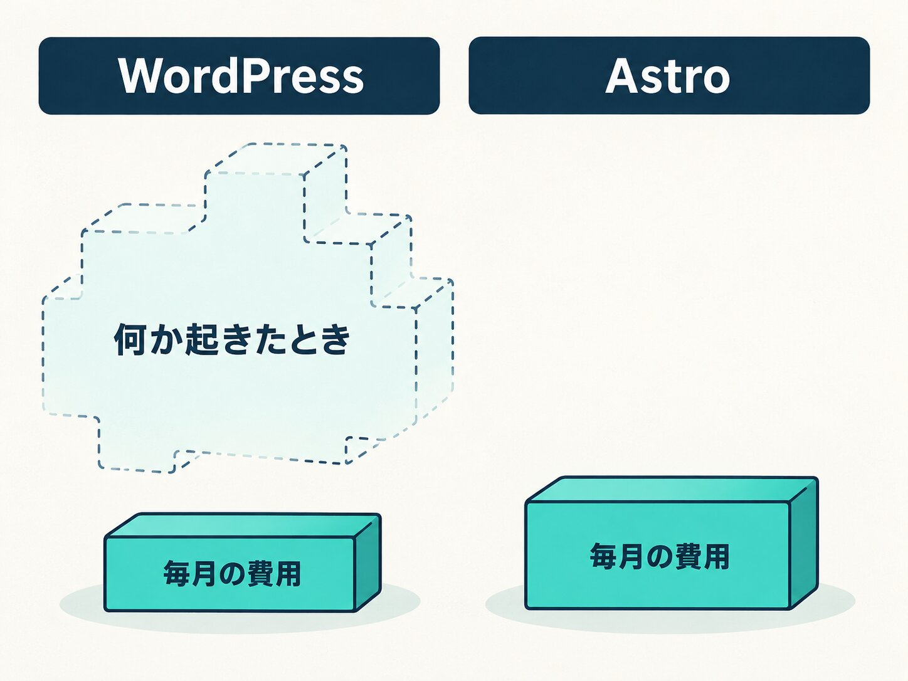

WordPressのサイトは、これまでたくさん作ってきました。自分のWeb制作はWordPressに育てられたと言ってもいいくらいで、当時WordPressを選んだ判断は、どれも正しかったと思っています。

それでも今年の9月、私が常務をしている会社（HAMAYOUリゾート）のサイトを、WordPressからAstroに作り直して移しました。このブログもAstroで作っています。この記事では、なぜ移したのか、移すときに何を決めたのか、移してどうだったかを書きます。WordPressにはWordPressの良さがある、という前提で読んでください。

## 移す前の形

会社では、山梨県の西湖でホテル、日帰り温泉、キャンプ場を営んでいます。これまでは、1つのWordPressのサイトの中に3つの施設が同居していました。キャンプ場を探して来た人が、ホテルや温泉のページの間で迷ってしまい、知りたい情報にたどり着きにくい形です。

そこで、施設ごとに1つずつサイトを分け、それぞれをAstroで一から作り直しました。置き場所も、レンタルサーバーから、作ったページを配る専用のサービスに移しています。

## Astroにした理由

### 毎月の費用は、WordPressのほうが安く見える

WordPressの一番の利点は、運用の費用がサーバー代とドメイン代でほぼ済むことです。WordPressをやめると、お知らせを自分で直せる画面や、問い合わせフォームの送信の仕組みを別に用意する必要があり、そこが毎月の費用になりがちです。短い目で見れば、WordPressのほうが安く見えます。

### ただ、何か起きたときの費用が読めない

気になるのは、何か起きたときです。WordPressは広く使われているぶん、弱いところを探す側も多く、穴が見つかって直されて、また見つかる、が続きます。Astroで作ったサイトと比べると、何か起きる確率はどうしても高くなります。

実際に何か起きると、内容によっては直すのにまとまった費用がかかります（乗っ取りに気づいたあとの流れは[こちらの記事](/blog/wordpress-hijacked)に書いています）。費用だけでなく、直している間はサイトを表示できなかったり、メンテナンス表示にしなければいけなかったりします。その間に来たお客様を逃すことも含めて広く見ると、Astroで作ったほうがトータルの費用は低くなる可能性もある、と考えています。はっきりとは言えませんが、何もなければ安く運用できる、の「何もなければ」をどう見るかの違いです。

### 見なければいけないところが多い

WordPressでは、本体、プラグイン、サーバーのPHPと、バージョンアップを見なければいけないところが増えていきます（本体のバージョンアップの話は[こちらの記事](/blog/wordpress-version-up)に書いています）。ここを手間と感じるかどうかでも、判断が分かれると思います。

会社の運営として考えると、私は費用が読みやすいほうに利点があると感じています。毎月いくらかかるかが先に分かっていて、急に大きな出費が来ないほうが、ほかの計画が立てやすいからです。

### 速さと、作りやすさ

ほかにも、ページが開くまでの速さ、新しい技術を取り入れやすいこと、特定の仕組みに頼り切らないこと、も魅力でした。Astroには「プラグイン」という考え方がなく、必要なものは一般の部品（ライブラリ）を組み込んで作ります。

WordPressをやめたときに毎月の費用になりがちな2つは、それぞれ次のようにしました。

- 問い合わせフォーム：送信だけを受け持つ外のサービスにつないだ
- 営業日や混み具合の更新：施設のスタッフが自分で直せる、小さな管理画面を自前で作った

キャンプ場のサイトには、周辺のお店や観光地を地図で探せるページも作りました。写真や動画も軽くして、スマートフォンでもすぐに開くようにしています。どれもいろいろ試して、実際に使ってみて使いやすいと思った形です。自分が一番使いやすい形にできるのは、作り直してよかった点です。

## 移すときに決めたこと

サイトを作り直すこと自体より、古いサイトから新しいサイトへ移すときのほうが、決めることが多くありました。

### 会社のサイトは「確かめる場所」として小さく作る

施設ごとにサイトを分けると、会社としての入口をどうするかが残ります。考えてみると、団体のお客様も、採用の応募も、きっかけはサイトの外でした。会社のサイトは「見つけてもらう場所」ではなく、よそで知った人が会社名で検索して「確かめる場所」です。そう考えて、会社のサイトは小さく作りました。

その小さなサイトに、古いURLから新しいURLへの転送（301リダイレクト）、パンフレットのPDF、よく読まれていた古いブログ記事の置き場をまとめて持たせています。レンタルサーバーをやめると、古いURLに来た人を案内する場所がなくなるので、それも兼ねさせた形です。

### 読まれている記事は残し、読まれていないものは捨てる

古いサイトのページを全部移す必要はありません。検索からの訪問を見ると、よく読まれている記事はごく一部で、ほとんど読まれていないお知らせがたくさんありました。読まれている記事はURLを変えずに残し、読まれていないお知らせは移さないと決めました。

### 切り替えは、戻り道を残してから

切り替えの前に、ドメインの設定（DNS）が変わるまでの待ち時間を短くしておきました。こうしておくと、何かあったときにすぐ元に戻せます。古いレンタルサーバーもすぐには解約せず、しばらく残して戻り道にしました（DNSの書き換えの話は[こちらの記事](/blog/rental-server-replacement-ip-change)にも書いています）。

切り替えは4つのサイトを同じ日にまとめて行い、午後の2時間ほどで終わりました。

### 当日見つかったこと：末尾のスラッシュ

切り替えた当日、古いお知らせのURLから新しいサイトへの転送が、一部で効いていないことに気づきました。WordPressのURLは、最後に「/」が付く形が標準です。新しいサイトの転送のルールは、この「/」付きのURLに当たらない書き方になっていました。主なページの転送は効いていたので、公開はそのままにして、「/」付きの分を足して直しました。WordPressから移すときは、古いURLが「/」付きかどうかを先に確かめておくと安心です。

## 移して1か月半、変わったこと

一番変わったのは、新しい機能を足したくなったときのやりやすさです。WordPressでは、何かを足そうとすると「WordPressの決まりの中でどうやるか」から考えなければいけませんでした。Astroでは、そこが柔軟です。施設の情報を直したいときも、足したいものがあるときも、作りに縛られずに考えられるので、楽になりました。

WordPressで使っていた有料の拡張機能も、WordPressをやめたので更新を止めました。移してから、不便になったと感じたことは特にありません。

## 「うちもAstroにした方がいい？」と聞かれたら

知り合いから聞かれたら、まずは状況を聞きます。いまのサイトの状態、かけられる費用、これからどう運用していきたいか。そのうえで選びます。

「細かいことは気にしない。とにかく毎月の費用を安くしたい。何かあったらそのとき考える」という考えなら、WordPressのままでもよいと思います。一方で、費用を読みやすくしたい、バージョンアップや弱いところの心配を減らしたい、自分たちの使いやすい形にしたい、という考えなら、Astroを勧めます。どちらでもよい、と言われたら、Astroを勧めます。

## まとめ

- WordPressは毎月の費用が安く見える。ただ、何か起きたときの費用と、直す間サイトが止まることまで入れると、トータルではAstroのほうが低くなる可能性もある
- WordPressは本体・プラグイン・PHPと見るところが多い。会社の運営としては、費用が読みやすいほうに利点がある
- 移すときは、会社のサイトの役割を決め、読まれている記事だけURLを残し、戻り道を用意してから切り替える。古いURLの末尾の「/」に注意する
- 移してからは、機能を足すのが柔軟になった。不便になったことは特にない
- どちらにするかは状況と運用の考え方しだい。どちらでもよければAstro

WordPressのサイトを作り替えるか迷っている方、移すときの段取りを任せたい方は、いまの状況をお聞かせください。
